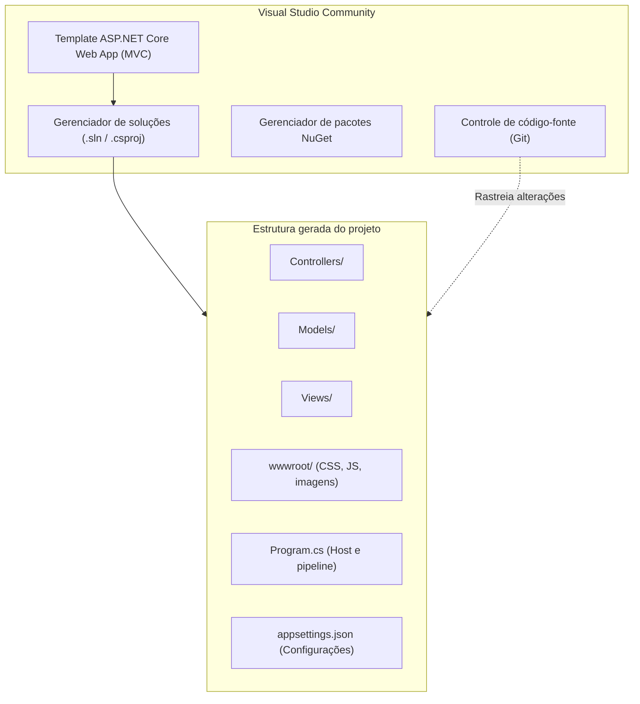
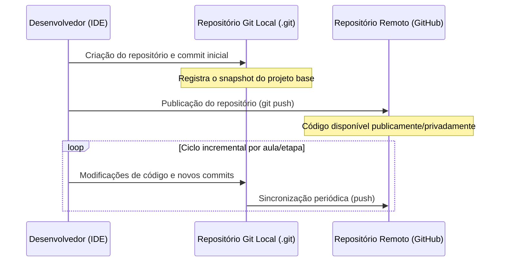

# Ambiente de desenvolvimento, Visual Studio e controle de versão no ASP.NET Core MVC

> **Contexto:** Após os fundamentos conceituais de arquitetura, MVC, ORM e o ciclo de requisição, este artigo consolida a preparação do ambiente oficial de desenvolvimento para a aplicação prática da disciplina (gestão e consumo de veículos). O foco aborda a utilização do Visual Studio Community, a criação do projeto estruturado em ASP.NET Core MVC (.NET 6 LTS), a anatomia de arquivos gerados pela IDE, o mecanismo de recarga em tempo de execução via *Razor Runtime Compilation* e a integração do controle de versão com Git e GitHub.

O desenvolvimento de aplicações Web profissionais exige ferramental integrado capaz de automatizar tarefas de compilação, depuração, gerenciamento de dependências e controle de versão. No ecossistema Microsoft, essa infraestrutura é provida de forma unificada pelo Visual Studio Community em conjunto com o Git.

## Visual Studio Community e anatomia do projeto ASP.NET Core MVC

O **Visual Studio Community** é um ambiente de desenvolvimento integrado (IDE, *Integrated Development Environment*) gratuito fornecido pela Microsoft para estudantes e desenvolvedores individuais. Diferente de editores leves de código que demandam acoplamento manual de extensões e ferramentas CLI via terminal, a IDE reúne compiladores, depurador gráfico, gerenciadores de soluções, exploradores de pacotes NuGet e integrações de nuvem e repositório em um único fluxo de trabalho.



### Criação e parâmetros do projeto

Na criação de um novo projeto orientado ao padrão MVC no Visual Studio, seleciona-se o modelo **Aplicativo Web ASP.NET Core (Model-View-Controller)** com suporte à linguagem C#. A configuração inicial envolve parâmetros estruturais definidos na interface da IDE:

1. **Nome e localização:** definição do nome do projeto e da pasta de trabalho correspondente. A solução reúne o arquivo de projeto (`.csproj`) e vincula as configurações de compilação.
2. **Framework de destino (.NET 6.0 LTS):** adoção de versões com suporte a longo prazo (LTS, *Long-Term Support*), assegurando estabilidade arquitetural e suporte estendido pela plataforma.
3. **Tipo de autenticação:** definida inicialmente como *Nenhuma* para permitir a construção passo a passo da aplicação e posterior implementação customizada ou via ASP.NET Core Identity.
4. **Instruções de nível superior (*Top-level statements*):** ao desmarcar a ocultação de classes de inicialização, a estrutura preserva a declaração explícita do ponto de entrada e da classe `Program`, tornando claros a inicialização do host, a injeção de dependências e os middlewares configurados.

### Anatomia da estrutura de arquivos

A estrutura inicial gerada pelo template organiza o projeto em responsabilidades funcionais bem delimitadas:

* **`Program.cs`:** ponto de entrada da aplicação que configura o host Web, registra serviços no contêiner de injeção de dependência (DI, *Dependency Injection*) e define o pipeline de requisições HTTP (roteamento, arquivos estáticos e middlewares).
* **`appsettings.json`:** arquivo de configuração estruturado em JSON (*JavaScript Object Notation*) contendo parâmetros operacionais, níveis de *logging* e *connection strings* para conexão a bancos de dados.
* **`Controllers/`:** diretório reservado para controladores que recebem requisições HTTP, coordenam chamadas de regras ou dados no Model e determinam a View ou redirecionamento de saída.
* **`Models/`:** diretório destinado às classes representativas do domínio, entidades de negócio e objetos manipulados pelo ORM (*Object-Relational Mapping*).
* **`Views/`:** arquivos `.cshtml` contendo a lógica de apresentação em Razor, agrupados em subpastas com o nome do respectivo Controller, além da pasta `Shared/` (com layouts como `_Layout.cshtml`).
* **`wwwroot/`:** raiz pública da aplicação destinada exclusivamente a recursos estáticos que não exigem processamento no servidor (folhas de estilo CSS, scripts JavaScript de cliente, ícones e imagens).
* **`Properties/launchSettings.json`:** definições de inicialização local para desenvolvimento, portas HTTP/HTTPS e perfis de execução como IIS Express ou Kestrel.

## Recarga em tempo de execução com Razor Runtime Compilation

Por padrão de compilação no .NET, alterações realizadas no código de arquivos de visualização `.cshtml` exigem a interrupção do processo em execução e uma nova recompilação da solução para que os ajustes visuais se reflitam no navegador.

Para acelerar o fluxo de desenvolvimento de interfaces, o ecossistema .NET disponibiliza o mecanismo de compilação em tempo de execução de páginas Razor por meio do pacote `Microsoft.AspNetCore.Mvc.Razor.RuntimeCompilation`.

### Instalação via Gerenciador de Pacotes NuGet

O NuGet é o repositório central e gerenciador de dependências de projetos .NET. A adição do pacote de compilação em tempo de execução é realizada diretamente pelo gerenciador visual da IDE:

1. Clicar com o botão direito sobre a raiz do projeto e selecionar **Gerenciar pacotes NuGet** (*Manage NuGet Packages*).
2. Na aba **Procurar** (*Browse*), pesquisar pelo identificador `Microsoft.AspNetCore.Mvc.Razor.RuntimeCompilation`.
3. Selecionar a versão compatível com o framework de destino do projeto (versão `6.x` para projetos baseados em .NET 6).
4. Executar a instalação e aceitar os termos de licença da biblioteca.

### Habilitação do serviço no pipeline de inicialização

Após a instalação do pacote, a funcionalidade deve ser registrada no contêiner de serviços da aplicação. No arquivo `Program.cs`, adiciona-se o encadeamento `.AddRazorRuntimeCompilation()` logo após a chamada de registro dos controladores com Views:

```csharp
// Registro de serviços no Program.cs
builder.Services.AddControllersWithViews()
    .AddRazorRuntimeCompilation();
```

Com essa diretiva habilitada, modificações salvas em qualquer arquivo `.cshtml` provocam a recompilação imediata do template pelo servidor em desenvolvimento. O desenvolvedor precisa apenas atualizar a página no navegador (`F5` ou recarregar) para visualizar o novo resultado visual, sem interromper o processo depurador nem reiniciar a aplicação Web.

## Versionamento e rastreabilidade com Git e GitHub

O controle de versão é um pilar da engenharia de software para garantir rastreabilidade, trabalho colaborativo seguro e histórico incremental das etapas de desenvolvimento.



### Configuração integrada no Visual Studio

O Visual Studio possui integração nativa com o Git, permitindo inicializar repositórios locais e associá-los a serviços de hospedagem remota sem a obrigatoriedade imediata de comandos de terminal:

1. **Inicialização do controle de versão:** na barra de status inferior ou no menu principal **Git**, seleciona-se a opção **Criar repositório Git...** (*Create Git Repository*).
2. **Vinculação de conta:** a IDE reconhece contas conectadas da Microsoft e do GitHub, autenticando credenciais com segurança.
3. **Parametrização remota:** definição do nome do repositório remoto, visibilidade (público ou privado) e seleção da conta de destino.
4. **Geração do snapshot inicial:** o Visual Studio gera automaticamente arquivos fundamentais como o `.gitignore` (específico para excluir binários compilados, pastas temporárias `/bin`, `/obj` e arquivos de usuário do .NET) e efetua o *commit* e *push* inicial para o branch principal (`main` ou `master`).

A abordagem de commits incrementais permite comparar a evolução técnica do sistema em cada aula, isolando implementações de modelos, migrações de dados, regras de negócio e refatorações de interface.

## Pontos que costumam gerar confusão

* **Visual Studio Community versus Visual Studio Code:** o Visual Studio Community é uma IDE completa, nativa e com ferramentas pesadas de compilação integradas para Windows; o Visual Studio Code é um editor extensível e multiplataforma que depende de ferramentas externas (como o .NET SDK e extensões como o C# Dev Kit).
* **Compilação de Views versus código C# executável:** o recurso de *Razor Runtime Compilation* monitora e recompila arquivos de marcação `.cshtml`; alterações em regras de negócio dentro de classes C# (`Controllers`, `Models` ou serviços) continuam exigindo recompilação ou o uso do recurso de *Hot Reload* da IDE.
* **Ignorar arquivos temporários no Git:** nunca se deve versionar as pastas `bin/` e `obj/`, nem arquivos de configuração específicos da máquina local do usuário (`.vs/`); o arquivo `.gitignore` do .NET garante que apenas o código-fonte essencial seja rastreado.
* **Versão LTS versus versão mais recente do framework:** a versão LTS (*Long-Term Support*) oferece ciclos maiores de manutenção e correções de segurança corporativa, sendo preferida em ambientes acadêmicos e projetos de produção para evitar quebras por alterações frequentes de API.
