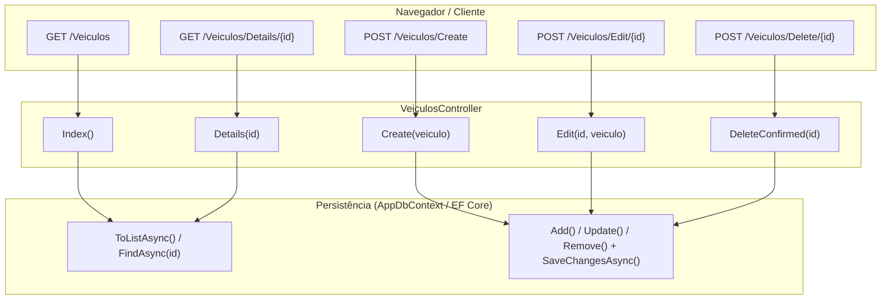

# Implementação prática do CRUD de veículos no ASP.NET Core MVC

> **Contexto:** Este artigo consolida o ciclo completo de construção do primeiro CRUD (*Create, Read, Update, Delete*) da aplicação prática da disciplina, utilizando a entidade `Veiculo`. A jornada aborda desde a modelagem da entidade com Data Annotations e a configuração do contexto de persistência com Entity Framework Core e SQL Server LocalDB, passando pela geração e aplicação de migrações (*Migrations*), até a implementação das ações do controlador (`Index`, `Create`, `Details`, `Edit` e `Delete`) e suas respectivas Views Razor customizadas.

A implementação de operações fundamentais de manipulação e persistência de dados em aplicações ASP.NET Core MVC estrutura-se sobre a integração coordenada entre três camadas: os **modelos anotados** (que definem atributos e validações), o **contexto do ORM** (*Object-Relational Mapping*, responsável pela tradução relacional) e os **controladores** (que orquestram o ciclo HTTP entre requisições de clientes e respostas renderizadas).

## Modelagem da entidade e configuração de persistência

A construção da aplicação inicia-se pela definição do modelo de domínio na pasta `Models/`. A classe `Veiculo` reúne os dados necessários para o rastreamento do consumo de automóveis, utilizando Data Annotations para estabelecer restrições de validação e mapeamento com o banco relacional.

### Classe de entidade `Veiculo`

A utilização dos atributos `[Table]`, `[Key]`, `[Required]` e `[Display]` assegura que as regras sejam aplicadas de maneira unificada: o Entity Framework Core as interpreta na criação das colunas do banco de dados, o ASP.NET Core as utiliza na validação server-side via `ModelState`, e os templates Razor geram validações em JavaScript client-side e rótulos amigáveis de interface:

```csharp
using System.ComponentModel.DataAnnotations;
using System.ComponentModel.DataAnnotations.Schema;

namespace AppWebBackend.Models;

[Table("Veiculos")]
public class Veiculo
{
    [Key]
    public int Id { get; set; }

    [Required(ErrorMessage = "Obrigatório informar o nome.")]
    [Display(Name = "Nome")]
    public string Nome { get; set; } = string.Empty;

    [Required(ErrorMessage = "Obrigatório informar a placa.")]
    [Display(Name = "Placa")]
    public string Placa { get; set; } = string.Empty;

    [Required(ErrorMessage = "Obrigatório informar o ano de fabricação.")]
    [Display(Name = "Ano de fabricação")]
    public int AnoFabricacao { get; set; }

    [Required(ErrorMessage = "Obrigatório informar o ano do modelo.")]
    [Display(Name = "Ano do modelo")]
    public int AnoModelo { get; set; }
}
```

### Contexto de dados e registro de serviços

Para conectar a entidade ao banco relacional via Entity Framework Core, cria-se a classe `AppDbContext` (herdando de `DbContext`), expondo o conjunto tipado `DbSet<Veiculo>`:

```csharp
using AppWebBackend.Models;
using Microsoft.EntityFrameworkCore;

namespace AppWebBackend.Models;

public class AppDbContext : DbContext
{
    public AppDbContext(DbContextOptions<AppDbContext> options) : base(options)
    {
    }

    public DbSet<Veiculo> Veiculos { get; set; }
}
```

A cadeia de conexão (*connection string*) para o SQL Server LocalDB é configurada em `appsettings.json`:

```json
{
  "ConnectionStrings": {
    "DefaultConnection": "Server=(localdb)\\mssqllocaldb;Database=AppWebBackendContext;Trusted_Connection=True;MultipleActiveResultSets=true"
  }
}
```

No arquivo `Program.cs`, o contexto é registrado no contêiner de injeção de dependência da aplicação, ficando disponível para resolução automática nos controladores:

```csharp
builder.Services.AddDbContext<AppDbContext>(options =>
    options.UseSqlServer(builder.Configuration.GetConnectionString("DefaultConnection")));
```

## Evolução do banco com Migrations

O Entity Framework Core gerencia o esquema relacional por meio de migrações versionadas (*Migrations*). Os comandos são executados no Package Manager Console do Visual Studio:

1. **Geração da migração inicial:**
   ```powershell
   Add-Migration M01-AddTableVeiculos
   ```
   Esse comando analisa a classe `Veiculo` e o `DbSet<Veiculo>`, gerando um arquivo C# com as instruções `CreateTable` (coluna `Id` com auto-incremento `IDENTITY`, colunas `NOT NULL` e restrição de chave primária).
2. **Aplicação do esquema ao banco de dados:**
   ```powershell
   Update-Database
   ```
   O EF Core conecta ao SQL Server, cria a base de dados se ela ainda não existir, cria a tabela técnica `__EFMigrationsHistory` e aplica a estrutura da tabela `Veiculos`.

## Fluxo do CRUD no controlador `VeiculosController`

O controlador `VeiculosController` estende a classe `Controller` e recebe uma instância de `AppDbContext` via injeção por construtor. Cada operação do CRUD é associada a rotas convencionais e verbos HTTP específicos:



### 1. Listagem (`Index`)

A action `Index` recupera a coleção de veículos de forma assíncrona com `ToListAsync()` e a encaminha para a visualização:

```csharp
public async Task<IActionResult> Index()
{
    var dados = await _context.Veiculos.ToListAsync();
    return View(dados);
}
```

Na View correspondente (`Views/Veiculos/Index.cshtml`), os dados são iterados com `@foreach`, utilizando Tag Helpers (`asp-action="Edit"`, `asp-route-id="@item.Id"`) para gerar links tipados para as demais operações.

### 2. Cadastro (`Create`)

A criação exige dois métodos complementares:

* **GET `Create()`:** devolve a View com o formulário em branco.
* **POST `Create(Veiculo veiculo)`:** recebe os dados submetidos pelo formulário via model binding. Se `ModelState.IsValid` for verdadeiro, o veículo é adicionado a `_context.Veiculos`, persistido com `SaveChangesAsync()` e o usuário é redirecionado para `Index`:

```csharp
[HttpGet]
public IActionResult Create()
{
    return View();
}

[HttpPost]
[ValidateAntiForgeryToken]
public async Task<IActionResult> Create(
    [Bind("Nome,Placa,AnoFabricacao,AnoModelo")] Veiculo veiculo)
{
    if (ModelState.IsValid)
    {
        _context.Veiculos.Add(veiculo);
        await _context.SaveChangesAsync();
        return RedirectToAction(nameof(Index));
    }
    return View(veiculo);
}
```

### 3. Detalhamento (`Details`)

A action `Details` recebe um identificador que pode ser nulo (`int? id`). O método valida a presença do parâmetro e consulta a entidade com `FirstOrDefaultAsync()` ou `FindAsync()`. Caso o registro não exista, devolve o código de resposta HTTP 404 (`NotFound()`):

```csharp
public async Task<IActionResult> Details(int? id)
{
    if (id == null)
        return NotFound();

    var veiculo = await _context.Veiculos.FirstOrDefaultAsync(m => m.Id == id);

    if (veiculo == null)
        return NotFound();

    return View(veiculo);
}
```

### 4. Edição (`Edit`)

A atualização também se divide em duas etapas para garantir integridade estrutural:

* **GET `Edit(int? id)`:** busca a entidade pelo identificador e preenche o formulário existente.
* **POST `Edit(int id, Veiculo veiculo)`:** valida se o `id` da rota coincide com `veiculo.Id` (impedindo alterações indevidas de chave primária). Se válido, os dados são atualizados no contexto com `_context.Veiculos.Update(veiculo)` e gravados no banco:

```csharp
[HttpGet]
public async Task<IActionResult> Edit(int? id)
{
    if (id == null)
        return NotFound();

    var veiculo = await _context.Veiculos.FindAsync(id);

    if (veiculo == null)
        return NotFound();

    return View(veiculo);
}

[HttpPost]
[ValidateAntiForgeryToken]
public async Task<IActionResult> Edit(int id,
    [Bind("Id,Nome,Placa,AnoFabricacao,AnoModelo")] Veiculo veiculo)
{
    if (id != veiculo.Id)
        return NotFound();

    if (ModelState.IsValid)
    {
        _context.Veiculos.Update(veiculo);
        await _context.SaveChangesAsync();
        return RedirectToAction(nameof(Index));
    }
    return View(veiculo);
}
```

> **Atenção ao campo `Id` no formulário:** Na View de edição (`Views/Veiculos/Edit.cshtml`), o identificador deve ser incluído como campo oculto (`<input type="hidden" asp-for="Id" />`). Sem esse campo, o model binding do POST receberá `Id` zerado, violando a verificação `id != veiculo.Id`.

### 5. Exclusão (`Delete`)

Por motivos de segurança e boa usabilidade, a exclusão de registros nunca deve ser executada imediatamente por requisições do tipo GET (para evitar exclusões acidentais por rastreadores Web ou links clicados inadvertidamente). O fluxo adota confirmação em dois passos:

* **GET `Delete(int? id)`:** busca o registro e exibe uma tela de confirmação ("Tem certeza de que deseja excluir este registro?").
* **POST `DeleteConfirmed(int id)`:** recebe a confirmação enviada pelo formulário, remove a entidade com `_context.Veiculos.Remove(veiculo)` e salva as alterações:

```csharp
[HttpGet]
public async Task<IActionResult> Delete(int? id)
{
    if (id == null)
        return NotFound();

    var veiculo = await _context.Veiculos.FirstOrDefaultAsync(m => m.Id == id);

    if (veiculo == null)
        return NotFound();

    return View(veiculo);
}

[HttpPost, ActionName("Delete")]
[ValidateAntiForgeryToken]
public async Task<IActionResult> DeleteConfirmed(int id)
{
    var veiculo = await _context.Veiculos.FindAsync(id);

    if (veiculo != null)
    {
        _context.Veiculos.Remove(veiculo);
        await _context.SaveChangesAsync();
    }

    return RedirectToAction(nameof(Index));
}
```

> **Renomeação da action no POST com `ActionName`:** Em C#, métodos com o mesmo nome e mesmos tipos de parâmetros não podem coexistir (`Delete(int? id)` e `Delete(int id)` gerariam sobrecarga ambígua no compilador). A convenção do ASP.NET Core MVC utiliza o atributo `[ActionName("Delete")]` no método `DeleteConfirmed(int id)`, mantendo a URL `/Veiculos/Delete/{id}` para a requisição POST de exclusão.

## Pontos que costumam gerar confusão

* **`Add-Migration` não altera o banco:** o comando `Add-Migration` apenas inspeciona o código C# e gera o arquivo de migração; a criação ou alteração física das tabelas no SQL Server só ocorre após a execução de `Update-Database`.
* **Diferença entre `[ActionName("Delete")]` e o nome do método C#:** o nome do método no código-fonte é `DeleteConfirmed`, mas o atributo `ActionName` informa ao pipeline de roteamento que ele atende a rota POST `/Veiculos/Delete`.
* **Verificação de `id != veiculo.Id` no POST:** essa checagem impede que um usuário mal-intencionado manipule os dados da requisição para tentar sobrescrever a chave primária de outro registro não autorizado.
* **Necessidade de métodos assíncronos (`async`/`await`):** operações de banco de dados (`ToListAsync`, `FindAsync`, `SaveChangesAsync`) realizam entrada e saída (*I/O*) na rede; o uso de assincronismo libera a thread de execução do servidor enquanto o banco processa a consulta, aumentando a escalabilidade da aplicação.
