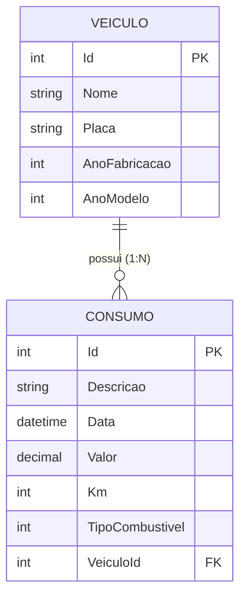
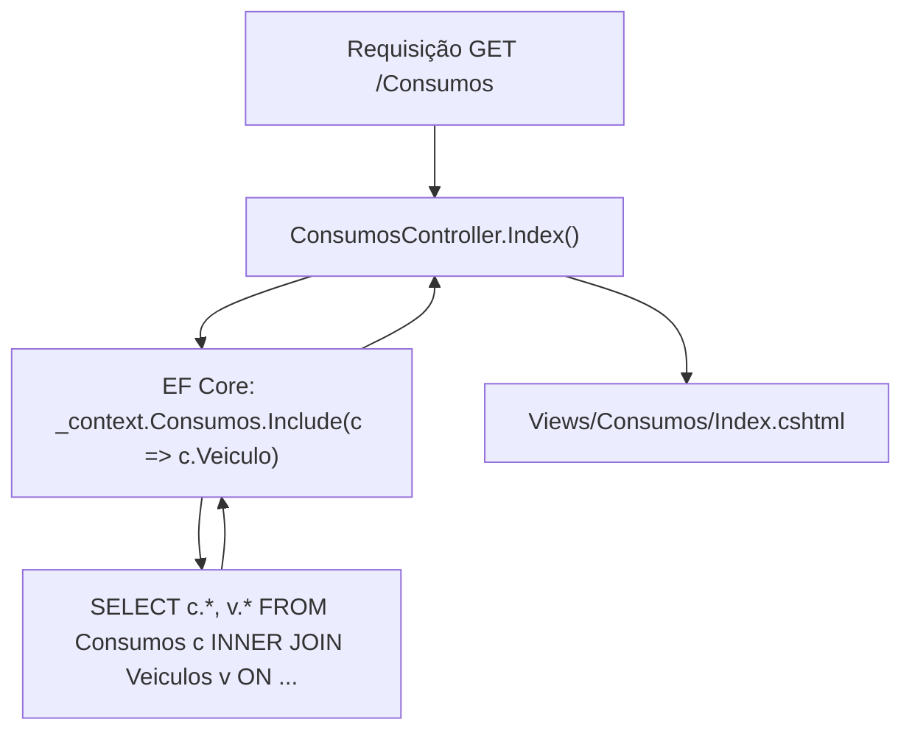

# Relacionamentos entre modelos e novas funcionalidades no ASP.NET Core MVC

> **Contexto:** Após a implementação do primeiro CRUD isolado com a entidade `Veiculo` no [[05. Desenvolvimento Web Back-End/08. Implementação prática do CRUD de veículos no ASP.NET Core MVC|artigo 08]], este artigo aborda a expansão da aplicação para cenários relacionais do mundo real. O percurso compreende a modelagem da entidade dependente `Consumo`, o mapeamento do relacionamento 1:N com chave estrangeira e propriedades de navegação, a utilização de enumerações em C# para campos de seleção fixa, a geração de scaffolding completo de controladores e Views, o carregamento de dados relacionados com `Include()` e a passagem de listas de seleção via `ViewData` e `SelectList`.

Em sistemas Web comerciais, entidades raramente operam de forma isolada. A representação fiel de um domínio exige estabelecer vínculos relacionais entre entidades, garantindo integridade referencial no banco de dados e interfaces coesas que permitam selecionar entidades associadas em formulários e exibir dados compostos em consultas.

## Modelagem do relacionamento 1:N entre veículo e consumo

No domínio de gerenciamento de frotas e consumo, um veículo pode registrar múltiplos abastecimentos ao longo do tempo, enquanto cada registro de consumo pertence a exatamente um veículo. Essa regra define uma associação de multiplicidade **1:N (um para muitos)**.



### 1. Enumeração `TipoCombustivel`

Para representar opções fechadas de preenchimento (como o combustível utilizado), utiliza-se o tipo primitivo de enumeração (`enum`) em C#, evitando o uso de strings livres que possam introduzir inconsistências de digitação:

```csharp
namespace AppWebBackend.Models;

public enum TipoCombustivel
{
    Gasolina,
    Etanol,
    Diesel,
    Gas
}
```

### 2. Entidade dependente `Consumo`

A classe `Consumo` define as propriedades de abastecimento e expressa o vínculo relacional com `Veiculo` por meio de duas propriedades complementares:
* **Chave estrangeira (`VeiculoId`):** armazena o valor escalar correspondente à chave primária do veículo associado no banco relacional.
* **Propriedade de navegação (`Veiculo`):** permite acessar a instância completa do objeto `Veiculo` em memória no código C#.

```csharp
using System.ComponentModel.DataAnnotations;
using System.ComponentModel.DataAnnotations.Schema;

namespace AppWebBackend.Models;

[Table("Consumos")]
public class Consumo
{
    [Key]
    public int Id { get; set; }

    [Required(ErrorMessage = "Obrigatório informar a descrição.")]
    [Display(Name = "Descrição")]
    public string Descricao { get; set; } = string.Empty;

    [Required(ErrorMessage = "Obrigatório informar a data.")]
    [DataType(DataType.Date)]
    public DateTime Data { get; set; }

    [Required(ErrorMessage = "Obrigatório informar o valor.")]
    [Column(TypeName = "decimal(18,2)")]
    public decimal Valor { get; set; }

    [Required(ErrorMessage = "Obrigatório informar a quilometragem.")]
    [Display(Name = "Quilometragem")]
    public int Km { get; set; }

    [Display(Name = "Tipo de combustível")]
    public TipoCombustivel TipoCombustivel { get; set; }

    [Display(Name = "Veículo")]
    [Required(ErrorMessage = "Obrigatório informar o veículo.")]
    public int VeiculoId { get; set; }

    [ForeignKey("VeiculoId")]
    public Veiculo? Veiculo { get; set; }
}
```

### 3. Coleção de navegação inversa em `Veiculo`

Para permitir a navegação bidirecional no modelo orientado a objetos, a entidade principal `Veiculo` pode declarar uma coleção de navegação inversa:

```csharp
public ICollection<Consumo>? Consumos { get; set; }
```

Essa declaração não altera as colunas da tabela `Veiculos` no banco relacional, mas informa ao Entity Framework Core que a partir de uma instância de `Veiculo` é possível consultar todos os consumos associados.

## Atualização do contexto e migração relacional

Com o novo modelo definido, a classe `AppDbContext` é atualizada para expor o conjunto `Consumos`:

```csharp
public DbSet<Veiculo> Veiculos { get; set; }
public DbSet<Consumo> Consumos { get; set; }
```

### Geração da Migration relacional

No Package Manager Console do Visual Studio, registra-se a evolução do esquema:

```powershell
Add-Migration M02-AddTableConsumos
Update-Database
```

Ao inspecionar a migração gerada, constata-se que o EF Core cria a tabela `Consumos` com restrição de chave estrangeira (`foreignKey`), definindo comportamento de exclusão em cascata (`onDelete: ReferentialAction.Cascade`):

```csharp
migrationBuilder.CreateTable(
    name: "Consumos",
    columns: table => new
    {
        Id = table.Column<int>(type: "int", nullable: false)
            .Annotation("SqlServer:Identity", "1, 1"),
        Descricao = table.Column<string>(type: "nvarchar(max)", nullable: false),
        Data = table.Column<DateTime>(type: "datetime2", nullable: false),
        Valor = table.Column<decimal>(type: "decimal(18,2)", nullable: false),
        Km = table.Column<int>(type: "int", nullable: false),
        TipoCombustivel = table.Column<int>(type: "int", nullable: false),
        VeiculoId = table.Column<int>(type: "int", nullable: false)
    },
    constraints: table =>
    {
        table.PrimaryKey("PK_Consumos", x => x.Id);
        table.ForeignKey(
            name: "FK_Consumos_Veiculos_VeiculoId",
            column: x => x.VeiculoId,
            principalTable: "Veiculos",
            principalColumn: "Id",
            onDelete: ReferentialAction.Cascade);
    });
```

## Carregamento de dados relacionados e scaffolding

Ao utilizar a ferramenta de geração automatizada da IDE (scaffolding via opção *Controlador MVC com exibições, usando o Entity Framework* para a classe `Consumo`), o ASP.NET Core gera o `ConsumosController` e o conjunto de Views correspondentes (`Index`, `Create`, `Edit`, `Details` e `Delete`).



### Consulta com carregamento adiantado (`Include`)

Por padrão, o Entity Framework Core não preenche propriedades de navegação automaticamente para economizar recursos de rede e processamento (*lazy loading* desabilitado por padrão). Para exibir dados do veículo na listagem de consumos, a action `Index` utiliza o método de carregamento adiantado (*eager loading*) via `.Include()`:

```csharp
public async Task<IActionResult> Index()
{
    var appDbContext = _context.Consumos.Include(c => c.Veiculo);
    return View(await appDbContext.ToListAsync());
}
```

O método `Include(c => c.Veiculo)` instrui o provedor do EF Core a emitir uma junção SQL (`INNER JOIN` ou `LEFT JOIN`) entre as tabelas `Consumos` e `Veiculos`, permitindo acessar diretamente `@item.Veiculo.Nome` dentro do laço de exibição da View Razor.

## Passagem de dados para formulários: `ViewData`, `SelectList` e Tag Helpers

Na criação e na edição de um consumo, o usuário não deve digitar o identificador numérico `VeiculoId` manualmente. O formulário deve apresentar uma lista suspensa (*dropdown* / elemento `<select>`) com os nomes dos veículos disponíveis no banco de dados.

### Preparação da lista no controlador

O controlador consulta os veículos e instancia um objeto `SelectList`, armazenando-o na coleção dinâmica `ViewData`:

```csharp
// GET: Consumos/Create
public IActionResult Create()
{
    ViewData["VeiculoId"] = new SelectList(_context.Veiculos, "Id", "Nome");
    return View();
}
```

O construtor `SelectList(_context.Veiculos, "Id", "Nome")` recebe:
1. A fonte de dados (`_context.Veiculos`);
2. O nome da propriedade que servirá como valor submetido (`"Id"`, chave primária);
3. O nome da propriedade que será exibida textualmente para o usuário (`"Nome"`).

### Renderização na View com Tag Helpers

Na View Razor (`Views/Consumos/Create.cshtml`), o Tag Helper `asp-items` consome a lista disponibilizada em `ViewData`, associando o valor selecionado ao campo `VeiculoId` do modelo com `asp-for`:

```html
<div class="form-group">
    <label asp-for="VeiculoId" class="control-label"></label>
    <select asp-for="VeiculoId" class="form-control" asp-items="ViewBag.VeiculoId"></select>
</div>
```

### Renderização de opções de `enum` com `Html.GetEnumSelectList`

Para o campo `TipoCombustivel`, o ASP.NET Core disponibiliza um método auxiliar nativo que transforma qualquer enumeração em itens de seleção sem a necessidade de consultas adicionais a banco:

```html
<div class="form-group">
    <label asp-for="TipoCombustivel" class="control-label"></label>
    <select asp-for="TipoCombustivel" class="form-control" 
            asp-items="Html.GetEnumSelectList<TipoCombustivel>()"></select>
    <span asp-validation-for="TipoCombustivel" class="text-danger"></span>
</div>
```

Esse mecanismo itera sobre os valores constantes da enumeração (`Gasolina`, `Etanol`, etc.) e gera as respectivas tags `<option value="0">Gasolina</option>` dinamicamente.

## Pontos que costumam gerar confusão

* **Chave estrangeira física versus propriedade de navegação:** `VeiculoId` é o campo escalar que vira coluna no banco relacional; `Veiculo` é um ponteiro de navegação em memória do C# para acessar propriedades do objeto vinculado.
* **Ausência do `.Include()` gera referência nula:** se a consulta for executada apenas com `_context.Consumos.ToListAsync()`, a propriedade `item.Veiculo` virá como `null`, gerando uma `NullReferenceException` ao tentar acessar `item.Veiculo.Nome` na View.
* **Exclusão em cascata (*Cascade Delete*):** por padrão de chave estrangeira obrigatória no EF Core, excluir um veículo fará com que o banco remova automaticamente todos os abastecimentos vinculados a ele; se isso for indesejado, a regra de exclusão deve ser configurada explicitamente como restritiva (`ReferentialAction.Restrict`).
* **Repopular `ViewData` em caso de erro de validação:** na action `POST Create` ou `POST Edit`, se `ModelState.IsValid` for falso e a View for devolvida com erros, a `ViewData["VeiculoId"]` deve ser preenchida novamente antes de retornar a View; caso contrário, a lista suspensa de veículos ficará vazia.
