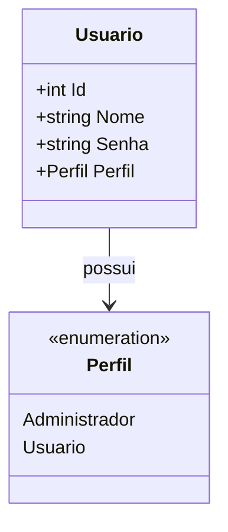
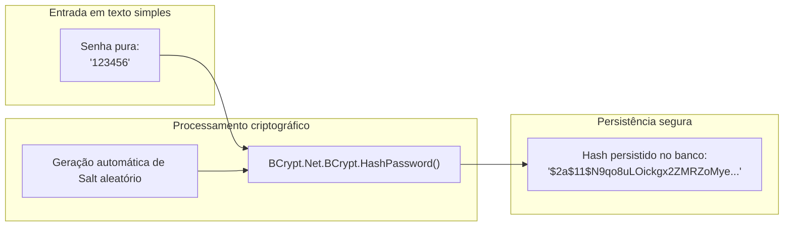

# Controle de usuários e criptografia de senhas no ASP.NET Core MVC

> **Contexto:** A segurança em aplicações Web apoia-se em princípios fundamentais de confidencialidade, integridade e disponibilidade. Após a modelagem de entidades de domínio como `Veiculo` e `Consumo`, este artigo detalha o gerenciamento de credenciais na aplicação prática. A abordagem cobre a modelagem da entidade `Usuario`, a definição de níveis de acesso por perfil via enumeração (`Perfil`), a criação de migrações e persistência de contas, e a proteção criptográfica de credenciais com geração de *hash* seguro via algoritmo BCrypt (`BCrypt.Net-Next`), assegurando que senhas jamais trafeguem ou sejam armazenadas em texto simples.

O armazenamento de credenciais de acesso é um dos pontos mais críticos da segurança de software. Em conformidade com boas práticas de proteção de dados e requisitos não funcionais de confidencialidade, sistemas modernos nunca devem persistir senhas em formato legível (*plain text*). Caso a base de dados sofra violação ou acesso não autorizado, as senhas devem permanecer indecifráveis por meio de funções criptográficas de dispersão unidirecional (*hash*).

## Modelagem da entidade `Usuario` e perfis de acesso

O controle de identidades inicia-se pela definição do modelo na pasta `Models/`. Além dos atributos cadastrais básicos, a entidade define um campo de perfil para controle de autorização e utiliza Data Annotations para formatação visual segura em formulários.



### 1. Enumeração `Perfil`

Para evitar inconsistências na atribuição de permissões operacionais, os níveis de autorização são parametrizados por um tipo `enum`:

```csharp
namespace AppWebBackend.Models;

public enum Perfil
{
    Administrador,
    Usuario
}
```

O perfil `Administrador` destina-se à gestão irrestrita de contas e registros, enquanto `Usuario` representa o operador padrão da aplicação com escopo operacional restrito.

### 2. Classe de entidade `Usuario`

A classe declara a chave primária `Id`, o `Nome` de identificação, o `Perfil` associado e a `Senha`. A anotação `[DataType(DataType.Password)]` assegura que os templates de interface gerem elementos `<input type="password" />`, ocultando os caracteres durante a digitação:

```csharp
using System.ComponentModel.DataAnnotations;
using System.ComponentModel.DataAnnotations.Schema;

namespace AppWebBackend.Models;

[Table("Usuarios")]
public class Usuario
{
    [Key]
    public int Id { get; set; }

    [Required(ErrorMessage = "Obrigatório informar o nome.")]
    public string Nome { get; set; } = string.Empty;

    [Required(ErrorMessage = "Obrigatório informar a senha.")]
    [DataType(DataType.Password)]
    public string Senha { get; set; } = string.Empty;

    [Required(ErrorMessage = "Obrigatório informar o perfil.")]
    public Perfil Perfil { get; set; }
}
```

## Persistência e migração da tabela de usuários

Para incluir a nova entidade no mapeamento relacional, adiciona-se o conjunto tipado `DbSet<Usuario>` na classe de contexto `AppDbContext`:

```csharp
public DbSet<Veiculo> Veiculos { get; set; }
public DbSet<Consumo> Consumos { get; set; }
public DbSet<Usuario> Usuarios { get; set; }
```

### Execução da Migration

No Package Manager Console do Visual Studio, registra-se e aplica-se a nova migração ao banco SQL Server LocalDB:

```powershell
Add-Migration M03-AddTableUsuarios
Update-Database
```

O Entity Framework Core gera a tabela `Usuarios` com a coluna `Id` como chave primária auto-incremental (`IDENTITY`), `Nome` e `Senha` como cadeias de texto obrigatórias e `Perfil` como inteiro representativo da enumeração.

## Criptografia de senhas com algoritmo BCrypt

Uma função de *hash* criptográfico é um algoritmo matemático unidirecional: a partir de uma entrada (a senha digitada), produz-se uma saída de tamanho fixo (*digest* ou *hash*), sendo computacionalmente inviável reverter o *hash* para obter a senha original.



### Instalação do pacote `BCrypt.Net-Next`

Para implementar o algoritmo BCrypt em .NET, utiliza-se a biblioteca de código aberto mantida pelo NuGet `BCrypt.Net-Next`. O BCrypt incorpora automaticamente um valor aleatório de dispersão (*salt*) ao cálculo do *hash*, impedindo ataques baseados em tabelas pré-computadas (*rainbow tables*) e ataques de dicionário:

1. Acessar o **Gerenciador de Pacotes NuGet** do projeto;
2. Na aba **Procurar**, pesquisar por `BCrypt.Net-Next`;
3. Concluir a instalação da versão estável compatível com o framework.

### Criptografia nas ações `Create` e `Edit` do `UsuariosController`

No controlador gerado por scaffolding (`UsuariosController`), a senha recebida em texto simples pelo formulário deve ser interceptada e substituída pelo respectivo *hash* antes de ser persistida no banco:

```csharp
// POST: Usuarios/Create
[HttpPost]
[ValidateAntiForgeryToken]
public async Task<IActionResult> Create(
    [Bind("Id,Nome,Senha,Perfil")] Usuario usuario)
{
    if (ModelState.IsValid)
    {
        // Converte a senha em texto plano em um hash seguro antes de persistir
        usuario.Senha = BCrypt.Net.BCrypt.HashPassword(usuario.Senha);

        _context.Add(usuario);
        await _context.SaveChangesAsync();
        return RedirectToAction(nameof(Index));
    }
    return View(usuario);
}
```

Da mesma forma, na ação de edição (`Edit`), caso o usuário redefina a senha, o novo valor precisa ser convertido em *hash* antes da invocação do método `Update`:

```csharp
// POST: Usuarios/Edit/5
[HttpPost]
[ValidateAntiForgeryToken]
public async Task<IActionResult> Edit(int id, 
    [Bind("Id,Nome,Senha,Perfil")] Usuario usuario)
{
    if (id != usuario.Id)
        return NotFound();

    if (ModelState.IsValid)
    {
        usuario.Senha = BCrypt.Net.BCrypt.HashPassword(usuario.Senha);

        _context.Update(usuario);
        await _context.SaveChangesAsync();
        return RedirectToAction(nameof(Index));
    }
    return View(usuario);
}
```

## Higienização das Views de exibição

Por padrão, geradores automáticos de scaffolding criam colunas e campos de exibição para todas as propriedades do modelo. Mesmo estando na forma de *hash*, expor a sequência cifrada da senha na interface visual é uma violação de boas práticas de segurança e usabilidade.

### Remoção do campo `Senha` nas Views de leitura

Os arquivos de visualização pública e administrativa devem ser limpos:

* **`Views/Usuarios/Index.cshtml`:** remover o cabeçalho `<th>@Html.DisplayNameFor(model => model.Senha)</th>` e a célula correspondente `<td>@Html.DisplayFor(modelItem => item.Senha)</td>`. A tabela listará apenas o **Nome** e o **Perfil**.
* **`Views/Usuarios/Details.cshtml` e `Views/Usuarios/Delete.cshtml`:** remover o par `<dt>` e `<dd>` referente ao campo `Senha`. O operador visualiza e confirma a exclusão apenas conferindo o nome e o perfil do usuário.

### Renderização do seletor de perfil na criação e edição

Para garantir que o campo `Perfil` seja apresentado como uma lista suspensa de opções válidas nos formulários de cadastro e edição, a View Razor utiliza o método auxiliar de enumeração:

```html
<div class="form-group">
    <label asp-for="Perfil" class="control-label"></label>
    <select asp-for="Perfil" class="form-control" 
            asp-items="Html.GetEnumSelectList<Perfil>()"></select>
    <span asp-validation-for="Perfil" class="text-danger"></span>
</div>
```

## Pontos que costumam gerar confusão

* **`DataType(DataType.Password)` não criptografa:** essa anotação atua unicamente na camada de apresentação (gerando `<input type="password">` com caracteres em asteriscos no navegador); ela não altera nem cifra a string que chega ao servidor.
* **Hash versus criptografia bidirecional:** criptografia reversível permite descriptografar o texto de volta à forma original conhecendo a chave; o *hash* do BCrypt é irreversível e unidirecional, validando o acesso futuro comparando o *hash* do texto digitado no login com o *hash* armazenado no banco (`BCrypt.Verify`).
* **Inclusão do *Salt* pelo BCrypt:** o BCrypt embuti o fator de custo e o *salt* aleatório dentro da própria string do *hash* gerado (por exemplo, `$2a$11$...`), eliminando a necessidade de criar uma coluna separada no banco de dados para armazenar o *salt*.
* **Ocultação da senha em listagens:** exibir o *hash* na listagem (`Index`) expõe a assinatura criptográfica para outros usuários; o correto é omitir a coluna de senha de todas as telas de leitura.
