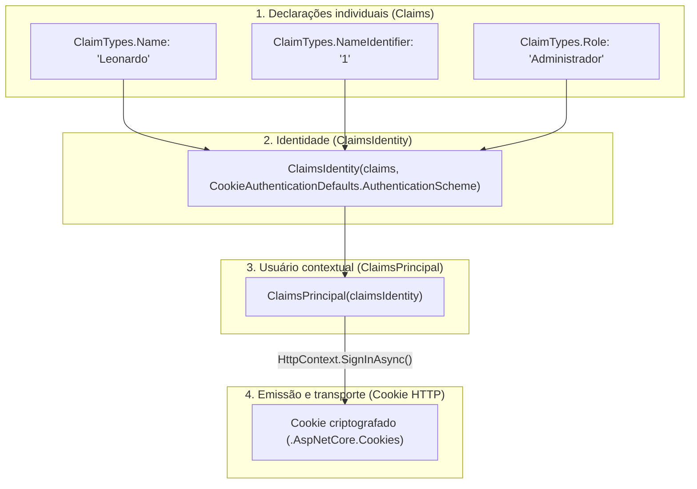
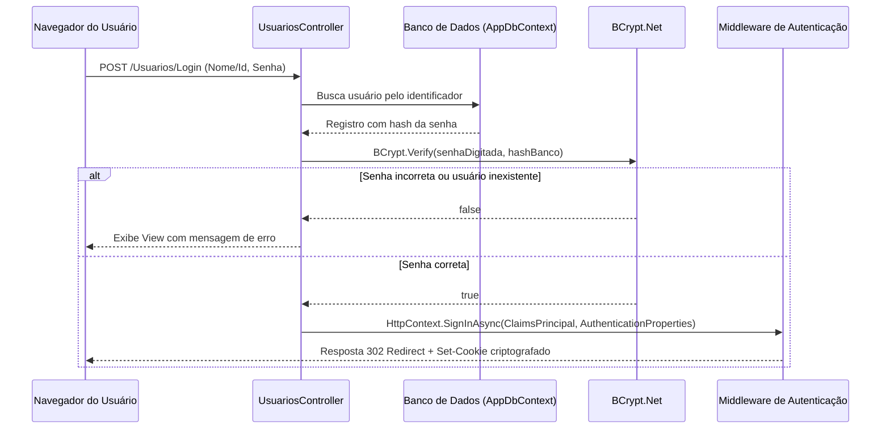

# Autenticação baseada em cookies, claims e login no ASP.NET Core MVC

> **Contexto:** Enquanto o [[05. Desenvolvimento Web Back-End/10. Controle de usuários e criptografia de senhas no ASP.NET Core MVC|artigo 10]] focou no cadastro de contas e na proteção de senhas com *hash* BCrypt, este artigo aborda a implementação do fluxo operacional de segurança de sessão no ASP.NET Core MVC. O percurso compreende a configuração do middleware de autenticação por cookies (*Cookie Authentication*), a verificação de credenciais com `BCrypt.Verify`, a emissão de declarações de identidade (*Claims*, `ClaimsIdentity` e `ClaimsPrincipal`), a persistência da sessão via `SignInAsync` e `SignOutAsync`, e a alternância dinâmica da interface com base no estado do usuário (`User.Identity.IsAuthenticated`).

A autenticação é o processo de verificação formal da identidade do usuário ("quem é você?"), constituindo o pré-requisito indispensável para qualquer mecanismo posterior de autorização ("o que você tem permissão para fazer?"). Em aplicações Web renderizadas no servidor (*server-centric*) como o ASP.NET Core MVC, o padrão da indústria para gerenciar o estado da sessão de usuários autenticados apoia-se em **cookies de autenticação criptografados**.

## Arquitetura de autenticação: cookies, claims e principal

O ecossistema de segurança do .NET adota um modelo baseado em declarações (*Claims-based Identity*). Em vez de associar apenas um identificador bruto à sessão, o sistema constrói um perfil completo do usuário autenticado:



* **Claim:** afirmação específica sobre o usuário (nome, código identificador, papel ou permissão).
* **`ClaimsIdentity`:** coleção de *claims* que representa uma identidade digital válida reconhecida por determinado esquema de autenticação.
* **`ClaimsPrincipal`:** a figura principal associada à requisição (representada em C# por `User` ou `HttpContext.User`), que pode conter uma ou mais identidades.
* **Cookie de autenticação:** tíquete criptografado emitido pelo servidor e armazenado pelo navegador do cliente, enviado a cada requisição subsequente para comprovar que a sessão permanece ativa.

## Configuração do pipeline de autenticação em `Program.cs`

Para que o ASP.NET Core interprete e valide os cookies recebidos dos clientes, o serviço de autenticação deve ser registrado e o respectivo middleware acoplado ao pipeline HTTP.

### 1. Registro do serviço de cookies

No arquivo `Program.cs`, antes da chamada `builder.Build()`, registra-se o esquema de autenticação por cookies utilizando `CookieAuthenticationDefaults.AuthenticationScheme`:

```csharp
using Microsoft.AspNetCore.Authentication.Cookies;

builder.Services.AddAuthentication(CookieAuthenticationDefaults.AuthenticationScheme)
    .AddCookie(options =>
    {
        options.AccessDeniedPath = "/Usuarios/AccessDenied";
        options.LoginPath = "/Usuarios/Login";
        options.ExpireTimeSpan = TimeSpan.FromHours(8);
        options.SlidingExpiration = true;
    });
```

* **`LoginPath`:** rota para a qual requisições não autenticadas serão automaticamente redirecionadas caso tentem acessar recursos protegidos.
* **`AccessDeniedPath`:** rota exibida quando um usuário autenticado tenta acessar um recurso para o qual seu perfil não possui privilégios.
* **`ExpireTimeSpan`:** tempo de vida útil do tíquete de sessão (por exemplo, 8 horas).
* **`SlidingExpiration`:** quando ativado, renova a validade do cookie caso o usuário realize requisições enquanto a sessão estiver ativa na metade do período de expiração.

### 2. Ordem estrita dos middlewares de segurança

No pipeline de execução de middlewares em `Program.cs`, a chamada `UseAuthentication()` deve obrigatoriamente preceder `UseAuthorization()` e suceder `UseRouting()`:

```csharp
app.UseRouting();

// 1º: Identifica quem é o usuário a partir do cookie da requisição
app.UseAuthentication();

// 2º: Avalia se o usuário identificado tem permissão para a rota solicitada
app.UseAuthorization();
```

Inverter a sequência desses middlewares impede que a autorização tenha acesso aos dados da identidade decodificada pelo middleware de autenticação.

## Implementação do fluxo de login e logout em `UsuariosController`

O controlador `UsuariosController` gerencia as ações de autenticação, recebendo as credenciais fornecidas no formulário e emitindo o tíquete de sessão.



### 1. Ações de Login (`GET` e `POST`)

A ação GET exibe o formulário de login. A ação POST valida as credenciais contra a base relacional com apoio do método `BCrypt.Verify`:

```csharp
using System.Security.Claims;
using Microsoft.AspNetCore.Authentication;
using Microsoft.AspNetCore.Authentication.Cookies;
using Microsoft.AspNetCore.Mvc;
using Microsoft.EntityFrameworkCore;

// GET: Usuarios/Login
public IActionResult Login()
{
    return View();
}

// POST: Usuarios/Login
[HttpPost]
[ValidateAntiForgeryToken]
public async Task<IActionResult> Login([Bind("Id,Senha")] Usuario usuario)
{
    var usuarioBanco = await _context.Usuarios
        .FirstOrDefaultAsync(u => u.Id == usuario.Id);

    if (usuarioBanco == null)
    {
        ViewBag.Message = "Usuário ou senha inválidos!";
        return View();
    }

    // Compara a senha em texto digitada com o hash persistido no banco
    bool senhaValida = BCrypt.Net.BCrypt.Verify(usuario.Senha, usuarioBanco.Senha);

    if (!senhaValida)
    {
        ViewBag.Message = "Usuário ou senha inválidos!";
        return View();
    }

    // Montagem das credenciais (Claims)
    var claims = new List<Claim>
    {
        new Claim(ClaimTypes.Name, usuarioBanco.Nome),
        new Claim(ClaimTypes.NameIdentifier, usuarioBanco.Id.ToString()),
        new Claim(ClaimTypes.Role, usuarioBanco.Perfil.ToString())
    };

    var claimsIdentity = new ClaimsIdentity(
        claims, CookieAuthenticationDefaults.AuthenticationScheme);

    var authProperties = new AuthenticationProperties
    {
        AllowRefresh = true,
        ExpiresUtc = DateTimeOffset.UtcNow.AddHours(8),
        IsPersistent = true
    };

    // Cria a sessão e emite o cookie HTTP criptografado
    await HttpContext.SignInAsync(
        CookieAuthenticationDefaults.AuthenticationScheme,
        new ClaimsPrincipal(claimsIdentity),
        authProperties);

    return RedirectToAction("Index", "Home");
}
```

> **Mensagem genérica de falha:** Por convenções rigorosas de segurança, mensagens de erro de autenticação nunca devem detalhar se o problema foi "usuário não encontrado" ou "senha incorreta". Mensagens genéricas como *"Usuário ou senha inválidos!"* impedem ataques de enumeração de contas válidas no sistema.

### 2. Ação de Logout

O encerramento da sessão do usuário exige a destruição do tíquete criptografado no cliente por meio de `SignOutAsync()`:

```csharp
public async Task<IActionResult> Logout()
{
    await HttpContext.SignOutAsync(
        CookieAuthenticationDefaults.AuthenticationScheme);

    return RedirectToAction("Login", "Usuarios");
}
```

Ao executar `SignOutAsync`, o middleware de autenticação instrui o navegador a expirar e remover o cookie de sessão correspondente.

## Alternância de interface no layout compartilhado

Com a identidade do usuário gerenciada pelo framework, a interface do sistema pode inspecionar o objeto contextual `User` no arquivo de layout geral (`Views/Shared/_Layout.cshtml`), alternando os links de autenticação:

```html
<ul class="navbar-nav">
    @if (User.Identity != null && User.Identity.IsAuthenticated)
    {
        <li class="nav-item">
            <span class="nav-link text-dark">Olá, @User.Identity.Name</span>
        </li>
        <li class="nav-item">
            <a class="nav-link text-dark" asp-area="" 
               asp-controller="Usuarios" asp-action="Logout">Sair</a>
        </li>
    }
    else
    {
        <li class="nav-item">
            <a class="nav-link text-dark" asp-area="" 
               asp-controller="Usuarios" asp-action="Login">Entrar</a>
        </li>
    }
</ul>
```

A propriedade `User.Identity.IsAuthenticated` retorna `true` unicamente se a requisição atual transportou um cookie de sessão válido e não expirado, enquanto `User.Identity.Name` recupera o valor previamente mapeado na *claim* `ClaimTypes.Name`.

## Pontos que costumam gerar confusão

* **Cookie de sessão versus ASP.NET Core Identity completo:** o ASP.NET Core Identity é uma biblioteca completa e abrangente que inclui tabelas próprias de banco (`IdentityDbContext`), recuperação de senha por e-mail, confirmação em duas etapas (*2FA*) e *lockout*; o fluxo apresentado neste artigo utiliza o mecanismo central e leve de **autenticação por cookies com Claims** integrado ao banco de dados customizado da aplicação.
* **`BCrypt.Verify` versus comparar strings com `==`:** nunca se deve gerar o *hash* da senha digitada e compará-la com `==` contra o banco de dados; como o BCrypt utiliza *salt* dinâmico aleatório em cada operação, duas chamadas de `HashPassword` para a mesma senha geram saídas diferentes. O método `Verify` extrai o *salt* do *hash* existente e valida a correspondência de forma segura.
* **Ordem de `UseAuthentication` e `UseAuthorization`:** registrar `UseAuthorization` antes de `UseAuthentication` faz com que o sistema avalie as regras de acesso antes de descriptografar o cookie da requisição, tratando todo usuário como anônimo.
* **`User.Identity.Name` vazio:** essa propriedade só terá valor se a lista de *claims* fornecida durante o login incluir explicitamente uma entrada do tipo `ClaimTypes.Name`.
