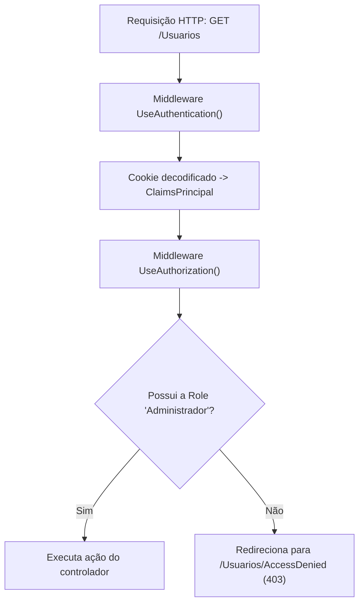

# Autorização de acesso baseada em perfis no ASP.NET Core MVC

> **Contexto:** Após a configuração da autenticação por cookies e da emissão de credenciais com Claims no [[05. Desenvolvimento Web Back-End/11. Autenticação baseada em cookies, claims e login no ASP.NET Core MVC|artigo 11]], este artigo aborda a implementação da camada de autorização. O conteúdo explora a distinção conceitual entre autenticação e autorização, a aplicação dos atributos `[Authorize]` e `[AllowAnonymous]`, o controle de acesso baseado em papéis (*Role-Based Access Control*, RBAC), a rota de acesso negado (`/Usuarios/AccessDenied`) e a filtragem condicional de elementos de interface com `@User.IsInRole()`.

A segurança de uma aplicação Web completa exige duas etapas complementares e coordenadas: primeiro, a **autenticação** verifica a identidade do cliente (*quem é você?*); em seguida, a **autorização** inspeciona os privilégios associados a essa identidade para determinar se a operação solicitada pode ser executada (*o que você tem permissão para fazer?*).

## Distinção e modelo de autorização baseada em perfis

No modelo RBAC (*Role-Based Access Control*, controle de acesso baseado em papéis), as permissões não são atribuídas de forma dispersa a cada usuário individual, mas sim agrupadas em perfis organizacionais predefinidos (como `Administrador` e `Usuario`). Quando o usuário realiza o login, seu perfil é encapsulado em uma declaração do tipo `ClaimTypes.Role`:



O ASP.NET Core MVC permite configurar essa proteção de forma declarativa, aplicando atributos diretamente sobre classes controladoras inteiras ou sobre ações específicas.

## Atributos declarativos de controle de acesso

O framework disponibiliza Attributes no namespace `Microsoft.AspNetCore.Authorization` para gerenciar as regras de entrada:

### 1. `[Authorize]` global por controlador

Ao decorar uma classe de controlador com `[Authorize]`, todas as suas ações passam a exigir que a requisição pertença a um usuário previamente autenticado:

```csharp
using Microsoft.AspNetCore.Authorization;
using Microsoft.AspNetCore.Mvc;

namespace AppWebBackend.Controllers;

[Authorize]
public class VeiculosController : Controller
{
    // Todas as ações (Index, Create, Edit, Details, Delete)
    // agora exigem autenticação obrigatória
}
```

Caso uma requisição anônima tente acessar qualquer rota deste controlador (como `/Veiculos`), o middleware de autenticação intercepta a requisição e emite um redirecionamento HTTP 302 para a rota configurada em `options.LoginPath` (por exemplo, `/Usuarios/Login`).

### 2. Isenção de autenticação com `[AllowAnonymous]`

Quando um controlador é protegido com `[Authorize]`, determinadas rotas públicas essenciais (como a própria tela de login) deixariam de funcionar se não houvesse uma exceção explícita. O atributo `[AllowAnonymous]` ignora qualquer exigência de credencial:

```csharp
[Authorize]
public class UsuariosController : Controller
{
    // Permite que visitantes não logados acessem a tela de login
    [AllowAnonymous]
    public IActionResult Login()
    {
        return View();
    }

    [AllowAnonymous]
    [HttpPost]
    [ValidateAntiForgeryToken]
    public async Task<IActionResult> Login([Bind("Id,Senha")] Usuario usuario)
    {
        // Fluxo de autenticação
    }
}
```

### 3. Restrição por perfil com `[Authorize(Roles = "...")]`

Para restringir o acesso a determinados perfis administrativos, o atributo recebe o argumento nomeado `Roles`. Pode-se aplicar a restrição na classe inteira ou em ações selecionadas:

```csharp
[Authorize(Roles = "Administrador")]
public class UsuariosController : Controller
{
    // Somente usuários com a Claim ClaimTypes.Role igual a "Administrador"
    // podem visualizar a listagem, cadastrar ou excluir outros usuários
}
```

Caso múltiplos perfis devam ter acesso à mesma funcionalidade, os nomes são separados por vírgula (`[Authorize(Roles = "Administrador,Gestor")]`).

## Tratamento de acesso negado (`AccessDenied`)

Quando um usuário autenticado tenta acessar uma rota para a qual não possui o papel exigido (por exemplo, um usuário comum tentando acessar `/Usuarios`), o framework bloqueia o acesso e o redireciona para a rota definida na propriedade `options.AccessDeniedPath` configurada no `Program.cs`.

### Ação e View de acesso negado

No `UsuariosController`, cria-se a ação correspondente:

```csharp
[AllowAnonymous]
public IActionResult AccessDenied()
{
    return View();
}
```

Na respectiva View Razor (`Views/Usuarios/AccessDenied.cshtml`), exibe-se uma mensagem amigável instruindo o usuário sobre a restrição de privilégios:

```html
@{
    ViewData["Title"] = "Acesso negado";
}

<div class="alert alert-danger mt-4" role="alert">
    <h4 class="alert-heading">Acesso não autorizado</h4>
    <p>Você não possui as permissões necessárias para acessar este recurso.</p>
    <hr>
    <a class="btn btn-outline-danger" asp-controller="Home" asp-action="Index">Voltar para o início</a>
</div>
```

## Ocultação condicional na interface com `@User.IsInRole()`

A segurança real de um sistema Web reside obrigatoriamente no servidor (através dos atributos `[Authorize]` nos controladores). No entanto, apresentar links ou botões de recursos restritos para usuários que não têm permissão de acessá-los prejudica a usabilidade e gera tentativas frustradas de navegação.

No arquivo de layout compartilhado (`Views/Shared/_Layout.cshtml`), a interface consulta os métodos auxiliares do `ClaimsPrincipal` (`User`):

```html
<ul class="navbar-nav flex-grow-1">
    <li class="nav-item">
        <a class="nav-link text-dark" asp-controller="Home" asp-action="Index">Início</a>
    </li>

    @* Itens visíveis apenas para qualquer usuário autenticado *@
    @if (User.Identity != null && User.Identity.IsAuthenticated)
    {
        <li class="nav-item">
            <a class="nav-link text-dark" asp-controller="Veiculos" asp-action="Index">Veículos</a>
        </li>
        <li class="nav-item">
            <a class="nav-link text-dark" asp-controller="Consumos" asp-action="Index">Consumos</a>
        </li>

        @* Item administrativo visível exclusivamente para Administradores *@
        @if (User.IsInRole("Administrador"))
        {
            <li class="nav-item">
                <a class="nav-link text-dark" asp-controller="Usuarios" asp-action="Index">Usuários</a>
            </li>
        }
    }
</ul>
```

### Comportamento dinâmico da navegação

1. **Visitante anônimo:** visualiza apenas a página inicial e a opção de *Login*;
2. **Usuário com perfil comum:** visualiza os menus de *Veículos* e *Consumos*, além da saudação com opção de *Sair*; o link *Usuários* não é renderizado no HTML;
3. **Usuário com perfil Administrador:** visualiza a navegação completa, incluindo o gerenciamento de *Usuários*.

## Pontos que costumam gerar confusão

* **Esconder o link no HTML não é segurança:** ocultar o menu com `@if (User.IsInRole("Administrador"))` apenas melhora a interface visual; sem o atributo `[Authorize(Roles = "Administrador")]` decorando a classe do controlador, qualquer usuário comum continuará conseguindo acessar a URL `/Usuarios` digitando o caminho diretamente na barra de endereços do navegador.
* **Sobrescrita de `[Authorize]` por `[AllowAnonymous]`:** o atributo `[AllowAnonymous]` possui prioridade mais alta que `[Authorize]`. Se a classe estiver marcada com `[Authorize]` e um método interno estiver decorado com `[AllowAnonymous]`, a rota do método será pública.
* **Diferenciação de maiúsculas em `Roles`:** a verificação de papéis em `User.IsInRole("Administrador")` e `[Authorize(Roles = "Administrador")]` é sensível a maiúsculas e minúsculas (*case-sensitive*), devendo coincidir rigorosamente com a string registrada na *claim* durante o login.
* **Acesso Negado (403) versus Redirecionamento para Login (401):** se o usuário não estiver logado, o sistema emite HTTP 401 e redireciona para o `LoginPath`; se o usuário já estiver logado, mas não tiver o papel requerido, o sistema emite HTTP 403 e redireciona para o `AccessDeniedPath`.
