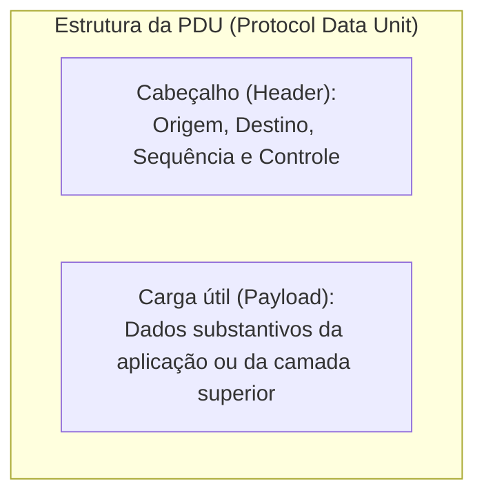
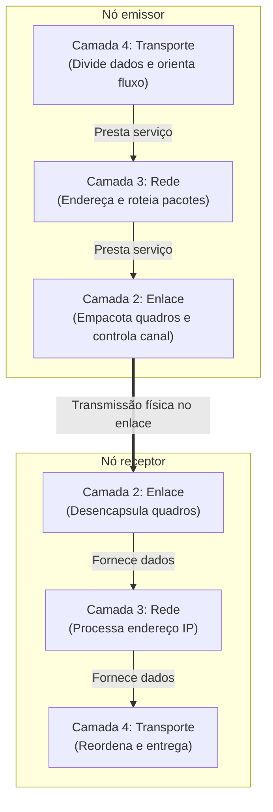

# Terminologia e fundamentos de redes de computadores

> **Contexto:** Este artigo inaugura o estudo de Redes de Computadores estabelecendo os conceitos basilares e o vocabulário técnico universal da disciplina. A abordagem descontrói os elementos constitutivos de uma rede (nós e enlaces), as estruturas de empacotamento e transmissão de dados (PDUs e quadros), as modalidades de endereçamento e difusão de tráfego (unicast, multicast e broadcast), as métricas de desempenho de canal (vazão, atraso e perda de pacotes) e a organização da comunicação em camadas e serviços orientados ou não à conexão.

Uma **rede de computadores** é um conjunto de dois ou mais dispositivos autônomos interconectados com capacidade para emitir, receber e processar dados por meio de canais de comunicação compartilhados. Compreender o funcionamento da Internet e de infraestruturas locais exige separar com rigor os componentes físicos que realizam a transmissão dos modelos lógicos e protocolos que coordenam a troca inteligível de informações.

## Elementos constitutivos: nós, enlaces e endereçamento

Toda comunicação em rede depende de entidades ativas e de meios de propagação de sinais:

* **Nó (*Node*):** elemento ativo conectado à rede com capacidade de emitir, receber e processar dados. Computadores pessoais, servidores, roteadores, switches e impressoras de rede são nós típicos.
* **Enlace (*Link*):** canal físico ou sem fio que interliga diretamente dois nós vizinhos. Pode ser implementado por cabos de cobre de par trançado (sinais elétricos), fibras ópticas (pulsos de luz) ou radiofrequência/Wi-Fi (ondas eletromagnéticas).

Para que mensagens transitem entre nós ao longo de múltiplos enlaces, cada dispositivo necessita de identificação unívoca em dois níveis:

| Nível de endereçamento | Exemplo | Analogia (Técnica de Feynman) | Escopo e características |
| --- | --- | --- | --- |
| **Endereço físico (MAC Address)** | `00:1A:2B:3C:4D:5E` | O **DNA** biológico de uma pessoa: é gravado de fábrica na placa de rede, permanente e universalmente único para aquela interface. | Endereçamento de controle de acesso ao meio (*Media Access Control*, MAC). Identifica o hardware diretamente dentro do enlace local. |
| **Endereço lógico (IP Address)** | `192.168.1.10` ou `200.18.14.5` | O **CPF ou endereço postal**: documento atribuído dinamicamente ou administrativamente conforme a localização da pessoa. | Endereçamento de protocolo Internet (*Internet Protocol*, IP). Permite o roteamento e a localização hierárquica do nó entre diferentes redes. |

Uma mesma placa de rede (um único endereço físico MAC) pode ser associada a múltiplos endereços lógicos IP ao longo do tempo ou simultaneamente, mas em uma sub-rede funcional cada endereço lógico deve apontar exclusivamente para uma interface física por vez para evitar conflitos de tráfego.

## Protocolos, PDU e encapsulamento de dados

A simples existência de um cabo ou sinal de rádio entre dois nós não garante a comunicação. Uma analogia clara é o telefone de barbante entre duas pessoas: se ambas colocarem a lata no ouvido ao mesmo tempo, ou se ambas falarem simultaneamente, a conversa se perde. É indispensável uma convenção mútua (como dizer "câmbio" para alternar a fala).

Um **protocolo de rede** é um conjunto formal de regras, padrões, formatos de mensagens e procedimentos que define como os nós devem emitir, sincronizar, processar e responder a transmissões de dados. É a existência de padrões universais (como a família TCP/IP) que possibilita a computadores rodando Windows, Linux, macOS ou roteadores de fabricantes diversos comunicarem-se com total transparência.

### Unidade de dados de protocolo (PDU)

Para trafegar pela rede, a informação é estruturada em blocos modulares chamados de **PDU (*Protocol Data Unit*, unidade de dados de protocolo)**. Toda PDU é composta por:
1. **Cabeçalho (*Header*):** metadados de controle contendo endereços de origem e destino, tamanho da carga, informações de ordenação e somas de verificação (*checksum*) para detecção de erros.
2. **Carga útil (*Payload*):** os dados substantivos que a aplicação deseja efetivamente transmitir.

A PDU recebe denominações específicas de acordo com a camada e o protocolo envolvido: **mensagem** na camada de aplicação, **segmento** (no protocolo TCP) ou **datagrama** (no protocolo UDP) na camada de transporte, **pacote** na camada de rede (IP), e **quadro (*frame*)** na camada de enlace. O quadro pode ser comparado ao caminhão de carga que transporta os dados pela rodovia do enlace físico.

## Modalidades de disseminação de tráfego

Conforme o destinatário da mensagem dentro da topologia da rede, a entrega pode ocorrer em três modos distintos:

* **Unicast (ponto a ponto):** transmissão direcionada exclusivamente a um único nó destinatário específico. *Analogia:* falar em particular ao pé do ouvido de uma pessoa em uma sala de reuniões.
* **Multicast (um para grupo):** transmissão direcionada a um grupo selecionado de nós que assinam determinado serviço ou canal. *Analogia:* o professor ir até o fundo da sala e falar apenas com os alunos da última fileira.
* **Broadcast (difusão universal):** transmissão enviada simultaneamente para todos os nós pertencentes àquele segmento de rede local. *Analogia:* alguém pegar um megafone e falar em voz alta para todos os presentes na sala de aula.

## Métricas fundamentais de desempenho de rede

A qualidade de um enlace ou circuito de telecomunicações é avaliada por três grandezas quantitativas operacionais:

1. **Vazão (*Throughput*):** volume de bits transmitido e processado com sucesso através de um ponto da rede por unidade de tempo, medido convencionalmente em bps (*bits por segundo*, como Mbps ou Gbps). Uma rede com vazão de 100 Mbps tem a capacidade de transferir até 100 milhões de bits a cada segundo.
2. **Atraso (*Delay* ou Latência):** tempo decorrido para que uma PDU viaje do nó de origem até a sua recepção completa no nó de destino. É composto pelo atraso de propagação no meio físico, atraso de transmissão do hardware, atraso de processamento e atraso de enfileiramento em buffers de roteadores.
3. **Perda de pacotes (*Packet Loss*):** proporção de pacotes descartados durante o trajeto antes de atingirem o destinatário. Ocorre principalmente por corrupção de bits devido a ruídos eletromagnéticos ou por descarte forçado quando as filas de memória (*buffers*) de roteadores intermediários sofrem congestionamento (*buffer overflow*).

## Arquitetura em camadas e tipos de serviços

Assim como o envio corporativo de uma carta física exige etapas sequenciais hierarquizadas (redação pelo autor → envelopamento e endereçamento pela secretária → transporte e despacho pelo mensageiro), a comunicação digital é estruturada em **camadas de abstração**.

Cada camada executa funções especializadas e oferece uma interface de **serviço** para a camada imediatamente superior, consumindo serviços fornecidos pela camada imediatamente inferior:

### Serviços orientados versus não orientados à conexão

No nível de transporte e aplicação, a comunicação pode adotar dois paradigmas fundamentais de serviço:

* **Orientado à conexão (*Connection-oriented*):** antes de qualquer envio de dados substantivos, os nós executam um processo preliminar de negociação (*handshake*) para estabelecer parâmetros mútuos de sessão (tamanho máximo de PDU, taxa de fluxo e números de sequência). Garante confiabilidade, entrega sequencial e retransmissão de dados perdidos (como no protocolo TCP).
* **Não orientado à conexão (*Connectionless*):** cada pacote ou datagrama é despachado individualmente sem negociação prévia de canal e sem garantia de entrega ou ordenação. Prioriza velocidade mínima de latência e simplicidade estrutural (como no protocolo UDP).

## Pontos que costumam gerar confusão

* **Endereço MAC versus endereço IP:** o endereço MAC é físico, gravado no hardware e local ao enlace; o endereço IP é lógico, hierárquico e roteável entre redes distintas.
* **Vazão versus largura de banda (*Bandwidth*):** largura de banda é a capacidade máxima teórica de transmissão do canal físico; vazão (*throughput*) é a taxa real de transferência útil obtida na prática sob condições de tráfego.
* **PDU versus pacote:** pacote é a denominação específica da PDU na camada de rede (camada 3); no enlace ela se chama quadro (*frame*), e no transporte se chama segmento (TCP) ou datagrama (UDP).
* **Broadcast versus Multicast:** o broadcast atinge compulsoriamente todas as máquinas do segmento de rede local; o multicast é direcionado e recebido apenas por computadores associados ao grupo específico de destino.
