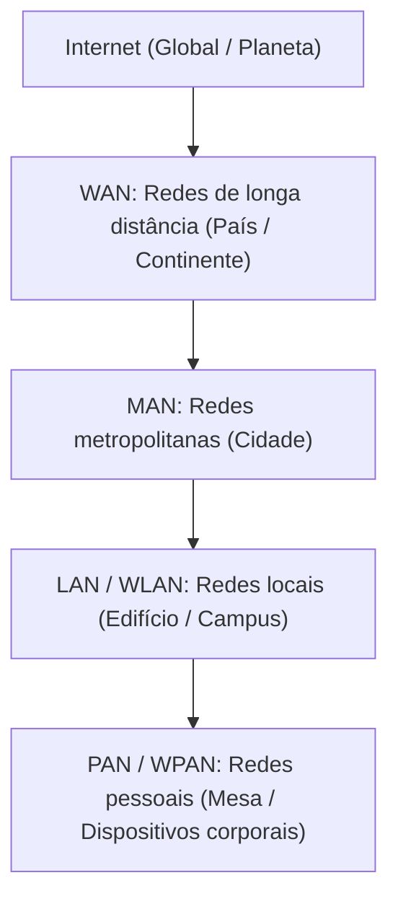
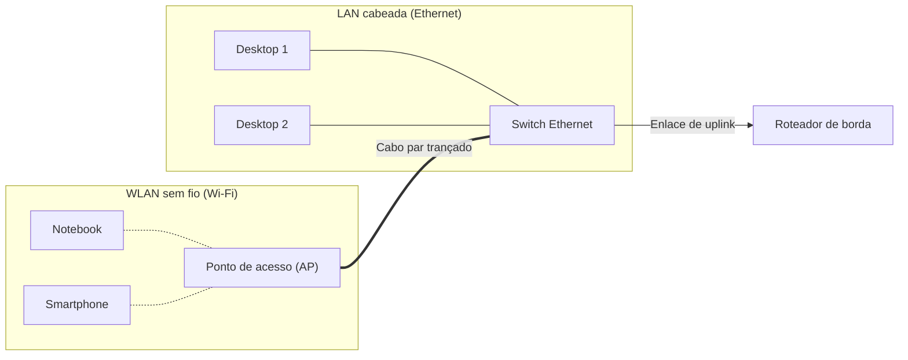

# Tipos de redes de computadores por abrangência geográfica

> **Contexto:** Após a introdução ao vocabulário fundamental e aos elementos de conectividade no [[09. Redes de Computadores/01. Terminologia e fundamentos de redes de computadores|artigo 01]], este artigo aborda a classificação taxonômica das redes de computadores com base na sua escala física e extensão geográfica. O percurso descontrói desde conexões pessoais em escala milimétrica até a interconexão planetária: redes pessoais cabeadas e sem fio (PAN e WPAN), redes locais (LAN e WLAN), redes metropolitanas (MAN), redes de longa distância (WAN) e o ecossistema global de redes interconectadas (a Internet).

A diversidade de cenários de conectividade moderna abrange desde o pareamento sem fio entre um telefone celular e um fone de ouvido até a comunicação corporativa entre filiais situadas em extremidades opostas de um continente. Para estruturar o estudo e o dimensionamento dessas infraestruturas, a ciência da computação classifica as redes a partir da sua **escala de abrangência geográfica**, parâmetro que influencia diretamente a topologia, as tecnologias físicas de enlace, as taxas de dados e as taxas de erro envolvidas.

## Taxonomia e escala geográfica segundo Tanenbaum

Na literatura clássica de Andrew S. Tanenbaum, a escala de distância física entre processadores serve como referência primária para categorizar sistemas e redes:

| Distância aproximada | Localização dos nós | Categoria de rede | Tecnologias típicas |
| --- | --- | --- | --- |
| **0,1 m a 1 m** | Metro quadrado / mesa de trabalho | **PAN** (*Personal Area Network*) / **WPAN** | USB, Bluetooth, ZigBee, UWB, RFID |
| **10 m a 1 km** | Cômodo, edifício, empresa ou campus | **LAN** (*Local Area Network*) / **WLAN** | Ethernet (par trançado/fibra), Wi-Fi (IEEE 802.11) |
| **10 km** | Cidade / região metropolitana | **MAN** (*Metropolitan Area Network*) | Redes de TV a cabo (DOCSIS), anéis de fibra óptica |
| **100 km a 1.000 km** | Estado, país ou continente | **WAN** (*Wide Area Network*) | Linhas alugadas, SONET/SDH, enlaces de telecomunicações, VPNs |
| **10.000 km** | Planeta Terra | **Internet** (Redes interconectadas) | Roteamento BGP, cabos submarinos, satélites, dorsais de Internet |

> **Precisão técnica sobre a escala prática:** Embora a escala teórica de Tanenbaum atribua até 1 metro para redes pessoais, soluções industriais e domésticas do mundo real consideram como PAN e WPAN enlaces que operam com alcance prático de até 10 metros ao redor do usuário.

## Redes de área pessoal: PAN e WPAN

A **PAN (*Personal Area Network*, rede de área pessoal)** engloba conexões de curta distância concebidas para interligar os dispositivos de uso individual de uma única pessoa em seu espaço imediato de trabalho.

Historicamente, as primeiras PANs dependiam de cabos como USB (*Universal Serial Bus*) ou FireWire, conectando computadores a teclados, mouses, scanners e impressoras. A densidade de cabos gerou a necessidade técnica de soluções sem fio, originando a **WPAN (*Wireless Personal Area Network*, rede pessoal sem fio)**.

### Principais tecnologias de WPAN

* **Bluetooth (IEEE 802.15.1):** padrão universal de interconexão de curto alcance voltado ao pareamento de dispositivos (como smartphones, fones de ouvido, sistemas automotivos e periféricos). O nome homenageia o rei escandinavo Harald Blåtand ("dente azul"), celebrado historicamente por unir tribos nórdicas divergentes.
* **ZigBee (IEEE 802.15.4):** tecnologia projetada para aplicações de IoT (*Internet of Things*, Internet das Coisas), sensores industriais e automação residencial. Opera com taxas de transmissão modestas, porém com consumo elétrico extremamente baixo, viabilizando nós cuja bateria dura anos.
* **Ultra Wideband (UWB):** tecnologia de transmissão por pulsos em faixas largas de radiofrequência, permitindo altíssimas taxas de transferência para mídia e localização espacial de extrema precisão.
* **RFID (*Radio Frequency Identification*, identificação por radiofrequência):** sistema baseado em sinais de rádio para leitura e identificação passiva ou ativa de etiquetas e cartões de proximidade.

## Redes de área local: LAN e WLAN

A **LAN (*Local Area Network*, rede local)** é o modelo mais disseminado em residências, escritórios, empresas e laboratórios acadêmicos, cobrindo uma área geograficamente restrita a um único prédio ou campus.

### Características e infraestrutura da LAN

* **Mídia de transmissão:** utiliza predominantemente cabos de par trançado com conectores RJ-45 (categoria Cat5e, Cat6 ou Cat6a) sob o padrão tecnológico **Ethernet**, além de fibras ópticas para conexões estruturadas (*backbones*).
* **Desempenho e confiabilidade:** opera convencionalmente em velocidades de 100 Mbps (*Fast Ethernet*), 1 Gbps (*Gigabit Ethernet*) até 10 Gbps (*10 Gigabit Ethernet*). Por ser instalada em ambiente fechado com cabeamento estruturado e distâncias curtas, apresenta latência reduzida e índices quase nulos de interferência eletromagnética e perda de quadros.
* **Comutação por Switch:** os nós de uma LAN são centralizados por um *switch*, dispositivo de camada 2 que comuta quadros diretamente entre as portas dos nós de origem e destino com base nos seus endereços MAC físicos.

### Redes locais sem fio (WLAN)

A necessidade de mobilidade corporativa e doméstica impulsionou o desenvolvimento da **WLAN (*Wireless Local Area Network*, rede local sem fio)**, popularizada sob a marca comercial **Wi-Fi** (família de padrões IEEE 802.11).

Em uma WLAN, os nós associam-se a um **ponto de acesso (*Access Point*, AP)** por sinais eletromagnéticos. Na arquitetura de rede, o ponto de acesso funciona como um concentrador e conversor de mídia (traduzindo quadros sem fio 802.11 para quadros Ethernet 802.3), conectando-se por cabo ao *switch* central da LAN. Dispositivos cabeados e dispositivos sem fio compartilham o mesmo domínio de rede local e comunicam-se de forma transparente.

## Redes de área metropolitana e de longa distância: MAN e WAN

Quando a necessidade de interconexão ultrapassa os limites de um campus, surgem estruturas com modelos operacionais e de custeio distintos:

### Redes de área metropolitana (MAN)

A **MAN (*Metropolitan Area Network*, rede metropolitana)** estende-se sobre o território de uma cidade ou grande centro urbano, com alcance típico na ordem de dezenas de quilômetros.

* **Exemplo pioneiro:** redes de TV a cabo, que utilizaram originalmente o cabeamento coaxial instalado nos postes das cidades para criar anéis de transmissão de dados bidirecionais (padrão DOCSIS), fornecendo internet banda larga aos domicílios.
* **Provedores de acesso (ISPs locais):** empresas provedoras de internet estruturam anéis metropolitanos de fibra óptica de alta velocidade pela cidade para interconectar bairros à sua central de roteamento.

### Redes de longa distância (WAN)

A **WAN (*Wide Area Network*, rede de longa distância)** atende à comunicação de dados entre cidades, estados, países ou continentes, operando em distâncias de centenas a milhares de quilômetros.

Ao contrário de LANs (onde a empresa instala e administra seus próprios cabos e *switches*), as corporações que precisam interligar filiais distantes contratam serviços e circuitos de operadoras de telecomunicações. Essas conexões podem utilizar tecnologias como redes ópticas SONET/SDH ou circuitos de satélite.

Modernamente, a comunicação WAN corporativa utiliza frequentemente a própria infraestrutura pública da Internet como canal de transporte, criando enlaces virtuais criptografados por meio de **VPNs (*Virtual Private Networks*, redes privadas virtuais)**.

## Redes interconectadas: a Internet

A **Internet** não é um tipo único e homogêneo de rede física, mas sim uma **interconexão mundial de milhares de redes autônomas e heterogêneas** (LANs, MANs e WANs pertencentes a governos, universidades, empresas e operadoras).

A viabilidade da Internet fundamenta-se na utilização de um conjunto comum de protocolos de comunicação: o conjunto **TCP/IP**. Quando um usuário assina um plano residencial de telecomunicações, seu computador ingressa na rede local/metropolitana do provedor; esse provedor, por sua vez, estabelece acordos de trânsito e troca de tráfego com operadoras de grande porte (*backbones* mundiais), garantindo que dados alcancem qualquer nó endereçável no globo.

## Pontos que costumam gerar confusão

* **Wi-Fi não é sinônimo de Internet:** Wi-Fi é apenas uma tecnologia de transmissão de enlace local sem fio (WLAN); um computador pode estar conectado ao Wi-Fi com sinal excelente e não ter acesso à Internet se o enlace do provedor estiver inoperante.
* **Ponto de acesso não é necessariamente roteador:** no ambiente doméstico, o aparelho fornecido pela operadora acumula três funções no mesmo gabinete físico (ponto de acesso Wi-Fi, *switch* Ethernet e roteador/modem); em termos arquiteturais, a função de interligar computadores sem fio na rede local é exclusiva do ponto de acesso, sem demandar roteamento.
* **Diferença entre PAN e LAN:** a PAN orbita estritamente o espaço pessoal imediato do usuário (alcance de até 10 metros, foco em baixo consumo e periféricos); a LAN atende a um prédio ou organização, com foco em alta vazão compartilhada e dezenas ou centenas de computadores.
* **WAN própria versus circuito alugado:** quase nenhuma organização privada é proprietária física dos cabos ou satélites de uma WAN internacional; as empresas contratam canais de transmissão de concessionárias de telecomunicações ou tunelam seu tráfego via VPNs sobre a Internet.
