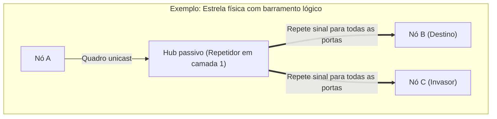
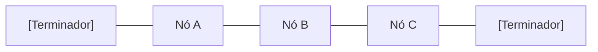
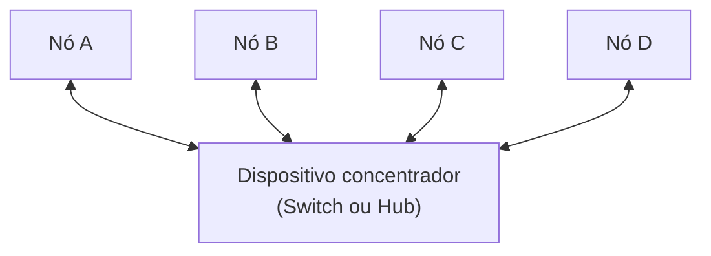
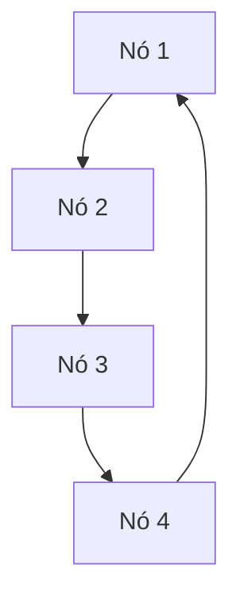
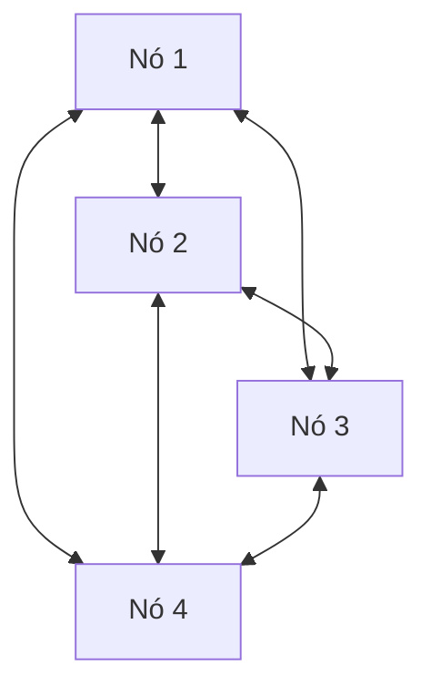

# Topologias de redes de computadores

> **Contexto:** Após o estudo da escala geográfica e das tecnologias de enlace no [[09. Redes de Computadores/02. Tipos de redes de computadores por abrangência geográfica|artigo 02]], este artigo aprofunda o arranjo estrutural das redes. A abordagem descontrói a distinção entre topologia física (a disposição geométrica dos cabos e equipamentos) e topologia lógica (a dinâmica real de propagação dos quadros), detalhando as quatro arquiteturas clássicas: barramento (*bus*), estrela (*star*), anel (*ring*) e malha (*mesh*), seus mecanismos de controle de acesso ao meio, vantagens, vulnerabilidades e o papel diferenciado de hubs e switches.

A palavra **topologia** tem origem no grego (*topos*, lugar, e *logos*, estudo), designando na computação a forma como os nós e enlaces de uma rede são organizados e interconectados. O projeto de uma rede corporativa ou industrial exige a escolha consciente da topologia mais adequada, pois ela determina o custo de cabeamento, a facilidade de expansão, os pontos únicos de falha e o comportamento do tráfego sob alta demanda.

## Topologia física versus topologia lógica

A compreensão arquitetural de redes exige separar dois conceitos que frequentemente não coincidem na prática:

* **Topologia física:** descreve o arranjo espacial real, o leiaute de instalação dos cabos, conectores e o posicionamento físico dos equipamentos na infraestrutura predial.
* **Topologia lógica:** descreve o caminho percorrido pelos sinais elétricos ou ópticos e o padrão de propagação dos quadros (*frames*) entre os nós da rede.

Um caso clássico dessa discrepância ocorre em uma rede cabeada ligada a um **hub**: fisicamente, os cabos partem de cada nó para um ponto central, formando uma estrela física; no entanto, como o hub é um mero repetidor de sinais da camada física (camada 1), o quadro recebido é replicado compulsoriamente para todas as portas. Logicamente, o comportamento é idêntico ao de um **barramento compartilhado**.

## Arquiteturas clássicas de topologia

As quatro configurações fundamentais de interconexão apresentam trade-offs estruturais específicos:

### 1. Topologia em barramento (*Bus*)

Na topologia em barramento, todos os nós compartilham um único meio de transmissão comum (um cabo contínuo). Historicamente, foi muito utilizada em redes Ethernet coaxiais (como a norma 10BASE2), onde as placas de rede conectavam-se ao cabo central por meio de conectores em formato de "T" (conectores BNC).

* **Mecanismo de propagação:** quando um nó transmite um quadro, o sinal elétrico propaga-se bidirecionalmente por toda a extensão do cabo. Cada placa de rede conectada inspeciona o endereço MAC de destino no cabeçalho: se coincidir com o seu próprio endereço, aceita o pacote; caso contrário, descarta-o.
* **Terminadores de carga:** resistores instalados nas extremidades do cabo com a função de absorver a energia dos sinais, impedindo que ondas elétricas sofram reflexão e causem colisões com novas transmissões.
* **Vantagens:** custo financeiro mínimo de implantação, baixo consumo de cabos e dispensa o uso de equipamentos concentradores centrais.
* **Desvantagens:** alta concorrência pelo meio compartilhado (apenas um nó pode falar por vez; múltiplos envios simultâneos geram colisão); baixa segurança (placas de rede configuradas em **modo promíscuo** capturam todo o tráfego do barramento); e fragilidade extrema (um único mau contato ou rompimento em qualquer ponto do cabo interrompe a rede inteira).

### 2. Topologia em estrela (*Star*)

Na topologia em estrela, cada nó possui um enlace ponto a ponto exclusivo conectado diretamente a um nó concentrador central (*switch* ou *hub*). É a arquitetura dominante nas redes locais modernas (LANs Ethernet cabeadas e WLANs).

* **Diferença de inteligência entre concentradores:**
  * **Hub (repetidor):** não possui inteligência de camada 2; replica todo quadro recebido para todas as suas demais portas, gerando colisão lógica e insegurança.
  * **Switch (comutador):** aprende os endereços MAC de cada nó conectado inspecionando o cabeçalho dos quadros e construindo uma tabela de encaminhamento em memória (*tabela CAM*). Ao receber um quadro, comuta o sinal exclusivamente para a porta correspondente ao nó de destino, eliminando colisões e isolando o tráfego.
* **Vantagens:** alta facilidade de manutenção e expansão (adicionar ou desconectar um nó não interfere nos demais); isolamento de falhas (o rompimento de um cabo afeta unicamente o dispositivo a ele conectado).
* **Desvantagens:** dependência crítica do nó central (se o switch sofrer pane, toda a rede ligada a ele para); consumo de cabeamento superior ao do barramento.

### 3. Topologia em anel (*Ring*)

Na topologia em anel, cada nó é conectado a exatamente dois outros nós vizinhos, fechando um circuito fechado e unidirecional de transmissão.

* **Mecanismo do Token Ring:** para eliminar colisões de pacotes no anel compartilhado, protocolos clássicos como o Token Ring utilizam um padrão baseado na posse de um **token** (um bloco especial de controle que circula continuamente pelo circuito). *Analogia da caneta:* em uma sala de reuniões com várias pessoas, estabelece-se que apenas quem estiver segurando a caneta tem autorização para falar; após concluir, a caneta é repassada para a pessoa seguinte.
* **Aplicações metropolitanas:** além de redes locais legadas, anéis com redundância de fibra óptica (como anéis duplos autorregeneráveis) são largamente empregados em redes metropolitanas (MANs) e operadoras de telecomunicações.
* **Vantagens:** todos os nós possuem oportunidades equivalentes de acesso ao canal; desempenho previsível e estável sob cargas pesadas de tráfego.
* **Desvantagens:** dependência sequencial (em anéis simples, o desligamento ou pane de uma máquina intermediária rompe o circuito e derruba toda a rede); inserção complexa de novos nós.

### 4. Topologia em malha (*Mesh*)

Na topologia em malha, os nós possuem enlaces múltiplos diretos entre si, criando caminhos alternativos e redundantes para o tráfego de dados.

* **Malha completa versus malha parcial:** em uma malha completa, todo nó conecta-se a todos os demais nós da rede (exigindo \( \frac{n(n-1)}{2} \) enlaces); em uma malha parcial, mantêm-se enlaces redundantes apenas entre os nós mais críticos.
* **Redes sem fio Mesh e medição inteligente:** a topologia em malha é a base das modernas redes sem fio *Mesh* e da infraestrutura de telemetria inteligente de concessionárias elétricas. Medidores residenciais atuam simultaneamente como pontos de coleta e como roteadores repetidores, repassando dados de vizinho a vizinho até a central. Caso um ponto saia do ar, a malha recalcula o percurso autonomamente (*self-healing*).
* **Vantagens:** máxima robustez e tolerância a falhas (a quebra de uma rota é absorvida por caminhos alternativos sem interrupção do serviço).
* **Desvantagens:** custo e complexidade de cabeamento proibitivos para redes cabeadas extensas.

## Quadro comparativo de topologias

| Critério | Barramento | Estrela (com Switch) | Anel | Malha (*Mesh*) |
| --- | --- | --- | --- | --- |
| **Custo de implantação** | Muito baixo | Moderado | Moderado | Elevado (cabos/interfaces) |
| **Ponto único de falha** | O próprio cabo principal | O switch central | Qualquer nó (em anel simples) | Inexistente (alta redundância) |
| **Isolamento de falhas** | Péssimo (difícil diagnóstico) | Excelente | Ruim | Excelente |
| **Desempenho sob carga** | Degrada rápido por colisão | Alto (comutação dedicada) | Previsível (controlado por token) | Altíssimo |
| **Aplicação típica atual** | Redes legadas e sensores simples | Redes corporativas e domésticas | MANs de fibra óptica de operadoras | Redes Wi-Fi Mesh e IoT industrial |

## Pontos que costumam gerar confusão

* **Topologia física versus topologia lógica:** a forma como os cabos estão dispostos visualmente no forro do prédio (física) não garante que os sinais trafeguem daquela forma (lógica); um hub forma estrela física, mas opera como barramento lógico.
* **Modo promíscuo:** placas de rede normais descartam quadros cujo endereço MAC de destino seja diferente do seu; quando configuradas em modo promíscuo (usadas por ferramentas de diagnóstico e ataque como Wireshark), a placa captura todos os quadros que cruzam o canal compartilhado.
* **Função dos terminadores de barramento:** terminadores não servem para "fechar o circuito elétrico" como em uma lâmpada, mas sim para evitar a reflexão do sinal (o efeito de "eco" eletromagnético nas pontas abertas do cabo).
* **Malha em ambientes sem fio:** embora a malha cabeada seja cara devido à proliferação de cabos, a topologia em malha sem fio (*Wireless Mesh*) é barata e extremamente flexível, pois os enlaces são conexões lógicas de rádio autoconfiguráveis.
