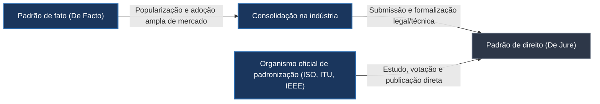
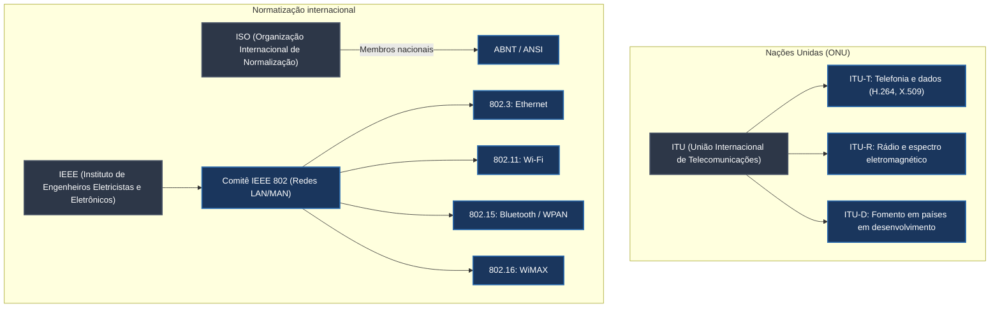
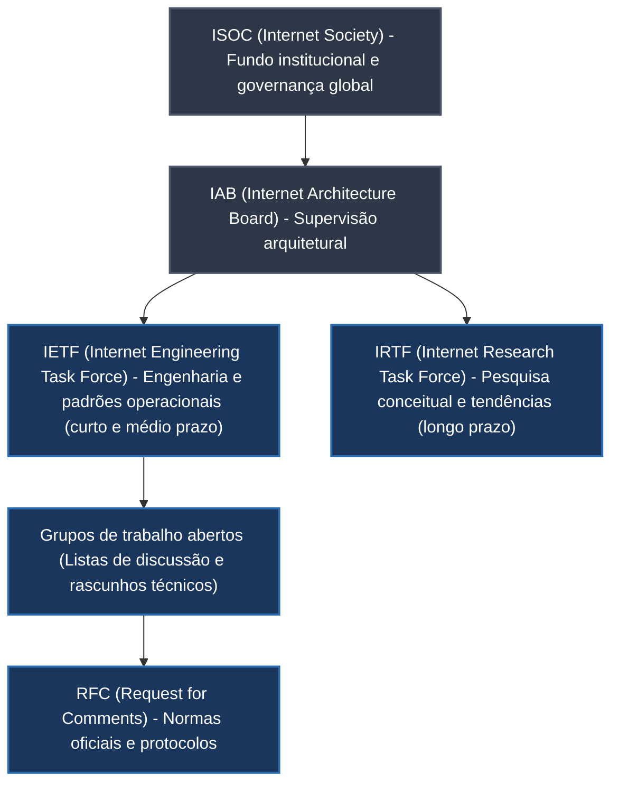

# Padronização de redes de computadores e organismos internacionais

A viabilidade técnica e a expansão global das redes de computadores dependem diretamente da padronização e da interoperabilidade. Sem especificações públicas e regras uniformizadas, dispositivos de fabricantes distintos operariam como ilhas isoladas incapazes de negociar sinais elétricos, formatos de cabeçalhos ou fluxos de dados.

Historicamente, a padronização em redes pode ser comparada à definição das bitolas em ferrovias: se cada região ou companhia construísse trilhos com espaçamentos arbitrários, trens de uma malha não conseguiriam ingressar na outra, inviabilizando o transporte interestadual e forçando transbordos caros e ineficientes. Nas telecomunicações e na computação distribuída, os padrões atuam como essa bitola universal, assegurando que hardware e software construídos em diferentes continentes conversem em harmonia e competitividade.

## Natureza e classificação dos padrões: de fato versus de jure

Um padrão consiste em um conjunto formal de regras, formatos, procedimentos, características elétricas e especificações de protocolos concebidos para garantir que múltiplos sistemas e componentes cooperem sem atrito. No ecossistema tecnológico, as normas classificam-se quanto à sua origem em duas categorias essenciais:

Um **padrão de fato** (*de facto*, expressão em latim que significa "na prática" ou "de fato") surge quando determinado protocolo, formato de arquivo ou interface proprietária atinge popularidade esmagadora e adoção em massa no mercado. Por força de conveniência econômica e efeito de rede, outros fabricantes passam a adotar voluntariamente aquela especificação para não perderem mercado. Já um **padrão de direito** (*de jure*, que significa "por lei" ou "por direito") é uma especificação formalmente debatida, aprovada, regulamentada e publicada por um órgão oficial de padronização nacional ou internacional reconhecido por governos e indústrias.

Com frequência, inovações bem-sucedidas iniciam sua trajetória como padrões de fato e, à medida que sua relevância transcende uma única empresa, são submetidas a comitês normativos para que se convertam em padrões de direito abertos e documentados, eliminando amarras proprietárias e assegurando longevidade tecnológica.

## Principais organismos internacionais de telecomunicações e indústria

Diversas entidades globais dividem atribuições na normatização de camadas físicas, elétricas, enlace de dados e telecomunicações internacionais:

A **ITU (*International Telecommunication Union*, União Internacional de Telecomunicações)**, fundada em 1865 para coordenar a telegrafia entre nações europeias, tornou-se agência especializada das Nações Unidas em 1947. Sua atuação organiza-se em três divisões: a **ITU-T** (setor de telecomunicações, responsável por padrões de sinalização telefônica, comunicação de dados e compressão de mídia, como a norma H.264 para vídeo e as especificações de certificados digitais X.509); a **ITU-R** (setor de radiocomunicação, encarregado da gestão e divisão do espectro eletromagnético internacional); e a **ITU-D** (setor de desenvolvimento, que articula investimentos de infraestrutura para inclusão digital).

A **ISO (*International Organization for Standardization*, Organização Internacional de Normalização)**, fundada em 1947, funciona como federação global cujos membros são os órgãos oficiais de normalização de cada nação, como a ABNT (*Associação Brasileira de Normas Técnicas*) no Brasil e a ANSI (*American National Standards Institute*) nos Estados Unidos. As normas ISO são desenvolvidas por comitês técnicos e grupos de trabalho a partir de um processo formal de consenso diplomático e industrial, exigindo a circulação de rascunhos de comitê (*committee drafts*) e minutas internacionais antes da homologação final.

O **IEEE (*Institute of Electrical and Electronics Engineers*, Instituto de Engenheiros Eletricistas e Eletrônicos)** destaca-se na área de engenharia de computação pelo **Comitê 802**, estabelecido em fevereiro de 1980 para padronizar redes de área local e metropolitana. Esse comitê gerou especificações universais para o mercado de conectividade:

| Subcomitê IEEE | Tecnologia correspondente | Meio e características centrais |
| --- | --- | --- |
| **IEEE 802.3** | **Ethernet** | Comunicação cabeada por par trançado e fibra óptica com detecção de colisão (CSMA/CD). |
| **IEEE 802.5** | **Token Ring** | Arquitetura legada em anel com passagem determinística de bastão (*token*). |
| **IEEE 802.11** | **Wi-Fi** | Redes locais sem fio (*WLAN*) operando em frequências de 2,4 GHz, 5 GHz e 6 GHz. |
| **IEEE 802.15** | **WPAN (Bluetooth / ZigBee)** | Redes pessoais sem fio de baixo alcance e consumo otimizado de energia. |
| **IEEE 802.16** | **WiMAX** | Acesso de banda larga sem fio metropolitano de longo alcance. |

A designação numérica vista em manuais e caixas de produtos de consumo (como adaptadores USB Wi-Fi descritos com o termo `802.11`) indica diretamente a conformidade do hardware com as especificações elaboradas pelo respectivo grupo de trabalho do IEEE.

## Governança da Internet: ISOC, IAB, IETF e IRTF

Enquanto entidades tradicionais como ISO e ITU operam segundo protocolos diplomáticos formais entre delegações estatais, o desenvolvimento normativo da Internet fundamentou-se em uma cultura pragmática, descentralizada e baseada em testes práticos (*running code*):

A **ISOC (*Internet Society*)**, estabelecida em 1992, é a organização sem fins lucrativos que promove o desenvolvimento aberto, a evolução contínua e o acesso global à Internet. A ISOC atua como mantenedora institucional das entidades de engenharia da rede, promovendo cooperação internacional e capacitação tecnológica em economias emergentes.

O **IAB (*Internet Architecture Board*, Conselho de Arquitetura da Internet)** atua como órgão consultivo de alto nível e comitê técnico da ISOC, responsabilizando-se pela integridade arquitetural do conjunto de protocolos TCP/IP, atribuição de parâmetros fundamentais e coordenação de relações externas com outros órgãos mundiais.

A **IETF (*Internet Engineering Task Force*, Força-Tarefa de Engenharia da Internet)** é o organismo primordial encarregado de desenvolver, testar e manter os padrões operacionais que fazem a Internet funcionar. Diferentemente da maioria das entidades tradicionais, a IETF não impõe afiliação formal, taxas associativas ou barreiras diplomáticas: qualquer engenheiro, pesquisador ou profissional pode ingressar em um grupo de trabalho (*Working Group*), acompanhar debates técnicos por listas de e-mails abertas e colaborar na confecção de minutas técnicas (*Internet-Drafts*).

As decisões no âmbito da IETF não dependem de unanimidade nem de eleições burocráticas estritas, mas sim do princípio histórico formulado por David Clark: *"Rejeitamos reis, presidentes e votações; acreditamos em consenso aproximado e código em execução"*. O **consenso aproximado** (*rough consensus*) assegura que o processo avance quando a liderança técnica julga que as objeções fundamentais foram respondidas e que a visão dominante da comunidade resolve adequadamente o problema, priorizando implementações práticas testadas em redes reais.

Enquanto a IETF concentra-se em soluções de curto e médio prazo demandadas pela operação imediata da Internet, a **IRTF (*Internet Research Task Force*, Força-Tarefa de Pesquisa da Internet)** direciona suas pesquisas para o longo prazo, investigando arquiteturas experimentais, criptografia avançada e protocolos de próxima geração que subsidiarão futuras demandas operacionais.

## O ciclo de documentos RFC e a especificação de protocolos

Os padrões da Internet publicados pela IETF assumem a denominação histórica de **RFC (*Request for Comments*, Pedido de Comentários)**. O nome originou-se em 1969 durante os primórdios da ARPANET, quando os pioneiros da rede utilizavam o título despretensioso para encorajar a comunidade acadêmica a criticar e aprimorar propostas técnicas em aberto.

Um documento nasce como um rascunho temporário de discussão chamado **Internet-Draft**. Caso o projeto amadureça no respectivo grupo de trabalho e receba validação por múltiplas implementações de software independentes, o texto é submetido à revisão do editor de RFCs e do IESG (*Internet Engineering Steering Group*). Quando aprovado, o documento recebe uma numeração sequencial fixa e imutável que nunca mais é alterada. Se um protocolo sofrer atualizações futuras ou correções estruturais, uma nova RFC com número próprio é emitida, tornando a RFC anterior obsoleta (*obsoleted by*) ou atualizada (*updated by*).

As RFCs fornecem a base descritiva e matemática que programadores e engenheiros de rede consultam para desenvolver navegadores, servidores web, sistemas operacionais e roteadores. Exemplos notórios de normas publicadas por RFCs incluem:
- **RFC 791:** Especificação do Protocolo IP (*Internet Protocol*), definindo cabeçalho de pacotes e classes de endereçamento;
- **RFC 793:** Protocolo de Controle de Transmissão (*Transmission Control Protocol* - TCP), definindo handshakes, ordenação e controle de congestionamento;
- **RFC 2616 e RFC 7230 / 9110:** Especificações sucessivas do Protocolo de Transferência de Hipertexto (*Hypertext Transfer Protocol* - HTTP).

## Padronização da World Wide Web: W3C e protocolos de aplicação

É fundamental distinguir conceitualmente a infraestrutura de transporte e roteamento da rede (a Internet) dos sistemas distribuídos que operam sobre ela. A **World Wide Web (Web)** é uma aplicação que utiliza a infraestrutura da Internet para disponibilizar documentos interconectados por hipertexto e hipermídia.

A Web possui seu próprio órgão diretor de padronização, o **W3C (*World Wide Web Consortium*, Consórcio World Wide Web)**, fundado em 1994 por Tim Berners-Lee, o criador original da Web no CERN. O consórcio reúne instituições de pesquisa, organizações governamentais e gigantes da indústria de tecnologia com a missão de desenvolver linguagens de apresentação, interfaces de programação e diretrizes universais de acessibilidade e semântica.

O W3C é responsável pela especificação e evolução de normas estruturais do ecossistema Web moderno:
- **HTML (*HyperText Markup Language*):** Linguagem de marcação fundamental para estruturação do conteúdo de páginas e aplicações;
- **CSS (*Cascading Style Sheets*):** Mecanismo de folhas de estilo em cascata para separação completa entre conteúdo e camada visual;
- **XML (*eXtensible Markup Language*):** Sintaxe padrão para representação hierárquica e intercâmbio de dados estruturados;
- **WCAG (*Web Content Accessibility Guidelines*):** Diretrizes internacionais que asseguram a usabilidade de serviços digitais por pessoas com deficiência sensorial ou motora.

A cooperação entre o W3C (padronizando a camada de apresentação e formatação na aplicação) e a IETF (padronizando os protocolos de transporte e de requisição/resposta como HTTP e WebSockets) garante que qualquer navegador web em qualquer dispositivo interprete código e renderize interfaces com previsibilidade e fidelidade.

## Pontos que costumam gerar confusão

- **Padrão de fato não significa ausência de regra:** Uma especificação de fato possui regras rígidas e precisas de formato (geralmente criadas por uma empresa líder); a diferença reside no fato de não ter sido originada por um órgão de normalização institucional.
- **A IETF não vende nem cobra por suas especificações:** Todas as RFCs e padrões da Internet são documentos públicos, gratuitos e acessíveis na íntegra para qualquer pessoa, o que fomentou a democratização planetária da tecnologia.
- **Uma RFC nunca tem seu conteúdo editado após ser publicada:** Se houver erros ou evolução técnica de um protocolo, a numeração da RFC permanece intacta e histórica, emitindo-se uma nova RFC que substitui formalmente a anterior.
- **O IEEE 802.11 não é sinônimo estrito do selo comercial Wi-Fi:** O IEEE redige a norma técnica de engenharia de radiofrequência e enlace (802.11a/b/g/n/ac/ax/be), enquanto a *Wi-Fi Alliance* é uma associação de fabricantes privada que realiza testes de conformidade e concede a marca comercial registrada "Wi-Fi".
- **A Internet e a Web não são a mesma entidade:** A Internet é a infraestrutura física e lógica global de redes interconectadas governada por órgãos como IETF e IAB, enquanto a Web é um serviço de aplicação centrado em hipertexto que opera sobre a Internet, cujos padrões são guiados pelo W3C.
