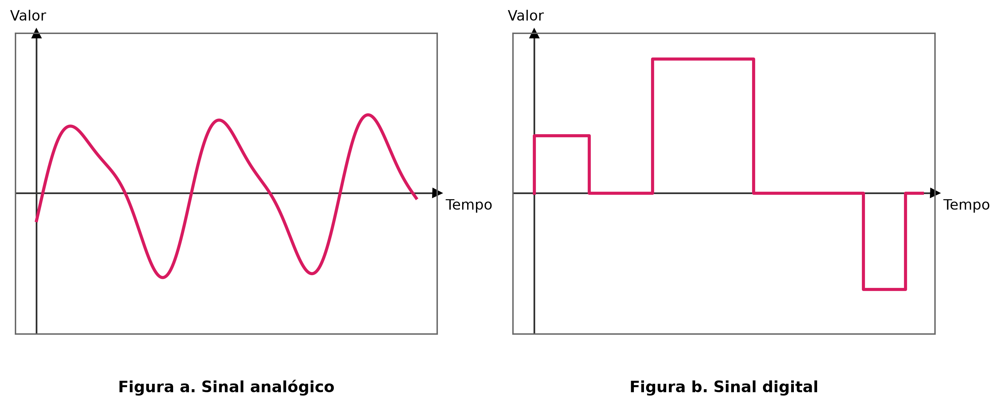
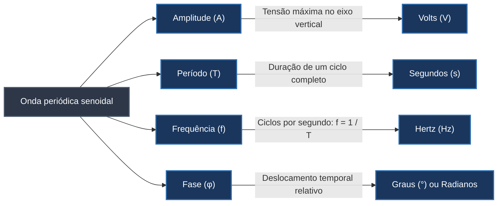

# Sinais na transmissão de dados: analógicos, digitais e parâmetros de onda

A transmissão de informações entre sistemas computacionais distribuídos depende da capacidade de converter dados lógicos em fenômenos físicos capazes de transitar por um meio de comunicação. Seja por variações de corrente elétrica em condutores de cobre, feixes de luz modulados em cabos de fibra óptica ou ondas de radiofrequência propagadas pelo ar, o elemento intermediário que transporta a informação é o **sinal**.

Para visualizar o mecanismo, imagine o recurso clássico dos sinais de fumaça empregado para comunicação à distância entre aldeias isoladas: a fumaça propriamente dita atua como o meio portador, mas a informação transmitida resulta da interrupção cadenciada e do formato imposto às nuvens, seguindo um código compartilhado entre emissor e receptor. Nos sistemas de telecomunicações modernos, variações intencionais de grandezas eletromagnéticas desempenham exatamente esse papel, permitindo que sequências binárias de bits sejam codificadas, propagadas e decodificadas sem ambiguidade.

## Sinais analógicos versus sinais digitais

Os sinais utilizados em telecomunicações classificam-se fundamentalmente em duas categorias segundo a natureza de sua variação temporal e de seus níveis de tensão ou intensidade:

Um **sinal analógico** é caracterizado pela continuidade no tempo e na amplitude. Ao transitar entre dois níveis distintos (por exemplo, de 0 V para 1 V), a onda assume infinitos valores intermediários de forma suave e gradual (passando por 0,1 V, 0,2 V, 0,5 V, 0,999 V até atingir o patamar final). Ondas de rádio, áudio captado por microfones e transmissões em linhas telefônicas tradicionais constituem exemplos típicos de grandezas analógicas.

Em contrapartida, um **sinal digital** apresenta variação discreta no tempo e na amplitude. Em vez de flutuar por infinitos estados intermediários, ele salta instantaneamente entre um número finito e bem definido de níveis de tensão (comumente representados por níveis altos e baixos, como +5 V e 0 V, gerando um formato de onda quadrada). Essa natureza discreta confere aos sinais digitais maior imunidade a ruídos eletromagnéticos de baixa intensidade, uma vez que pequenas flutuações de tensão podem ser filtradas e arredondadas para o nível lógico de referência sem corromper o bit transmitido.

| Característica | Sinal analógico | Sinal digital |
| --- | --- | --- |
| **Comportamento temporal** | Variação contínua e suave ao longo do tempo. | Variação discreta em saltos instantâneos de nível. |
| **Níveis de valor** | Assume um número teoricamente infinito de valores intermediários. | Restringe-se a um conjunto discreto e finito de estados (ex.: binário 0 e 1). |
| **Sensibilidade a ruído** | Alta; qualquer atenuação ou interferência deforma a informação original. | Menor; permite regeneração limpa do sinal por repetidores digitais. |
| **Aplicações típicas** | Rádio AM/FM, telefonia analógica tradicional, sensores contínuos. | Barramentos de computador, redes Ethernet cabeadas, portas USB. |

## Parâmetros fundamentais das ondas periódicas

Embora alguns sinais de dados sejam aperiódicos e irregulares, o estudo das ondas periódicas (especialmente a onda senoidal) fornece o fundamento matemático para a engenharia de transmissão. Um **sinal periódico** completa um padrão de oscilação em determinado intervalo e repete esse mesmo padrão de maneira idêntica em ciclos sucessivos.

Uma onda periódica senoidal é caracterizada por quatro propriedades interdependentes:

A **amplitude** corresponde ao valor máximo de intensidade, voltagem ou potência atingido pela onda em relação ao seu eixo de equilíbrio (eixo Y). Na transmissão elétrica, uma amplitude mais elevada indica maior potência de sinal injetada no cabo condutor, o que auxilia na superação de perdas causadas pela resistência física do meio.

O **período ($T$)** representa o tempo necessário, medido em segundos, para que o sinal execute um ciclo oscilatório completo (do ponto inicial ao encerramento da repetição).

A **frequência ($f$)** mede a quantidade de ciclos completos que a onda executa no intervalo de um segundo. Sua unidade no Sistema Internacional é o **Hertz (Hz)**, em que 1 Hz equivale a exatamente 1 ciclo por segundo. Frequência e período são grandezas matematicamente inversas:

$$f = \frac{1}{T} \quad \Longleftrightarrow \quad T = \frac{1}{f}$$

Se um sinal de controle elétrico opera na frequência de 12 Hz, isso significa que ocorrem 12 oscilações completas em cada segundo, resultando em um período de:

$$T = \frac{1}{12} \approx 0{,}0833 \text{ segundos (83,3 milissegundos)}$$

A **fase ($\phi$)** descreve o posicionamento ou deslocamento angular do primeiro ciclo da onda em relação à origem temporal ($t = 0$), sendo expressa em graus ou radianos. Uma onda com fase de 0° inicia sua subida exatamente na coordenada zero. Se o sinal sofrer um atraso temporal equivalente a um quarto de ciclo, sua fase é rotulada como 90° ($\pi/2$ radianos); se iniciar seu ciclo com inversão de meio período, sua fase corresponde a 180° ($\pi$ radianos).

## Comprimento de onda e velocidade de propagação

Enquanto o período expressa a duração de um ciclo no domínio do **tempo**, o **comprimento de onda ($\lambda$, lê-se lambda)** representa a extensão física ocupada por um ciclo completo no domínio do **espaço** através do meio material (medido em metros ou micrômetros).

O comprimento de onda depende conjuntamente da frequência do sinal e da **velocidade de propagação ($v$)** da onda no meio físico em que trafega:

$$\lambda = v \cdot T = \frac{v}{f}$$

Para consolidar o modelo mental com a técnica de Feynman, considere a passagem de um caminhão articulado diante de uma residência: se o veículo trafega com velocidade constante de 60 km/h (o que equivale a $16{,}66 \text{ m/s}$) e seu comprimento gasta exatamente 1,2 segundos para passar diante do observador (seu período $T$), o comprimento físico do veículo é o produto direto entre a velocidade e o tempo decorrido:

$$\text{Comprimento} = 16{,}66 \text{ m/s} \times 1{,}2 \text{ s} = 20 \text{ metros}$$

Empregando a relação por frequência, o inverso do período $1{,}2 \text{ s}$ resulta em $f \approx 0{,}8333 \text{ Hz}$. Dividindo a velocidade pela frequência, obtém-se o mesmo resultado de 20 metros.

Aplicando essa mesma formulação física às telecomunicações: no vácuo e no ar, as ondas eletromagnéticas viajam aproximadamente à velocidade da luz ($c \approx 3 \times 10^8 \text{ m/s}$). Quando uma fonte emite luz vermelha visível com frequência de $4 \times 10^{14} \text{ Hz}$ em uma fibra óptica ou no espaço livre, o comprimento de onda resultante no vácuo é:

$$\lambda = \frac{3 \times 10^8 \text{ m/s}}{4 \times 10^{14} \text{ Hz}} = 0{,}75 \times 10^{-6} \text{ metros} = 0{,}75 \ \mu\text{m (micrômetros)}$$

Em meios guiados de cobre (como cabos de par trançado e coaxiais), a velocidade de propagação do sinal elétrico sofre desaceleração pela constante dielétrica do isolamento, deslocando-se tipicamente a cerca de dois terços da velocidade da luz no vácuo ($\approx 2 \times 10^8 \text{ m/s}$), o que comprime proporcionalmente o comprimento físico das ondas ao longo do cabo.

## Pontos que costumam gerar confusão

- **Sinal analógico não é sinônimo de tecnologia antiga ou inferior:** A natureza física do mundo real e dos meios de transmissão (incluindo o espectro eletromagnético de radiofrequência do Wi-Fi e da telefonia móvel) é inteiramente analógica; sistemas digitais modulam parâmetros analógicos (como amplitude, frequência ou fase) para representar bits discretos pelo ar ou cabo.
- **Frequência e comprimento de onda são grandezas inversamente proporcionais:** Quanto maior a frequência de uma onda, menor é a distância física ocupada por cada ciclo individual no espaço.
- **Período e frequência medem aspectos opostos do mesmo fenômeno temporal:** O período mede quanto tempo leva para acontecer um único ciclo, enquanto a frequência quantifica quantos ciclos cabem em um único segundo.
- **A velocidade de propagação do sinal não varia com a taxa de transmissão de dados:** O sinal elétrico propaga-se no cobre a uma fração fixa da velocidade da luz independentemente de a placa de rede estar transmitindo dados a 10 Mbps ou a 1 Gbps; a taxa em bits por segundo dita a duração temporal de cada pulso de bit, e não a velocidade física com que a onda viaja pelo condutor.
- **A fase não altera o formato nem a velocidade da onda:** Mudar a fase de um sinal desloca apenas o instante temporal em que a oscilação se inicia em relação ao referencial de sincronismo, sem modificar sua amplitude máxima ou sua taxa de ciclos por segundo.
