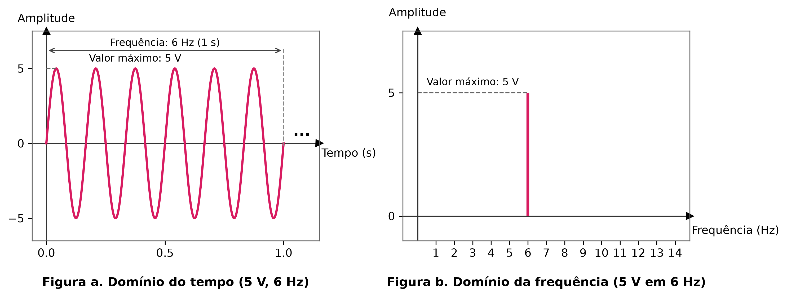
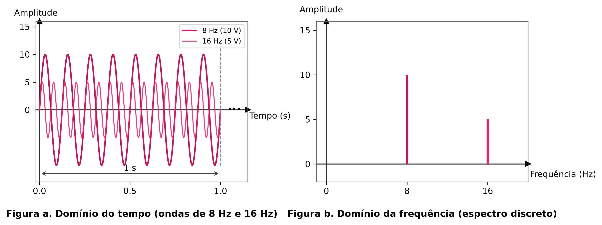
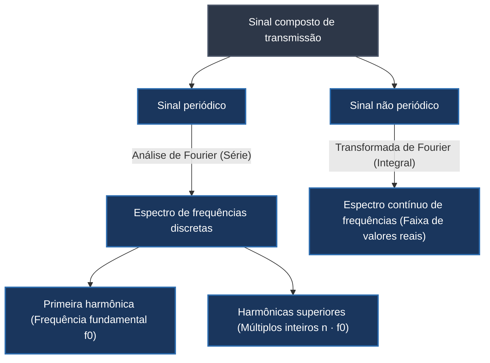
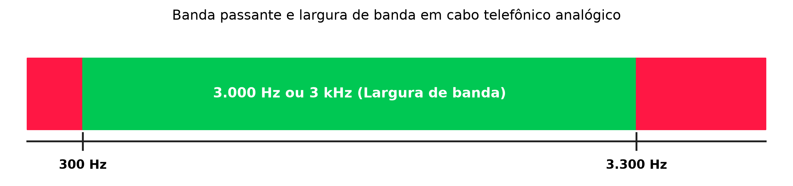

# Sinais compostos, análise de Fourier e largura de banda

Uma única onda senoidal simples possui capacidade restrita de representação. Embora uma oscilação pura de frequência fixa seja suficiente para fornecer energia elétrica em corrente alternada (como a rede de 60 Hz no Brasil) ou disparar um zumbido de alarme, ela é incapaz de transmitir a variedade dinâmica de informações exigida por sistemas de comunicação modernos. Para transmitir voz, vídeo ou sequências de dados digitais em alta velocidade, é indispensável combinar múltiplas ondas senoidais de diferentes frequências, amplitudes e fases, gerando um **sinal composto**.

A formação de sinais compostos apoia-se em um modelo mental análogo ao sistema de cores primárias RGB (*Red, Green, Blue*, vermelho, verde e azul): a partir da combinação de três cores fundamentais em proporções variadas, o olho humano percebe milhares de tonalidades distintas. Da mesma forma, ao superpor ondas senoidais simples com pesos e frequências adequados, obtém-se qualquer formato de onda arbitrário exigido para codificar informações no meio físico.

## Domínio do tempo versus domínio da frequência

A análise de sinais eletromagnéticos pode ser realizada sob duas perspectivas gráficas e matemáticas complementares: o **domínio do tempo** e o **domínio da frequência**.

No domínio do tempo, o gráfico exibe a evolução instantânea do sinal: o eixo horizontal representa o tempo decorrido (em segundos) e o eixo vertical registra a amplitude da grandeza física (em volts). Essa representação mostra a forma da onda enquanto ela se propaga pelo condutor físico.

No domínio da frequência, a perspectiva muda: o eixo horizontal passa a indicar as frequências componentes (em Hertz) e o eixo vertical preserva a amplitude máxima associada a cada uma dessas frequências. Uma onda senoidal pura, que no domínio do tempo desenha uma oscilação contínua, converte-se no domínio da frequência em uma única linha vertical discreta posicionado sobre o valor exato de sua frequência:

A superioridade analítica do domínio da frequência torna-se evidente quando múltiplos sinais compartilham o mesmo canal de comunicação. No domínio do tempo, a sobreposição visual de várias senoides produz traçados complexos e de difícil interpretação visual. Já no domínio da frequência, cada componente individual mantém-se isolada como uma barra vertical independente, facilitando a identificação imediata das frequências envolvidas e de suas respectivas potências:

## Fundamentos da análise de Fourier e decomposição harmônica

A base matemática que viabilizou a teoria moderna da comunicação foi estabelecida pelo matemático e físico francês Jean-Baptiste Joseph Fourier no início do século XIX. Em sua formulação clássica (**análise de Fourier**), ele demonstrou que qualquer sinal periódico composto pode ser decomposto em uma soma infinita (ou finita) de ondas senoidais simples.

Segundo as características temporais do sinal composto, a decomposição manifesta-se de duas formas:
- **Sinais compostos periódicos:** decompõem-se em uma série de ondas senoidais com frequências discretas ($f_0, 2f_0, 3f_0, \dots$). A componente com a menor frequência ($f_0$) dita o período fundamental de repetição do sinal e é denominada **frequência fundamental** ou **primeira harmônica**. As componentes subsequentes, cujas frequências são múltiplos inteiros da fundamental (por exemplo, $3f_0$ para a terceira harmônica ou $9f_0$ para a nona harmônica), determinam o contorno fino da forma de onda.
- **Sinais compostos não periódicos:** não apresentam ciclo fixo de repetição (como o padrão de ondas acústicas gerado pela fala humana ao articular palavras). Esses sinais decompõem-se em um espectro contínuo que abrange um conjunto infinito de frequências no domínio dos números reais (por exemplo, a voz humana produz frequências compreendidas tipicamente na faixa entre 0 Hz e 4.000 Hz).

Essa decomposição explica como pulsos digitais quadrados — comumente utilizados para codificar bits binários — são transportados fisicamente: uma onda quadrada perfeita requer uma quantidade infinita de harmônicas ímpares ($f, 3f, 5f, 7f, \dots$). Na prática de engenharia, os meios físicos transmitem apenas um subconjunto dessas harmônicas, preservando a aproximação suficiente para que o receptor reconheça os níveis lógicos originais.

## Banda passante e largura de banda de canais físicos

Ao transitar por qualquer meio de transmissão físico (cabos de cobre, fibras ópticas ou o espaço livre), as ondas eletromagnéticas sofrem perda gradual de energia, fenômeno denominado **atenuação**. 

Para compreender o impacto da distância e das propriedades do meio, considere a analogia de uma corrida a pé de longa distância: um atleta inicia a prova em ritmo acelerado, mas à medida que percorre quilômetros sob atrito com o solo, desníveis de relevo e resistência do ar, acumula fadiga física e perde intensidade. Nos cabos de rede, os sinais elétricos sofrem processo análogo: a resistência ôhmica do metal e a capacitância do isolamento atenuam intensidades, e esse desgaste é diretamente proporcional à frequência da onda transmitida.

Todo canal físico comporta-se como um filtro natural, permitindo a propagação sem deformação excessiva apenas dentro de um intervalo delimitado de frequências:

A **banda passante** é o intervalo contínuo de frequências que um determinado meio físico é capaz de conduzir sem sofrer atenuação severa ou distorções destrutivas. Em um canal telefônico tradicional de par trançado de cobre, por exemplo, frequências inferiores a 300 Hz ou superiores a 3.300 Hz sofrem atenuação drástica, estabelecendo a banda passante operacional entre 300 Hz e 3.300 Hz.

A **largura de banda ($B$)**, por sua vez, corresponde à extensão numérica dessa faixa, calculada como a diferença matemática entre a frequência máxima suportada ($f_{\max}$) e a frequência mínima suportada ($f_{\min}$):

$$B = f_{\max} - f_{\min}$$

No caso clássico da linha telefônica analógica:

$$B = 3.300 \text{ Hz} - 300 \text{ Hz} = 3.000 \text{ Hz} = 3 \text{ kHz}$$

A largura de banda constitui uma métrica determinante em redes de computadores: quanto maior a largura de banda de um canal físico (como os gigahertz oferecidos por cabos de fibra óptica em comparação com pares de cobre convencionais), maior é o volume de componentes harmônicas que o meio consegue transportar simultaneamente, elevando diretamente a capacidade teórica de transmissão de dados em bits por segundo.

## Pontos que costumam gerar confusão

- **Largura de banda e taxa de transferência de dados não são medidas na mesma unidade:** Na física das telecomunicações, largura de banda é a largura do espectro eletromagnético medida em Hertz (Hz); no jargão comercial de redes, o termo é frequentemente usado para designar a vazão de dados em bits por segundo (bps).
- **Uma onda quadrada perfeita não é um sinal simples:** Embora pareça trivial em diagramas digitais, uma onda quadrada com transições instantâneas é um sinal composto que exige infinitas frequências harmônicas para existir sem distorção.
- **O domínio da frequência não mostra a passagem do tempo:** O eixo horizontal no domínio da frequência exibe a taxa de repetição dos ciclos (Hz) e não o instante temporal; cada ponto no gráfico descreve uma propriedade permanente do componente senoidal.
- **Atenuação não é cancelamento total:** As frequências fora da banda passante não desaparecem magicamente, mas perdem tanta amplitude por calor e resistência do meio que sua potência chega ao receptor fraca demais para ser distinguida do ruído de fundo.
- **A primeira harmônica tem sempre a frequência do próprio sinal periódico:** A frequência fundamental coincide rigorosamente com o período de repetição global do sinal composto; as demais harmônicas são sempre múltiplos inteiros dessa frequência de referência.
