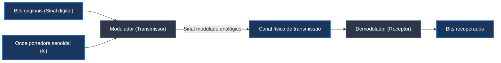
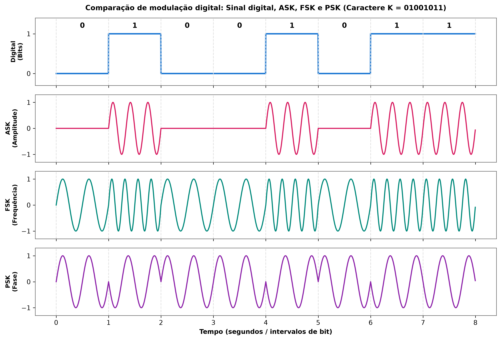
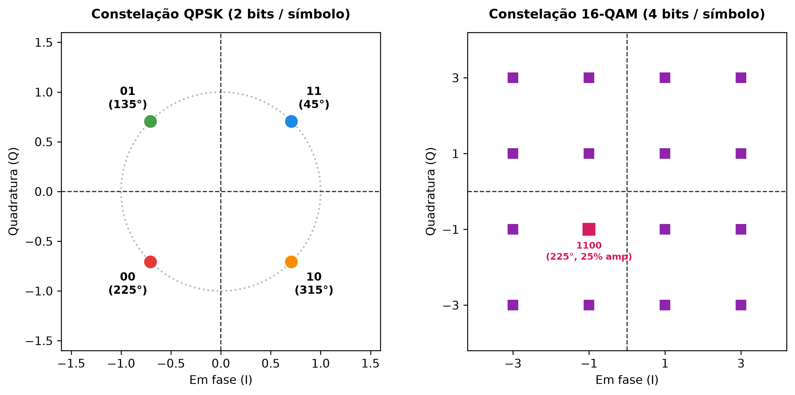

# Modulação digital: onda portadora, técnicas de chaveamento e modulação em quadratura

A transmissão de dados digitais por meios físicos analógicos (como canais de rádio, fibras ópticas e pares telefônicos de cobre) exige um mecanismo de conversão capaz de traduzir sequências lógicas de bits em perturbações eletromagnéticas que possam transitar pelo canal. Esse processo de adaptação denomina-se **modulação**, e o dispositivo historicamente encarregado de executar essa conversão mútua na borda da rede é o **modem** (acrônimo formado pela fusão dos termos *modulador* e *demodulador*).

O mecanismo apoia-se no modelo mental dos sinais de fumaça: a fumaça contínua produzida por uma fogueira atua como a **onda portadora** (*carrier wave*), responsável por conduzir a visibilidade do sinal à distância. Contudo, uma coluna de fumaça contínua e imutável não transmite mensagem alguma; é a intervenção do operador, cobrindo e descobrindo a fogueira com uma manta para criar baforadas curtas ou longas, que codifica a informação. No transmissor de dados, o **modulador** opera como o manipulador da manta, alterando parâmetros físicos da portadora de acordo com o fluxo de bits (o sinal modulante ou sinal ondulante digital). No destino, o **demodulador** analisa as variações recebidas no meio e reconstitui os bits originais entregues à aplicação receptora.

## Técnicas fundamentais de chaveamento: ASK, FSK e PSK

Como uma onda portadora senoidal pura é matematicamente definida por sua amplitude, sua frequência e sua fase, o chaveamento digital (*shift keying*) atua modificando uma ou mais dessas três propriedades fundamentais para mapear bits binários:

Tomando como exemplo de referência a transmissão do caractere `'K'`, cujo código ASCII (*American Standard Code for Information Interchange*) é 75 na base decimal e $01001011_2$ na base binária, as técnicas básicas de modulação comportam-se da seguinte maneira:

### 1. ASK (*Amplitude Shift Keying*, chaveamento por deslocamento de amplitude)
Na técnica ASK, a amplitude da onda portadora varia conforme o nível lógico do bit, mantendo a frequência e a fase constantes. Em sua variante binária mais elementar, denominada OOK (*On-Off Keying*), o bit `0` é representado pela ausência total de sinal (amplitude zero), enquanto o bit `1` é transmitido com a amplitude máxima da portadora. Embora seja simples de implementar em hardware, o ASK é altamente vulnerável a ruídos elétricos impulsivos, que afetam diretamente a amplitude das ondas no meio físico.

### 2. FSK (*Frequency Shift Keying*, chaveamento por deslocamento de frequência)
No FSK, a amplitude máxima e a fase permanecem constantes, enquanto a frequência da portadora é alternada entre dois valores discretos para expressar os níveis lógicos. Por exemplo, o bit `0` pode ser codificado por uma frequência mais baixa ($f_1 = 2 \text{ Hz}$), enquanto o bit `1` é transmitido por uma frequência mais alta ($f_2 = 4 \text{ Hz}$). Como o receptor inspeciona apenas a taxa de cruzamento por zero da onda e não sua amplitude absoluta, o FSK oferece maior imunidade contra ruídos e flutuações de ganho na linha.

### 3. PSK (*Phase Shift Keying*, chaveamento por deslocamento de fase)
Na modulação PSK binária (BPSK), tanto a amplitude quanto a frequência são mantidas inalteradas, variando-se exclusivamente o ângulo de fase da onda portadora. A convenção usual atribui fase de 0° para o bit `0` e uma inversão completa de meio ciclo (fase de 180° ou $\pi$ radianos) para o bit `1`. A detecção de transições abruptas de fase permite ótima robustez contra atenuação e ruído, sendo amplamente adotada em modems e padrões de radiofrequência.

## Taxa de transmissão versus taxa de dados: bauds e bits por segundo

Cada modificação deliberada aplicada à onda portadora durante um intervalo de tempo predefinido constitui um **símbolo**. No chaveamento binário simples (como BPSK ou ASK de dois níveis), cada símbolo transporta exatamente um único bit. Contudo, em virtude das limitações físicas de largura de banda dos canais, a engenharia de redes desenvolveu técnicas multinível capazes de codificar múltiplos bits em um único símbolo:

- **Taxa de modulação / taxa de transmissão ($S$):** representa a quantidade de alterações de sinal ou símbolos transmitidos por segundo, expressa na unidade **baud** (bauds por segundo).
- **Taxa de dados / taxa de bits ($R$):** expressa a quantidade efetiva de informação binária transmitida por segundo, mensurada em **bits por segundo (bps)**.

A relação matemática entre ambas depende do número de bits ($r$) agrupados em cada símbolo e do número total de estados ou símbolos distintos disponíveis ($M = 2^r$):

$$R = S \cdot r = S \cdot \log_2(M)$$

Quando um modem opera com ASK multinível de 4 níveis de amplitude, cada símbolo representa 2 bits ($00, 01, 10, 11$). Se a transmissão do byte correspondente à letra `'K'` ($01001011_2$) durar exatamente um segundo sob essa modulação, serão necessários apenas 4 símbolos para escoar os 8 bits. Nesse cenário:
- A taxa de transmissão é de $S = 4 \text{ bauds/s}$;
- A taxa de dados resultante é de $R = 4 \times 2 = 8 \text{ bps}$.

A taxa de dados em bps é sempre **maior ou igual** à taxa de modulação em bauds: elas coincidem apenas quando cada símbolo carrega um único bit ($r = 1$), e a taxa de bits torna-se um múltiplo da taxa de bauds sempre que técnicas de modulação de alta ordem são empregadas.

## Modulações de alta ordem: QPSK e QAM

Para maximizar a eficiência espectral sem exigir aumento da largura de banda analógica em Hertz, os sistemas modernos combinam variações angulares e amplitudes simultâneas, mapeadas visualmente por meio de **diagramas de constelação**:

### QPSK (*Quadrature Phase Shift Keying*, chaveamento por deslocamento de fase em quadratura)
O QPSK emprega quatro deslocamentos angulares de fase distintos separados por 90° para transmitir 2 bits por símbolo ($M = 4$, $r = 2$):
- $45^\circ \ (\pi/4) \implies 11$;
- $135^\circ \ (3\pi/4) \implies 01$;
- $225^\circ \ (5\pi/4) \implies 00$;
- $315^\circ \ (7\pi/4) \implies 10$.

Como cada pulso de sinal (baud) transfere 2 bits, a velocidade em bps é o dobro da taxa em bauds ($R = 2S$), preservando a largura de banda do canal.

### QAM (*Quadrature Amplitude Modulation*, modulação de amplitude em quadratura)
O QAM avança um passo além ao modular **simultaneamente a amplitude e a fase** de duas portadoras senoidais que oscilam na mesma frequência, mas desfasadas entre si em 90° (em quadratura: uma portadora em fase, $I$, e outra em quadratura, $Q$). A combinação linear dessas duas ondas resulta em uma matriz de pontos no diagrama de constelação:

| Variante QAM | Bits por símbolo ($r$) | Quantidade de símbolos ($M = 2^r$) | Eficiência e aplicação típica |
| --- | --- | --- | --- |
| **4-QAM** | 2 bits/símbolo | 4 símbolos | Matematicamente equivalente ao QPSK; modems de baixa velocidade. |
| **16-QAM** | 4 bits/símbolo | 16 símbolos | Redes cabeadas DOCSIS, TV digital e enlaces Wi-Fi intermediários. |
| **64-QAM** | 6 bits/símbolo | 64 símbolos | Wi-Fi 4 (802.11n) e redes móveis 3G/4G sob boa relação sinal-ruído. |
| **256-QAM** | 8 bits/símbolo | 256 símbolos | Redes móveis 4G LTE-Advanced e Wi-Fi 5 (802.11ac); transfere 1 byte por baud. |
| **1024-QAM / 4096-QAM** | 10 a 12 bits/símbolo | 1.024 a 4.096 símbolos | Padrões Wi-Fi 6 (802.11ax) e Wi-Fi 7 (802.11be) para enlaces de altíssima densidade. |

No diagrama de constelação do 16-QAM, por exemplo, o ponto que representa o quarteto de bits `1100` situa-se no terceiro quadrante com deslocamento angular de 225° e amplitude atenuada em 25% de sua escala máxima. Se esse mesmo ângulo de 225° for transmitido com 75% da amplitude máxima, o receptor decodificará o símbolo `1111`, demonstrando como múltiplos bits são discriminados com precisão a cada baud.

## Pontos que costumam gerar confusão

- **Baud e bit por segundo não são sinônimos:** Baud mede o número de eventos de modulação física (símbolos) transmitidos por segundo no cabo ou no ar; bps mede o volume real de dados binários transferidos. Em modulações como o 256-QAM, 1 baud transfere 8 bits por segundo.
- **Modulação não cria novos dados:** O modulador não altera o conteúdo lógico da mensagem enviada; ele apenas molda uma onda física para que o sinal digital consiga atravessar um canal cuja física é puramente analógica.
- **Ordens mais altas de QAM exigem canais mais limpos:** Um esquema como o 256-QAM ou 1024-QAM empacota os pontos da constelação muito próximos uns dos outros; qualquer ruído eletromagnético ou interferência leve pode fazer o demodulador errar o ponto e inverter bits, razão pela qual modems modernos reduzem a ordem de modulação dinamicamente quando a qualidade da linha piora.
- **O modem não atua apenas na Internet discada:** Embora o termo seja associado aos modems telefônicos legados de 56 kbps, o princípio de modulação/demodulação é empregado continuamente em roteadores Wi-Fi, modems de fibra óptica (ONU/ONT) e placas de rede de smartphones para dialogar com antenas de telefonia celular.
