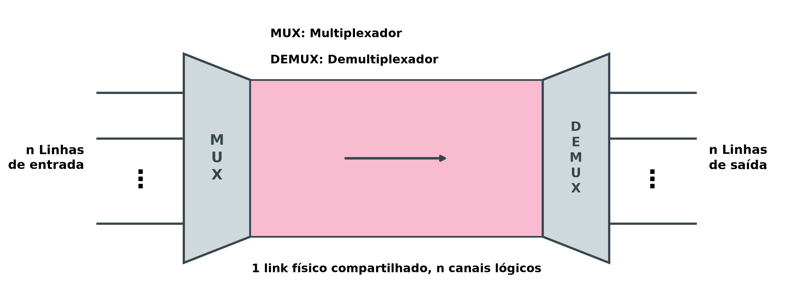
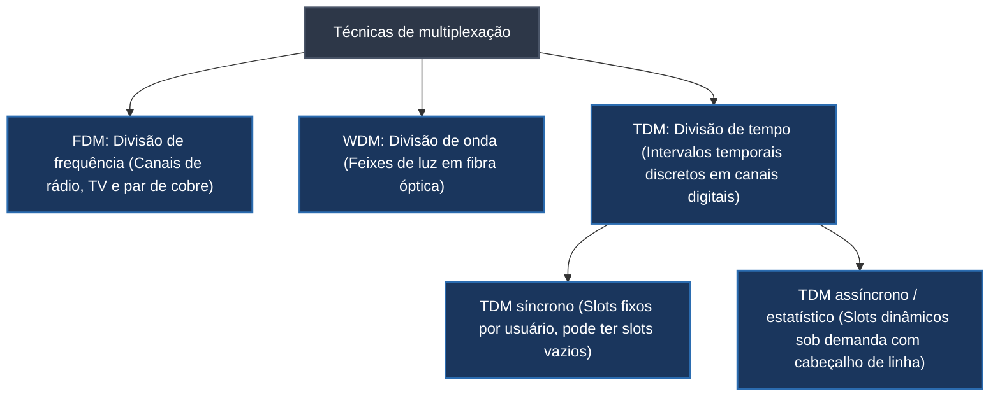
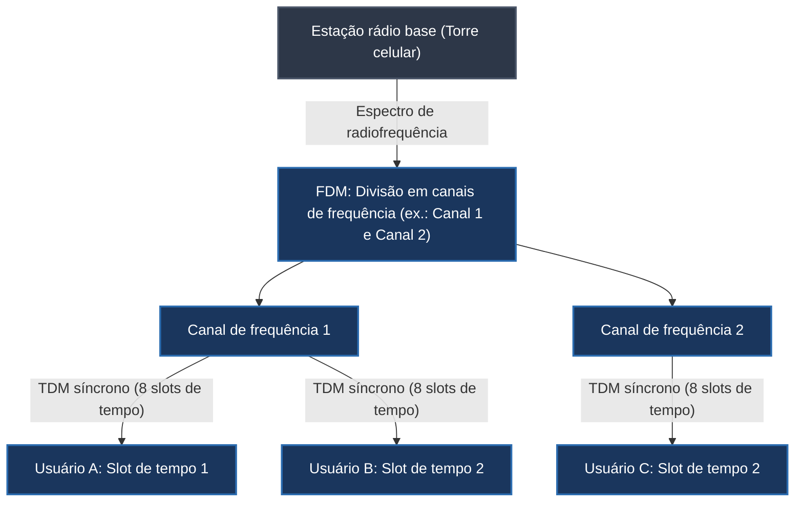

# Multiplexação em redes: compartilhamento de enlaces por FDM, WDM e TDM

A largura de banda disponível em enlaces de telecomunicações de alta capacidade (como cabos coaxiais troncais, fibras ópticas e enlaces de micro-ondas) quase sempre supera a demanda de tráfego de um único usuário ou dispositivo terminal. Se cada computador, residência ou aparelho celular exigisse uma infraestrutura física dedicada exclusiva para se conectar à rede, o custo financeiro e a complexidade de cabeamento tornariam o sistema inviável. Para solucionar essa discrepância e maximizar a eficiência econômica, emprega-se a **multiplexação**.

O modelo mental intuitivo baseia-se em uma rodovia interestadual de tráfego pesado: construir uma estrada separada e isolada para cada motorista seria um desperdício monumental de espaço e asfalto. Como a rodovia física possui largura muito superior à largura de um único veículo, o espaço é organizado e compartilhado por meio de regras formais de trânsito, dividindo o leito da estrada em várias faixas de rolamento paralelas. Na transmissão de dados, a multiplexação executa esse mesmo papel, permitindo que múltiplos fluxos lógicos de comunicação trafeguem simultaneamente pelo mesmo meio físico guiado ou não guiado.

## O processo de multiplexação: arquitetura MUX e DEMUX

Um sistema de transmissão multiplexado articula dois componentes fundamentais posicionados nas extremidades do canal de comunicação:

Na extremidade transmissora, o dispositivo concentrador denominado **multiplexador (MUX)** recebe $n$ linhas de entrada independentes e combina seus sinais em um único enlace de transmissão físico de alta capacidade, estruturado em $n$ canais lógicos. No destino, o dispositivo de recepção denominado **demultiplexador (DEMUX)** intercepta o sinal composto agregado, separa os fluxos individuais por meio de filtros ou sincronismo temporal e entrega cada mensagem à sua respectiva linha de saída correspondente.

As três técnicas clássicas de multiplexação classificam-se de acordo com o domínio físico utilizado para segregar os canais:

## FDM (*Frequency Division Multiplexing*, multiplexação por divisão de frequência)

O **FDM** é uma técnica analógica aplicável quando a largura de banda total do meio físico é significativamente maior que as larguras de banda combinadas dos sinais a serem transmitidos. O espectro do canal é fatiado em subfaixas de frequência menores, e cada sinal de entrada modula uma onda portadora distinta.

Para evitar sobreposições espectrais e interferências destrutivas entre canais adjacentes (diafonia ou *crosstalk*), intercalam-se pequenas faixas de frequências não utilizadas entre os canais, denominadas **bandas de proteção** (*guard bands*). No receptor, filtros passa-faixa sintonizados isolam a frequência central de cada canal, direcionando o sinal ao seu demodulador específico.

Aplicações práticas notórias do FDM incluem:
- **Radiodifusão FM:** A faixa comercial regulamentada estende-se de 87,5 MHz a 108,0 MHz (largura de banda total de 20,5 MHz). Essa faixa é dividida pelo órgão regulador em canais de 200 kHz (0,2 MHz). A sintonia de uma emissora (como "99,1 MHz") corresponde exatamente à frequência central da onda portadora atribuída àquela concessão.
- **Tecnologia ADSL (*Asymmetric Digital Subscriber Line*):** Utilizada amplamente no acesso à Internet por par trançado telefônico (sob marcas como Velox ou Speedy), a tecnologia divide o cabo em três canais FDM simultâneos: um canal de baixa frequência para telefonia de voz tradicional (POTS, 0 a 4 kHz), um canal intermediário para envio de dados (*upload*) e um canal de alta frequência com maior largura de banda para recepção de dados (*download*), viabilizando o uso simultâneo do telefone e da Internet na mesma linha.

## WDM (*Wavelength Division Multiplexing*, multiplexação por divisão de comprimento de onda)

O **WDM** foi concebido especificamente para explorar a altíssima largura de banda das fibras ópticas. Conceitualmente análogo ao FDM, o WDM opera no espectro eletromagnético da luz: múltiplos sinais ópticos gerados por lasers ou LEDs em comprimentos de onda distintos ($\lambda_1, \lambda_2, \lambda_3, \dots$, correspondentes a feixes de cores ou frequências ópticas diferentes) são combinados no multiplexador e injetados em um único filamento de fibra óptica.

Na prática de telecomunicações e em redes metropolitanas SONET/SDH, prismas ópticos ou redes de difração funcionam como multiplexadores e demultiplexadores passivos. Pela refração física da luz, um prisma combina múltiplos feixes angulares em um único raio composto na entrada e, na extremidade oposta, refrata o raio composto em seus comprimentos de onda componentes, direcionando cada cor a um fotodetector específico. Sistemas avançados como o DWDM (*Dense WDM*) combinam mais de uma centena de canais ópticos em uma única fibra, atingindo capacidades da ordem de terabits por segundo.

## TDM (*Time Division Multiplexing*, multiplexação por divisão de tempo)

Enquanto FDM e WDM dividem o espectro analógico em faixas contínuas, o **TDM** é uma técnica digital que compartilha o canal inteiro no domínio do tempo. Em vez de alocar uma faixa estreita para cada usuário durante todo o tempo, o canal inteiro de alta velocidade é concedido a cada transmissor por um intervalo de tempo muito curto e rotativo (**slot de tempo**).

Para visualizar o funcionamento do TDM, imagine uma reunião de trabalho em que todos os presentes desejam expressar suas ideias: para evitar tumulto e ruído coletivo, o moderador concede a palavra a cada participante por turnos rigorosos de um minuto. Ao término da fala do último integrante, a rodada recomeça com o primeiro.

O TDM opera sob duas modalidades arquiteturais:

### 1. TDM síncrono
No TDM síncrono, o tempo do enlace é dividido em quadros (*frames*), e cada quadro contém uma quantidade fixa de slots de tempo rigidamente associada a cada linha de entrada. Se houver $n$ conexões ativas na entrada, cada quadro conterá exatamente $n$ slots de tempo na mesma sequência pré-combinada ($A, B, C, \dots$).
- **Vantagem:** O hardware do demultiplexador no destino é simples, pois ele sabe que o primeiro slot do quadro sempre pertence à linha A, o segundo à linha B, e assim sucessivamente, sem necessidade de identificação embutida.
- **Desvantagem (ineficiência de capacidade):** Se uma das linhas de entrada não tiver dados para transmitir no momento da formação do quadro, seu respectivo slot de tempo viaja vazio pelo meio físico, gerando desperdício de capacidade de transmissão.

### 2. TDM assíncrono (TDM estatístico)
O TDM assíncrono resolve o desperdício de capacidade ao alocar slots de tempo dinamicamente, apenas para as conexões que efetivamente possuem dados prontos para transmissão no instante da amostragem.
- Como a posição física do slot no quadro deixa de ser fixa e previsível, cada slot de tempo precisa carregar obrigatoriamente um pequeno cabeçalho de controle contendo o **endereço ou identificador da linha de destino**, permitindo que o demultiplexador encaminhe o dado ao destinatário correto.

## Aplicações combinadas: telefonia móvel GSM

Em redes complexas de telecomunicações, as técnicas de multiplexação não são mutuamente excludentes, mas aplicadas de forma combinada e hierárquica. O padrão de telefonia celular **GSM (*Global System for Mobile Communications*)** exemplifica essa convergência prática na interface de rádio entre a torre (estação rádio base) e os aparelhos celulares:

Nesse arranjo, a operadora aplica primeiro **FDM** para fatiar o espectro eletromagnético atribuído à torre em múltiplos canais de radiofrequência de 200 kHz. Em seguida, aplica **TDM síncrono** dentro de cada canal de frequência, particionando o tempo em 8 slots cíclicos. Assim, até 8 chamadas telefônicas simultâneas de voz compartilham a mesma frequência sem colisão. Quando o usuário utiliza transmissão de dados via **GPRS (*General Packet Radio Service*)**, o sistema adota alocação dinâmica similar ao TDM assíncrono, permitindo que um único aparelho ocupe múltiplos slots vazios disponíveis para acelerar downloads.

## Pontos que costumam gerar confusão

- **Multiplexação e modulação são processos complementares, mas distintos:** Modulação altera os parâmetros de uma onda para representar dados; multiplexação agrega múltiplos fluxos modulados para que trafeguem em conjunto por um mesmo canal físico.
- **FDM e WDM compartilham o mesmo princípio físico básico:** Ambos realizam multiplexação por divisão de frequência; a distinção reside no meio e no espectro empregado (FDM lida com frequências elétricas e de rádio no cobre ou no ar, enquanto WDM opera na frequência óptica da luz em fibras ópticas).
- **No TDM síncrono, slots vazios consomem tempo de canal:** Se uma linha não emite bits, o slot reservado é transmitido como silêncio ou bytes de preenchimento, ocupando a fatia temporal correspondente no cabo.
- **TDM assíncrono não significa ausência de sincronismo elétrico:** A designação "assíncrono" ou "estatístico" refere-se à alocação não fixa dos slots aos usuários no quadro, e não à ausência de sincronismo de relógio e bits no canal físico.
- **Banda de proteção (*guard band*) não transporta dados:** A banda de proteção é um intervalo espectral deliberadamente deixado vazio entre canais FDM para evitar interferências de borda causadas por imperfeições nos filtros analógicos.
