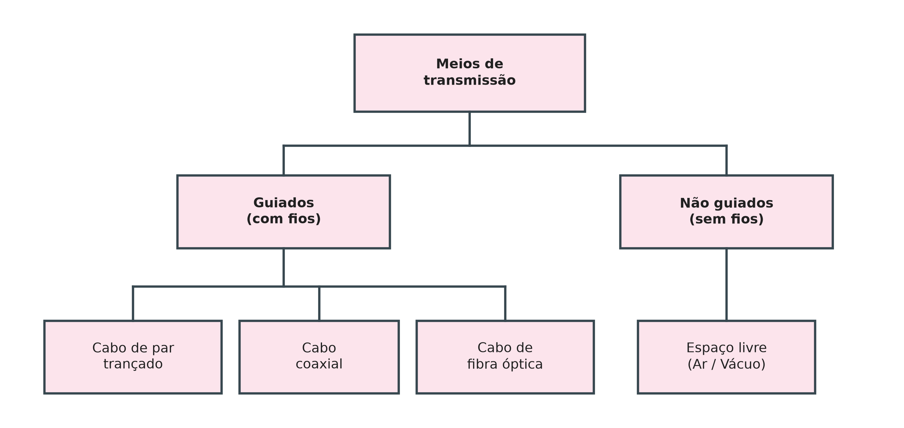
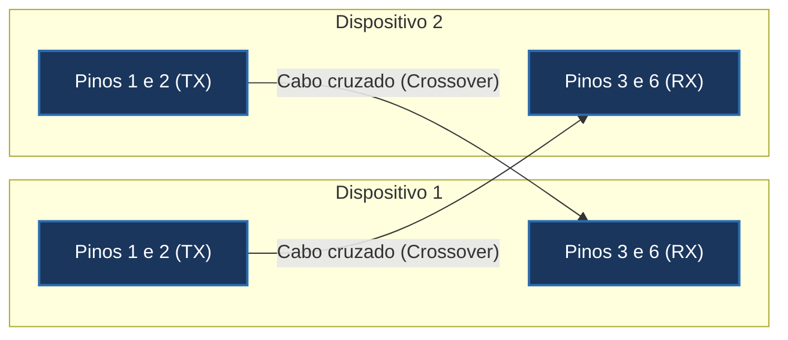
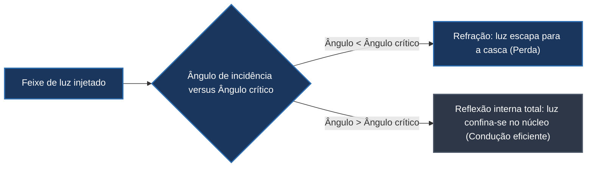
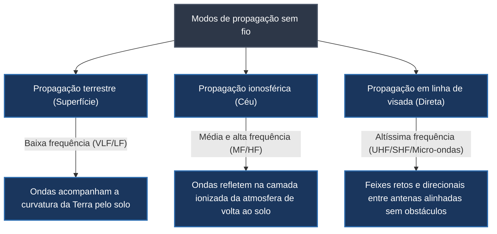

# Meios de transmissão em redes: guiados e não guiados

A camada física do modelo de referência de redes é responsável pela transmissão bruta de sequências binárias de bits entre interfaces de comunicação. Essa transferência concreta ocorre através de um **meio de transmissão**, definido como qualquer condutor material ou espaço físico capaz de propagar energia em forma de ondas eletromagnéticas ou ópticas de um transmissor até um receptor.

A escolha do meio de transmissão dita diretamente as métricas de desempenho da rede, influenciando a largura de banda máxima suportada, a taxa de atenuação com a distância, a imunidade contra ruídos eletromagnéticos externos e o custo de instalação e manutenção da infraestrutura.

## Taxonomia fundamental dos meios de transmissão

Conforme a arquitetura da camada física, os meios de transmissão dividem-se em duas grandes famílias:

Os **meios guiados (com fios)** conduzem as ondas eletromagnéticas por um caminho físico delimitado e confinado por condutores sólidos (como fios metálicos de cobre ou filamentos transparentes de vidro e plástico). Esses meios oferecem maior controle sobre o trajeto de propagação e proteção contra interceptações externas, embora demandem infraestrutura de cabeamento estruturado, passagens em eletrodutos e canaletas.

Os **meios não guiados (sem fios ou *wireless*)** transmitem e recebem ondas eletromagnéticas propagadas livremente pelo espaço (ar, atmosfera ou vácuo), sem impor contenção física à direção da radiação. Embora proporcionem alta mobilidade e facilidade de implantação em ambientes residenciais, corporativos ou áreas de topografia acidentada, o sinal irradia-se em área aberta, tornando o canal suscetível a interferências eletromagnéticas e demandando rigorosa criptografia de enlace.

## Meios guiados metálicos: par trançado e cabo coaxial

A transmissão guiada por condutores de cobre baseia-se na movimentação de elétrons induzida por diferenças de potencial elétrico. Dois tipos de cabos metálicos destacam-se nas redes de computadores:

### Cabo de par trançado (*Twisted Pair*)
O cabo de par trançado é o meio predominante em redes locais (LANs). Sua estrutura interna é composta por quatro pares de condutores de cobre isolados por polietileno, nos quais os dois fios de cada par são helicoidalmente trançados entre si:
- **Razão física do trançamento:** Em cada par, um fio conduz o sinal elétrico e o outro atua como referência de terra, operando por sinalização diferencial. Se os condutores corressem em paralelo estrito, o fio mais próximo de uma fonte de interferência externa (como motores ou lâmpadas fluorescentes) absorveria ruído elétrico muito superior ao do fio mais distante, degradando a leitura do receptor. Ao trançar os fios, ambos alternam continuamente de posição espacial, equalizando a exposição média a ruídos eletromagnéticos e cancelando emissões mútuas de diafonia (*crosstalk*).
- **Classificação por blindagem:**
  - **UTP (*Unshielded Twisted Pair*, par trançado sem blindagem):** Revestido apenas por uma capa externa de PVC; flexível, de baixo custo e amplamente adotado em cabeamento interno de escritórios.
  - **STP (*Shielded Twisted Pair*, par trançado blindado):** Possui malha ou folhas metálicas de alumínio envolvendo os pares ou o cabo global; oferece proteção superior contra ruído industrial em ambientes fabris, com custo e rigidez mecânica mais elevados.
- **Categorias (Cat5e vs. Cat6):** A designação de categoria estabelece a frequência de operação e o rigor de fabricação. Cabos Cat6 possuem maior taxa de torções por metro e um separador plástico interno em formato de cruz (*spline*) que isola os quatro pares, viabilizando taxas de 1 Gbps a 10 Gbps com baixíssima diafonia.
- **Conectores RJ-45 e pinagem TX/RX:** O par trançado conecta-se por plugues RJ-45 padronizados com 8 pinos. Em placas de rede Ethernet legadas de 10/100 Mbps, os pinos 1 e 2 são destinados à transmissão (TX) e os pinos 3 e 6 à recepção (RX). A conexão direta entre dois computadores sem equipamento intermediário exigia um cabo **crossover** (com as vias TX de uma ponta conectadas às vias RX da outra). Em redes modernas, placas e switches utilizam circuitos automáticos **Auto MDI-X**, que detectam o cabo e cruzam os sinais internamente de forma transparente.

### Cabo coaxial
O cabo coaxial é formado por um condutor central de cobre rígido envolvido por uma camada dielétrica isolante, recoberta por uma malha condutora metálica trançada que atua como blindagem e retorno de corrente, protegida por capa plástica externa. Essa geometria coaxial confere excelente imunidade a ruídos em frequências de rádio.
- **Aplicações e conectores:** Foi o alicerce das redes de barramento 10BASE2 e 10BASE5 com **conectores BNC**, adaptadores em **T BNC** e **terminadores resistivos de 50 ohms**, sendo amplamente utilizado atualmente em redes de TV a cabo e acesso em banda larga residencial via DOCSIS.

## Meios guiados ópticos: fibra óptica e princípios de reflexão interna total

A fibra óptica transporta pulsos digitais codificados em feixes de luz modulados por lasers semicondutores ou LEDs. A anatomia de um cabo óptico compreende:
1. **Núcleo (*Core*):** Filamento central cilíndrico ultra puro de vidro (sílica) ou plástico por onde a luz viaja;
2. **Casca (*Cladding*):** Camada óptica que envolve o núcleo, confeccionada com índice de refração estritamente menor que o do núcleo;
3. **Revestimento de proteção e reforço mecânico:** Fibras sintéticas de alta resistência à tração (como fios de aramida de marca comercial **Kevlar**) para proteção contra rompimento durante a passagem por dutos e postes;
4. **Capa externa (*Jacket*):** Proteção plástica impermeável contra umidade e intempéries.

O princípio físico fundamental que aprisiona a luz no núcleo é a **reflexão interna total**. Quando um feixe luminoso incide na fronteira entre dois materiais dielétricos com densidades ópticas distintas (núcleo e casca), o comportamento depende do **ângulo de incidência ($\theta$)** em relação à normal:
- Se o ângulo de incidência for menor que o **ângulo crítico ($\theta_c$)**, a luz sofre refração e escapa parcialmente para a casca, perdendo energia;
- Se o ângulo de incidência for **maior que o ângulo crítico**, o feixe sofre reflexão interna total de 100%, rebatendo continuamente nas paredes internas do núcleo como em um túnel espelhado perfeito, propagando-se por dezenas de quilômetros com atenuação insignificante.

### Modos de propagação óptica
As fibras ópticas classificam-se quanto ao diâmetro de seu núcleo e à trajetória percorrida pelos raios luminosos:

| Modo de propagação | Diâmetro do núcleo | Perfil de refração | Comportamento e aplicação |
| --- | --- | --- | --- |
| **Multimodo com índice degrau** | Grande ($\approx 50 \text{ a } 62{,}5 \ \mu\text{m}$) | Transição abrupta de densidade entre núcleo e casca. | Vários feixes percorrem caminhos de comprimentos diferentes, rebatendo em zigue-zague; sofre dispersão modal severa; distâncias curtas (até centenas de metros). |
| **Multimodo com índice gradual** | Médio ($\approx 50 \ \mu\text{m}$) | Densidade decresce suavemente do centro para as bordas. | Os raios viajam em curvas helicoidais suaves, compensando trajetórias mais longas com velocidades maiores na borda; reduz a dispersão modal. |
| **Monomodo (*Single-Mode*)** | Diminuto ($\approx 8 \text{ a } 10 \ \mu\text{m}$) | Núcleo estreito operando com fonte laser focalizada. | Permite apenas um único raio propagar-se quase em linha reta horizontal; elimina dispersão modal; ideal para backbones continentais e enlaces de dezenas a centenas de quilômetros. |

Os conectores ópticos comuns incluem o **conector SC** (*Subscriber Connector*, de encaixe quadrado por pressão, muito usado em caixas de terminação óptica), o **conector ST** (*Straight Tip*, cilíndrico com trava tipo baioneta) e o **conector MT-RJ** (formato compacto duplex que agrupa dois filamentos em um único corpo).

## Meios não guiados: radiofrequência e modos de propagação atmosférica

Nas transmissões não guiadas (*wireless*), os sinais propagam-se na forma de ondas eletromagnéticas pelo espaço livre, cobrindo o espectro que se estende de 3 kHz até 300 GHz (ondas de rádio e micro-ondas). Como o espaço eletromagnético é um recurso público e compartilhado, órgãos governamentais de telecomunicações (como a **Anatel** no Brasil e a **FCC** nos Estados Unidos) regulamentam a atribuição e o licenciamento de faixas de frequência para evitar interferências mútuas destrutivas.

A propagação atmosférica de ondas eletromagnéticas manifesta-se sob três mecanismos principais:

1. **Propagação terrestre (por onda de superfície):** Ondas de frequências mais baixas (faixas VLF e LF) propagam-se pela camada mais baixa da atmosfera e contornam a curvatura da Terra, dependendo de alta potência de transmissão;
2. **Propagação ionosférica (por reflexão celeste):** Ondas nas faixas de ondas curtas (HF) são irradiadas para as camadas superiores da atmosfera (a ionosfera), onde a densidade de íons reflete os sinais de volta para a superfície terrestre, permitindo enlaces transcontinentais intermitentes;
3. **Propagação em linha de visada (*Line-of-Sight* - LoS):** Ondas de frequências elevadas acima de 30 MHz (UHF, micro-ondas e comunicações via satélite) não acompanham a curvatura da Terra nem sofrem reflexão ionosférica eficiente. Elas propagam-se em feixes retos e estritos, exigindo que a antena transmissora e a receptora estejam mutuamente visíveis sem obstruções de relevo ou edificações.

As antenas utilizadas variam conforme o objetivo de cobertura: **antenas omnidirecionais** irradiam sinal de forma uniforme em 360° no plano horizontal (comuns em roteadores Wi-Fi residenciais e torres de celular celulares), enquanto **antenas unidirecionais / direcionais** (como antenas parabólicas) concentram a energia eletromagnética em um feixe estreito de alta potência voltado para um ponto focal específico, maximizando o alcance de enlaces ponto a ponto.

## Pontos que costumam gerar confusão

- **O par trançado não é trançado para economizar espaço ou dar flexibilidade:** O entrelaçamento tem finalidade puramente eletromagnética: garantir que ambos os condutores sofram a mesma indução de ruído externo para que a sinalização diferencial o cancele por subtração no receptor.
- **Auto MDI-X tornou cabos crossover praticamente obsoletos na prática:** Equipamentos modernos de rede invertem automaticamente as conexões TX e RX em hardware, tornando desnecessário confeccionar cabos com pinagens cruzadas manuais na maioria dos cenários contemporâneos.
- **Fibra monomodo não é chamada assim por transmitir apenas um bit:** O prefixo "mono" indica que a luz trafega por um **único modo óptico (um único feixe quase retilíneo)**, eliminando o atraso de múltiplos caminhos e permitindo taxas de dados absurdamente mais altas que as fibras multimodo.
- **Ondas eletromagnéticas em meios sem fio não viajam apenas em linha reta:** Embora micro-ondas exijam visada direta, ondas de radiofrequência sofrem reflexão em superfícies metálicas, refração na atmosfera e difração em bordas de prédios, gerando o fenômeno de propagação por múltiplos percursos (*multipath*).
- **Fibra óptica é imune a interferências eletromagnéticas, mas não é inquebrável:** A sílica do núcleo de vidro não conduz corrente elétrica e não sofre indução de campos magnéticos gerados por motores ou raios, mas possui raio mínimo de curvatura e requer cuidados contra dobras excessivas e poeira em suas extremidades conectorizadas.
