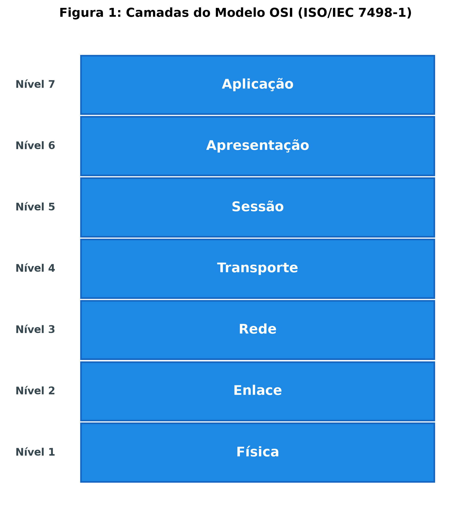
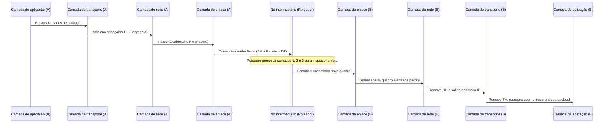

# Introdução ao modelo de referência OSI e arquitetura em camadas

A transmissão de dados através de uma rede de computadores envolve uma variedade imensa de tarefas heterogêneas: converter sequências de caracteres geradas por um aplicativo em sinais eletromagnéticos, definir o caminho mais adequado entre dezenas de roteadores, sincronizar emissor e receptor, checar erros provocados por ruído físico e garantir que mensagens fragmentadas sejam recompostas na ordem correta. Executar todo esse encadeamento por meio de um único programa monolítico seria inviável do ponto de vista de manutenção, engenharia e evolução tecnológica. Para dominar essa complexidade, a engenharia de redes adota o princípio de divisão em camadas hierárquicas, no qual cada nível executa um papel altamente especializado e fornece serviços ao nível imediatamente superior.

O modelo de referência mais influente para a compreensão dessa divisão modular é o OSI (*Open Systems Interconnection*, Interconexão de Sistemas Abertos), publicado pela ISO (*International Organization for Standardization*, Organização Internacional para Padronização) e pela ITU-T (*International Telecommunication Union - Telecommunication Standardization Sector*, Setor de Normalização das Telecomunicações da União Internacional de Telecomunicações) no padrão ISO/IEC 7498-1. Embora a Internet comercial tenha adotado na prática a arquitetura da pilha TCP/IP (*Transmission Control Protocol/Internet Protocol*, Protocolo de Controle de Transmissão/Protocolo de Internet), o modelo OSI com suas sete camadas permanece como o principal modelo conceitual e pedagógico mundial para ensinar, diagnosticar e projetar sistemas de comunicação de dados.

## Decomposição de processos e a analogia da correspondência corporativa

A lógica de uma arquitetura em camadas baseia-se na separação estrita de preocupações (*separation of concerns*). Uma comparação direta é a linha de montagem industrial de automóveis: o setor de estamparia molda as chapas de aço, o de pintura aplica as camadas de proteção e cor, a mecânica instala o motor e o acabamento acopla bancos e vidros. Cada estação recebe o produto parcialmente concluído da fase anterior, acrescenta valor de acordo com a sua especialidade técnica e o repassa à fase posterior, sem precisar conhecer em profundidade o ferramental interno das outras oficinas.

Outra analogia intuitiva que elucida a comunicação em rede é o envio de uma correspondência estratégica entre os diretores de duas filiais de uma multinacional situadas em países diferentes:

1. O diretor da filial de origem redige uma carta comercial no topo da hierarquia administrativa e solicita o envio à filial destinatária.
2. O assessor executivo recebe o texto original, traduz o conteúdo para um idioma comum de negócios (como o inglês), aplica criptografia se as informações forem confidenciais e organiza a mensagem formalmente.
3. A secretária de expedição recebe o documento tratado, anota os códigos de protocolo de controle da reunião, numera as páginas para controle de sequência e insere o material em um envelope interno de correspondência.
4. O departamento de expedição de correspondências recebe o envelope, identifica o endereço completo do prédio de destino, divide o material em pacotes menores se o peso exceder o limite de despacho postal e anota os identificadores de remessa.
5. O mensageiro interno reúne todos os pacotes, coloca-os dentro de um malote de transporte corporativo identificado com selos de controle de rota e os entrega à van de transporte da transportadora.
6. A van viaja pelas ruas e rodovias até a filial de destino, convertendo a carga física em movimento ao longo da infraestrutura viária.

No destino, ocorre exatamente a ordem inversa: a transportadora entrega o malote à expedição da filial destinatária, o mensageiro abre o malote, a conferência de protocolo reordena os pacotes e verifica se houve extravio, a assessoria traduz e decifra o texto e, finalmente, o diretor de destino lê a mensagem original. A beleza desse modelo é a transparência entre níveis: o diretor emissor conversa virtualmente de igual para igual com o diretor receptor sem precisar se preocupar com as rotas de vans ou com a tradução sintática, enquanto a van transporta a carga sem necessitar de permissão para ler o segredo industrial contido no documento.

## As sete camadas do modelo de referência OSI

O modelo OSI estrutura todo o processo de telecomunicação em sete camadas distintas, ordenadas de baixo para cima do nível 1 (mais próximo do meio físico) ao nível 7 (mais próximo do usuário humano ou do software aplicativa). As camadas superiores (7, 6 e 5) concentram-se no suporte ao usuário, sintaxe de dados e sessões de comunicação, operando geralmente em nível de software. As camadas inferiores (3, 2 e 1) lidam diretamente com o transporte de rede, endereçamento físico, detecção de erros e sinalização física, implementadas frequentemente em combinações de software do sistema operacional e hardware especializado (placas de rede, switches e transceptores). A camada 4 atua como elo de ligação e fronteira técnica entre essas duas metades.

A tabela abaixo sintetiza o papel funcional fundamental atribuído a cada um dos sete níveis do modelo de referência:

| Nível | Camada | Função principal | Exemplos de tarefas |
| :---: | :--- | :--- | :--- |
| **7** | **Aplicação** | Ponto de contato direto com aplicações e serviços finais | Navegação web, transferência de arquivos, correio eletrônico |
| **6** | **Apresentação** | Tradução de formatos, conversão de conjuntos de caracteres, criptografia e compressão | Conversão ASCII/EBCDIC, serialização de objetos, codificação JPEG/JSON |
| **5** | **Sessão** | Abertura, manutenção, controle de diálogo e sincronização de conexões | Inserção de pontos de checagem para retomada de downloads, controle de vez de fala |
| **4** | **Transporte** | Entrega confiável ou não confiável fim a fim (*end-to-end*), segmentação e controle de fluxo | Segmentação de fluxo de bytes, confirmação de entrega (*ACK*), controle de congestionamento |
| **3** | **Rede** | Roteamento de pacotes através de redes interconectadas e endereçamento lógico | Definição do melhor caminho em topologias complexas, endereçamento IP lógico |
| **2** | **Enlace** | Entrega física de quadros entre nós adjacentes no mesmo enlace e detecção de erros | Controle de acesso ao meio físico (MAC), delimitação de quadros, checagem CRC |
| **1** | **Física** | Transmissão de bits brutos não estruturados sobre o meio de propagação | Modulação de sinais elétricos, pulsos de laser ópticos, frequências de rádio |

Cada nível presta serviços à camada imediatamente acima dele por meio de pontos de acesso ao serviço (*Service Access Points*, SAPs) e requisita serviços à camada imediatamente abaixo.

## Mecanismo de encapsulamento e desencapsulamento

Para que as informações trafeguem pela hierarquia, cada camada adiciona informações administrativas de controle aos dados recebidos da camada superior. Esse processo sistemático chama-se **encapsulamento** durante a emissão e **desencapsulamento** durante a recepção.

Ao receber dados de uma aplicação no emissor, a camada 7 acrescenta um cabeçalho de aplicação (AH, *Application Header*) e entrega o bloco resultante à camada 6. A camada de apresentação enxerga todo esse bloco como carga útil pura (*payload*) e anexa seu próprio cabeçalho (PH, *Presentation Header*). Essa dinâmica se repete sucessivamente nas camadas de sessão (SH), transporte (TH) e rede (NH). Quando os dados chegam à camada de enlace (camada 2), ocorre uma particularidade: além de inserir um cabeçalho de enlace (DH, *Data Link Header*), ela também anexa um rodapé ou cauda de controle (DT, *Data Link Trailer*), normalmente contendo um código de redundância cíclica (*Cyclic Redundancy Check*, CRC) para verificação de integridade contra interferências no meio físico. Por fim, a camada física converte a sequência binária completa em pulsos físicos (voltagens, fótons ou ondas eletromagnéticas).

```mermaid
flowchart TD
    classDef core fill:#e1f5fe,stroke:#0288d1,stroke-width:2px;
    classDef component fill:#e8f5e9,stroke:#388e3c,stroke-width:2px;
    classDef data fill:#fff3e0,stroke:#f57c00,stroke-width:2px;

    subgraph Emissor ["Emissor (Descida na pilha: Encapsulamento)"]
        D7["Dados originais"]:::data
        D6["AH + Dados"]:::component
        D5["PH + AH + Dados"]:::component
        D4["SH + PH + AH + Dados"]:::component
        D3["TH + Payload de transporte (Segmento)"]:::component
        D2["NH + Payload de rede (Pacote)"]:::component
        D1["DH + Payload de enlace + DT (Quadro)"]:::core
        Bits["Sequência de bits transmitida ao meio"]:::data
    end

    D7 --> D6 --> D5 --> D4 --> D3 --> D2 --> D1 --> Bits
```

No receptor, o fluxo é estritamente simétrico e ascendente. A camada física capta os sinais do meio e reconstrói o fluxo de bits, entregando-o à camada de enlace. A camada de enlace processa seu cabeçalho (DH), recalcula o código de redundância do rodapé (DT) para garantir que nenhum bit foi corrompido durante a viagem, descarta o cabeçalho e o rodapé e repassa o miolo restante para a camada de rede. Cada camada subsequente remove exclusivamente o cabeçalho gerado pelo seu nível correspondente na ponta emissora, até que apenas os dados originais não adulterados sejam entregues à aplicação receptora.

## Unidades de dados de protocolo e comunicação par a par

Na literatura técnica de redes, a estrutura de dados manipulada em cada estágio do processo recebe uma designação formal. O termo genérico que engloba o bloco de controle somado à carga útil em qualquer camada é denominado **PDU** (*Protocol Data Unit*, Unidade de Dados de Protocolo).

Embora PDU seja a definição conceitual genérica, cada camada do modelo de rede adota uma denominação específica para o seu artefato consolidado:

- **Camadas superiores (Aplicação, Apresentação e Sessão):** o conjunto de dados tratados e manipulados é comumente referido de forma simples como **Dados** (*Data*) ou mensagens;
- **Camada de transporte (Camada 4):** a PDU recebe o nome de **Segmento** (*Segment*) quando se utiliza um protocolo orientado a conexão confiável como o TCP, ou **Datagrama de usuário** quando se utiliza um protocolo não orientado a conexão como o UDP;
- **Camada de rede (Camada 3):** a PDU recebe o nome padronizado de **Pacote** (*Packet*) ou datagrama;
- **Camada de enlace (Camada 2):** a PDU recebe a denominação estrita de **Quadro** (*Frame*);
- **Camada física (Camada 1):** a unidade elementar de transmissão é o **Bit**, que não possui estrutura formal de cabeçalho, sendo transmitido serialmente através do canal.

A organização dessas PDUs possibilita o conceito de **comunicação par a par** (*peer-to-peer process communication*). Embora fisicamente as informações percorram a trajetória vertical de descida na máquina emissora, travessia pelo meio condutor e subida na máquina receptora, do ponto de vista lógico e conceitual a camada de rede do emissor está se comunicando diretamente com a camada de rede do receptor. Os parâmetros contidos no cabeçalho NH foram escritos exclusivamente para serem lidos e interpretados pela camada NH da outra ponta, permanecendo totalmente transparentes e inalterados para os níveis adjacentes.

## Papel dos nós intermediários na arquitetura em camadas

Uma das maiores vantagens da arquitetura em camadas é que nem todos os dispositivos presentes em uma rede precisam implementar ou processar as sete camadas do modelo. Existe uma distinção arquitetural fundamental entre **sistemas finais** (*end systems* ou *hosts*) e **nós intermediários** (*intermediate systems* ou equipamentos de infraestrutura):

Os sistemas finais (computadores pessoais, smartphones, servidores de banco de dados e servidores web) executam a pilha completa de sete camadas. Como são os geradores e consumidores finais da informação, precisam lidar com as regras de negócio de aplicação, tradução de criptografia de apresentação e montagem de fluxos na camada de transporte.

Os nós intermediários de comutação da rede, por sua vez, operam apenas nas camadas inferiores necessárias para encaminhar o fluxo de tráfego até o destino:

- **Repetidores e hubs (Camada 1):** operam estritamente no nível de sinal físico, recebendo sinais analógicos ou pulsos elétricos, regenerando sua amplitude e replicando os bits para as outras portas sem analisar nenhum endereço ou cabeçalho;
- **Switches e pontes (Camada 2):** operam até a camada de enlace de dados. Eles recebem os bits, reconstroem o quadro (*frame*), conferem o somatório de verificação de erros no rodapé DT e leem os endereços físicos de hardware (endereços MAC, *Media Access Control*) contidos no cabeçalho DH para saber para qual porta encaminhar o tráfego, sem examinar os dados internos de rede ou de transporte;
- **Roteadores (Camada 3):** operam até a camada de rede. O roteador recebe o quadro, remove os cabeçalhos de enlace do meio local de entrada, avalia o cabeçalho NH contendo os endereços lógicos (endereços IP), consulta suas tabelas de rotas para selecionar o próximo salto e encapsula novamente o pacote dentro de um novo quadro compatível com o meio de saída (que pode ser fibra óptica, enlace serial ou cabo de par trançado).

Essa divisão preserva o desempenho global da rede: roteadores e switches corporativos manipulam milhões de fluxos simultâneos por segundo em nível de silício sem incorrer na sobrecarga de decifrar cabeçalhos de transporte ou decodificar dados de aplicação.

## Pontos que costumam gerar confusão

* **O modelo OSI é uma pilha de protocolos em operação cotidiana na Internet:** O modelo OSI é um modelo conceitual de referência para padronização e arquitetura, enquanto a Internet foi construída sobre a pilha pragmática do protocolo TCP/IP de quatro ou cinco camadas.
* **Encapsulamento significa criptografar os dados transmitidos:** Encapsular significa empacotar e anexar cabeçalhos administrativos de controle em torno de uma carga útil, enquanto criptografar é a alteração algorítmica do conteúdo para torná-lo ininteligível a terceiros (tarefa delegada à camada de apresentação).
* **Todas as camadas adicionam cabeçalho e rodapé em suas PDUs:** A grande maioria das camadas adiciona unicamente cabeçalhos (*headers*) à frente dos dados; apenas a camada de enlace (camada 2) acrescenta rotineiramente um rodapé (*trailer*) com códigos de detecção de erros ao final do bloco.
* **Roteadores e comutadores examinam o conteúdo completo das mensagens:** Equipamentos intermediários de infraestrutura operam tipicamente apenas até a camada 3 (roteadores) ou camada 2 (switches), ignorando a carga útil de aplicação e poupando capacidade de processamento.
* **Segmento e pacote são sinônimos intercambiáveis para qualquer dado:** A denominação técnica formal reserva o termo segmento para a PDU da camada de transporte (camada 4) e o termo pacote para a PDU da camada de rede (camada 3).
* **A ordem de processamento das camadas é a mesma na emissão e na recepção:** No dispositivo emissor o tráfego percorre a ordem descendente das camadas superiores para as inferiores (da aplicação para o meio físico), enquanto no receptor o caminho é estritamente ascendente (do meio físico para a aplicação).
