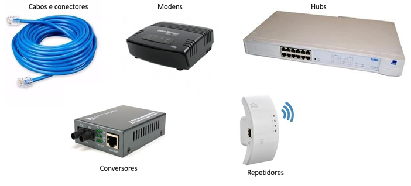
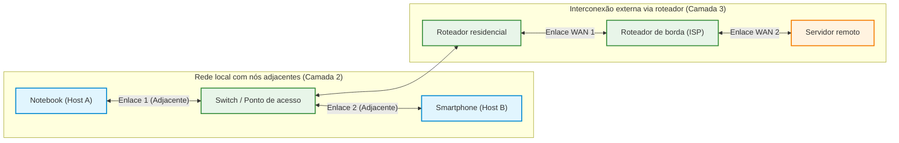
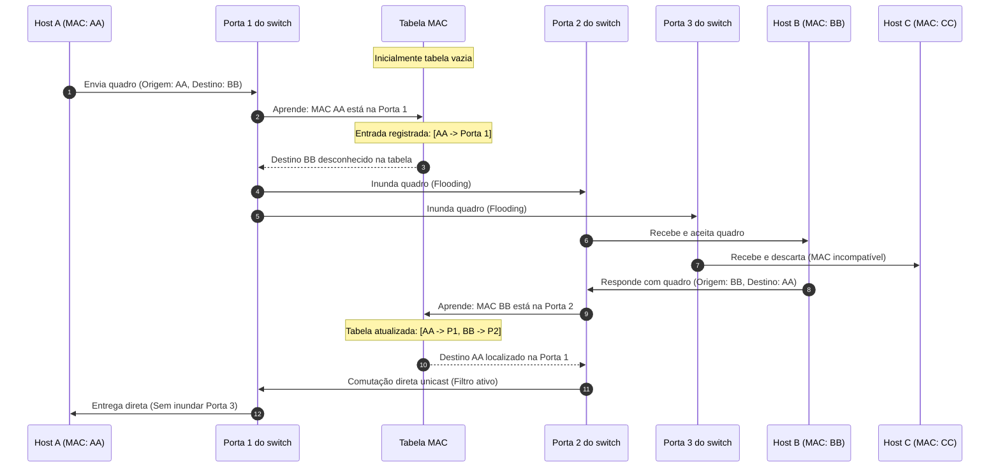

# Camadas física e de enlace do modelo OSI

A interconexão e a comunicação básica de dados entre dois computadores dependem fundamentalmente da cooperação técnica entre as duas camadas mais inferiores do modelo OSI (*Open Systems Interconnection*, Interconexão de Sistemas Abertos): a camada física (camada 1) e a camada de enlace de dados (camada 2). Enquanto a camada física lida com o hardware elétrico, óptico e mecânico para viabilizar a propagação de bits brutos através do canal de transmissão, a camada de enlace abstrai as irregularidades do meio, estrutura os bits em unidades lógicas denominadas quadros (*frames*), realiza o endereçamento físico e organiza o tráfego entre nós adjacentes.

Compreender com precisão a fronteira de responsabilidade entre esses dois níveis é um dos pilares da engenharia de redes. Um critério diagnóstico central consiste em identificar a capacidade computacional dos equipamentos de rede: dispositivos de camada 1 apenas regeneram ou modulam sinais eletromagnéticos sem interpretar dados lógicos, enquanto dispositivos de camada 2 processam ativamente os quadros e inspecionam endereços físicos de hardware gravados em placas de rede.

## Camada física: modos de transmissão e dispositivos de sinal

A camada física é a primeira camada processada quando um computador recebe dados de uma rede. Seu papel exclusivo é transmitir sequências de bits individuais através de condutores de cobre, fibras ópticas ou ondas eletromagnéticas de radiofrequência, sem conferir qualquer significado semântico ou estrutura sintática aos dados. Toda a infraestrutura tangível de rede (topologia de cabeamento, tipo de conector, modulação da onda portadora, chaveamento e multiplexação de canais) é governada pelas especificações deste nível.

A transferência física dos sinais eletromagnéticos sobre um canal de comunicação pode ocorrer segundo três modos de transmissão fundamentais:

- **Simplex (unidirecional):** a comunicação flui permanentemente em um único sentido, de um transmissor dedicado para um receptor passivo. Um exemplo cotidiano é o sistema de televisão aberta ou sensores meteorológicos de telemetria: a antena do televisor recebe a programação gerada pela torre emissora, mas jamais envia dados de volta através do mesmo canal. Analogicamente, funciona como uma rua de mão única estrita.
- **Half-duplex (bidirecional alternado):** a comunicação opera em ambos os sentidos, porém os nós não podem transmitir e receber simultaneamente. A analogia perfeita é a conversa por rádio amador ou *walkie-talkie*, em que uma pessoa precisa falar "câmbio" e liberar o canal para que a outra comece a transmitir. Em redes de tráfego viário, equivale a uma ponte estreita de mão dupla em obras com trânsito alternado por semáforo.
- **Full-duplex (bidirecional simultâneo):** a transmissão e a recepção de dados ocorrem concorrentemente em ambos os sentidos sem interferência mútua. É o padrão de excelência adotado por redes locais comutadas modernas (*Switched Ethernet*) e conexões de fibra óptica, operando como uma rodovia duplicada com pistas independentes para cada sentido de rolamento.



Como os nós de camada física apenas manipulam grandezas analógicas ou níveis binários de tensão, os equipamentos pertencentes à camada 1 não leem cabeçalhos nem reconhecem se um pacote é destinado a uma máquina específica. São exemplos típicos deste nível: cabos e conectores (como cabos de par trançado e conectores RJ-45), modems (que realizam a modulação e demodulação da onda portadora analógica), conversores de mídia (que transformam sinais elétricos de fios de cobre em pulsos de luz para fibras ópticas), repetidores (que amplificam e regeneram a amplitude de sinais atenuados) e hubs (concentradores passivos que replicam eletricamente qualquer sinal de entrada para todas as portas conectadas).

## Camada de enlace e o conceito de nós adjacentes

A camada de enlace situa-se no nível 2 da hierarquia OSI e tem como propósito fundamental abstrair as imperfeições e ruídos do canal físico para entregar um serviço de trânsito inteligível às camadas superiores. Sua unidade de dados de protocolo é denominada **quadro** (*frame*), também referida formalmente como LPDU (*Link Protocol Data Unit*, Unidade de Dados de Protocolo de Enlace).

A atribuição central da camada de enlace é viabilizar e coordenar a troca de quadros entre **nós adjacentes**. Dois nós são definidos rigorosamente como adjacentes quando é possível estabelecer comunicação direta entre eles sem a intervenção de um nó roteador (camada 3). São exemplos de nós adjacentes:

- Dois computadores interligados diretamente entre si por um cabo de rede (como um cabo par trançado crossover ou com portas Auto MDI-X);
- Equipamentos interconectados através de um mesmo concentrador local, seja ele um hub (camada 1), uma bridge (camada 2) ou um switch (camada 2);
- Dispositivos compartilhando o mesmo barramento elétrico ou o mesmo canal de radiofrequência gerenciado por um ponto de acesso sem fio (*Access Point*).



Quando um notebook e um smartphone trocam arquivos conectados à rede Wi-Fi de uma residência, eles atuam como nós adjacentes. Embora o aparelho físico fornecido pela operadora concentre as funções de modem, switch, roteador e ponto de acesso em um único gabinete plástico, a comunicação estritamente local entre os dois aparelhos utiliza apenas a função de switch/ponto de acesso (camada 2), sem acionar o mecanismo de roteamento de pacotes da camada 3. Por outro lado, para acessar uma página hospedada em um servidor remoto na Internet, a mensagem percorre múltiplos enlaces independentes em cadeia: do computador ao roteador residencial, do roteador residencial ao roteador do provedor de acesso (*Internet Service Provider*, ISP) e do provedor ao data center de destino.

## Endereçamento físico e estrutura do endereço MAC

Para que um quadro encontre sua placa de rede destinatária em um enlace local, a camada 2 utiliza o **endereço físico**, universalmente conhecido como endereço MAC (*Media Access Control*, Controle de Acesso ao Meio). O endereço MAC é um identificador único de hardware gravado de forma permanente na memória ROM (*Read-Only Memory*) da interface de rede (NIC, *Network Interface Card*) durante o processo de fabricação industrial.

Na arquitetura da família Ethernet e Wi-Fi (normas IEEE 802), o endereço MAC é composto por **48 bits** (6 octetos ou bytes), usualmente representados em notação hexadecimal agrupada de dois em dois dígitos separados por hífens ou dois-pontos (por exemplo, `5C-CD-5B-3C-B2-61`):

- **OUI (*Organizationally Unique Identifier*, Identificador Organizacional Único):** corresponde aos **três primeiros octetos** (24 bits superiores). Esse bloco numérico é atribuído e registrado formalmente pelo IEEE para cada fabricante de equipamentos (como Intel, Realtek, Apple, Cisco ou Dell).
- **Identificador do dispositivo:** corresponde aos **três últimos octetos** (24 bits inferiores). É atribuído pelo próprio fabricante de forma sequencial e controlada, funcionando como o número de série da interface física para garantir que nenhuma placa possua endereço idêntico no mundo.

```
+--------------------------+--------------------------+
|  3 primeiros octetos     |   3 últimos octetos      |
|      (24 bits)           |       (24 bits)          |
|    5C - CD - 5B          |      3C - B2 - 61        |
+--------------------------+--------------------------+
|  OUI (Fabricante/Intel)  | Identificador da placa   |
+--------------------------+--------------------------+
```

Em ambientes operacionais Microsoft Windows, é possível verificar os endereços físicos de todas as interfaces instaladas executando o comando `ipconfig /all` no prompt de comando:

```shell
Adaptador de Rede sem Fio Wi-Fi:

   Sufixo DNS específico de conexão......:
   Descrição.............................: Intel(R) Dual Band Wireless-AC 3165
   Endereço Físico.......................: 5C-CD-5B-3C-B2-61
   DHCP Habilitado.......................: Sim
```

Em distribuições Linux ou macOS, a mesma verificação é obtida por meio dos comandos `ip link show` ou `ifconfig`. Conhecendo os três primeiros bytes (`5C-CD-5B`), é possível realizar consultas em bases públicas de registro (como o serviço OUI lookup do IEEE) e identificar imediatamente que a controladora de rede foi fabricada pela *Intel Corporation*.

## Controle de acesso ao meio e arbitragem de canais

Quando diversos computadores estão conectados ao mesmo meio físico compartilhado (como em uma topologia em barramento ou no espaço aéreo de redes sem fio), surge o risco permanente de dois ou mais nós iniciarem transmissões simultâneas de suas ondas portadoras. A sobreposição descontrolada desses sinais elétricos ou eletromagnéticos no canal gera interferência destrutiva, distorcendo os pulsos lógicos e corrompendo as informações. Esse conflito físico denomina-se **colisão**.

Para viabilizar a convivência ordenada de múltiplos transmissores no mesmo canal, a camada de enlace divide-se internamente em duas subcamadas: a subcamada LLC (*Logical Link Control*, Controle de Enlace Lógico, responsável pelo fluxo e verificação de erros) e a subcamada MAC (*Media Access Control*, Controle de Acesso ao Meio). Esta última implementa protocolos de arbitragem para regular quem tem permissão para emitir sinais a cada instante:

- **CSMA/CD (*Carrier Sense Multiple Access with Collision Detection*, Acesso Múltiplo com Detecção de Portadora e Detecção de Colisão):** protocolo clássico das redes cabeadas Ethernet compartilhadas (IEEE 802.3). Antes de transmitir, a placa "escuta" o cabo para sentir se há portadora ativa (*carrier sense*). Se o canal estiver livre, ela inicia a transmissão; caso duas placas transmitam ao mesmo instante, ambas detectam o aumento súbito de tensão provocado pela colisão (*collision detection*), abortam o envio, emitem um sinal de reforço de colisão (*jam signal*) e aguardam um tempo aleatório calculado por recuo exponencial (*exponential backoff*) antes de tentar novamente.
- **CSMA/CA (*Carrier Sense Multiple Access with Collision Avoidance*, Acesso Múltiplo com Prevenção de Colisão):** protocolo adotado em redes locais sem fio Wi-Fi (IEEE 802.11). Como no meio aéreo é computacionalmente inviável para uma antena de rádio detectar colisões enquanto transmite com alta potência de saída, o protocolo atua preventivamente (*collision avoidance*). Antes de emitir quadros, o nó escuta o canal e, caso esteja livre, aguarda um tempo adicional aleatório e pode emitir sinais breves de controle RTS/CTS (*Request to Send / Clear to Send*) para reservar o canal e evitar colisões com estações ocultas.

Além da arbitragem de acesso, a camada de enlace pode fornecer serviços com diferentes níveis de garantia de entrega:

1. **Serviço não confiável e sem confirmação:** o emissor despacha o quadro e não aguarda confirmação de recebimento (*acknowledgment* ou ACK). Se o quadro for corrompido, ele é descartado silenciosamente no destino pela checagem CRC. É o padrão do Ethernet cabeado moderno, visto que a taxa de erro física de cabos de cobre modernos é residual e transferir essa conferência para a camada de transporte poupa processamento.
2. **Serviço confiável orientado à conexão:** o receptor confere cada quadro e devolve uma mensagem de confirmação positiva (*ACK*). Se o emissor não receber o ACK após um tempo limite estipulado, ele retransmite o quadro por conta própria sem envolver a camada de rede. É a abordagem empregada no padrão Wi-Fi (802.11) devido à alta taxa de perda natural inerente ao meio não guiado de radiofrequência.

## Mecanismo de comutação e autoaprendizagem em switches

A evolução do hardware de interconexão de redes locais ilustra com clareza o salto de inteligência entre a camada física e a camada de enlace:

Nas redes primitivas com topologia em estrela baseadas em **hubs (camada 1)**, o dispositivo atua apenas como repetidor cego de sinais elétricos. Se um hub de 24 portas tiver 20 computadores conectados e a máquina A transmitir dados para a máquina B, o hub replica fisicamente o sinal recebido para as outras 23 portas indiscriminadamente. Isso significa que as 18 máquinas não envolvidas na conversa sofrem ocupação forçada de suas interfaces, expondo dados sigilosos e reduzindo a capacidade agregada da rede a um único domínio de colisão global.

Para sanar esse gargalo, surgiram as **bridges** e, posteriormente, os **switches (comutadores de camada 2)**. Um switch é projetado em hardware dedicado com múltiplos chips ASIC (*Application-Specific Integrated Circuit*) capazes de inspecionar o cabeçalho dos quadros Ethernet e ler tanto o endereço MAC de origem quanto o endereço MAC de destino. O switch constrói dinamicamente uma **tabela de encaminhamento** (tabela MAC ou memória CAM, *Content Addressable Memory*) através de um algoritmo elegante de autoaprendizagem (*self-learning*):



O ciclo operacional de autoaprendizagem do switch opera em quatro passos lógicos contínuos:

1. **Estado inicial (tabela vazia):** ao ser ligado na tomada, a tabela de correspondência porta-MAC do switch encontra-se totalmente em branco.
2. **Aprendizagem passiva pela origem:** quando um quadro chega por uma de suas portas (por exemplo, porta 1), o switch analisa o campo **MAC de origem** do cabeçalho. Ele anota imediatamente em sua tabela que o computador portador daquele MAC está fisicamente conectado à porta 1.
3. **Inundação (*Flooding*) para destinos desconhecidos:** em seguida, o switch examina o **MAC de destino**. Se aquele endereço ainda não constar em sua tabela, o switch é obrigado a encaminhar o quadro para todas as demais portas ativas da rede (exceto a porta pela qual o quadro acabou de entrar).
4. **Comutação direta unicast:** quando a máquina destinatária responde, o switch aprende seu MAC de origem e a porta correspondente. A partir deste momento, todas as transmissões futuras entre essas duas máquinas são encaminhadas estritamente de forma ponto a ponto através das respectivas portas, mantendo as demais portas do switch totalmente livres para outras conversas simultâneas.

Essa capacidade de isolar o tráfego elimina as colisões e transforma cada porta do switch em um domínio de colisão independente operando em full-duplex. Existem ainda switches empresariais avançados chamados **switches gerenciáveis de camada 3** (*Layer 3 Switches*), que agregam hardware especializado para processar cabeçalhos de pacotes IP e executar roteamento interno entre redes locais virtuais (VLANs) em altíssima velocidade.

## Pontos que costumam gerar confusão

* **Hub e switch executam a mesma função em uma rede local:** O hub opera na camada 1 repetindo sinais eletromagnéticos cegamente para todas as portas, enquanto o switch opera na camada 2 lendo endereços MAC e comutando quadros exclusivamente para a porta de destino.
* **O endereço MAC muda quando o computador se conecta a um novo roteador:** O endereço MAC é um identificador físico gravado de fábrica na placa de rede do computador e permanece imutável em qualquer rede; quem se adapta dinamicamente à rede é o endereço lógico IP.
* **Dois dispositivos conectados ao mesmo roteador Wi-Fi não são adjacentes:** Dispositivos na mesma rede local doméstica comunicam-se no nível de enlace (camada 2) e são considerados adjacentes; o roteador residencial atua apenas como concentrador/ponto de acesso local para esse tráfego interno, sem acionar a camada 3 de roteamento.
* **A tabela de encaminhamento do switch precisa ser pré-configurada manualmente:** O switch de camada 2 povoa sua tabela de forma totalmente autônoma inspecionando os endereços MAC de origem dos quadros recebidos à medida que o tráfego flui pela rede.
* **O protocolo CSMA/CD impede que qualquer colisão aconteça na rede:** O CSMA/CD reduz a frequência das colisões e define um protocolo padronizado para detectá-las e retransmitir os quadros após um intervalo de recuo aleatório, mas não evita que duas placas comecem a falar no mesmo instante.
* **Toda rede Ethernet realiza confirmação formal de entrega na camada de enlace:** O padrão Ethernet cabeado opera sem conexão e sem confirmação na camada 2, descartando quadros com erro e delegando o controle de retransmissão confiável para a camada de transporte (TCP).
