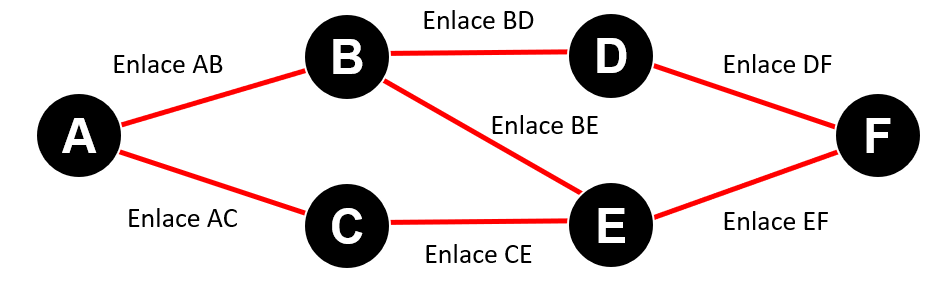
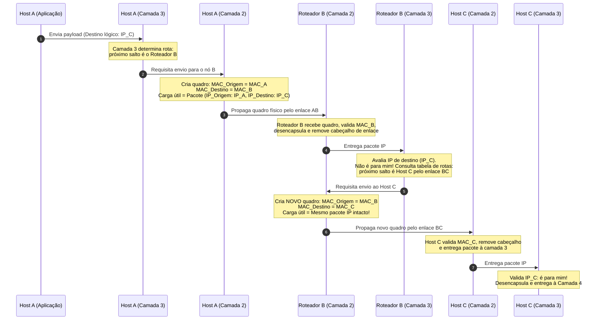
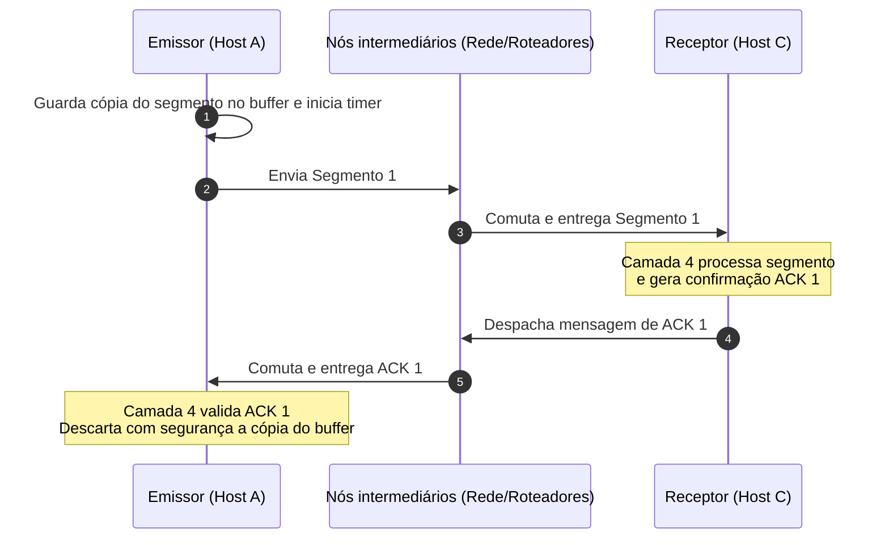

# Camadas de rede e transporte do modelo OSI

A interconexão global que caracteriza a Internet fundamenta-se na cooperação entre a camada de rede (camada 3) e a camada de transporte (camada 4) do modelo OSI (*Open Systems Interconnection*, Interconexão de Sistemas Abertos). Enquanto a camada de enlace opera estritamente entre nós adjacentes no mesmo segmento físico, computadores reais que precisam se comunicar encontram-se frequentemente em redes distintas, separados por continentes e por múltiplos saltos de trânsito. A camada de rede atua como o núcleo dessa arquitetura ao encontrar o caminho ótimo através de múltiplos enlaces heterogêneos.

Por outro lado, embora a camada de rede resolva a rota dos pacotes, ela não assume a responsabilidade de garantir se os dados foram entregues intactos ou se foram descartados por congestionamento no trajeto. Essa garantia cabe à camada de transporte, que opera exclusivamente de ponta a ponta (*end-to-end*) entre o sistema emissor original e o receptor final. Compreender a divisão de trabalho entre esses dois níveis é essencial para assimilar a dinâmica de protocolos fundamentais como IP, TCP e UDP.

## Camada de rede: roteamento e orquestração de enlaces

A camada de rede pode ser concebida didaticamente como um maestro orquestrando múltiplos músicos individuais da camada de enlace. A camada de enlace tem uma visão míope do sistema: ela sabe apenas como transferir um quadro (*frame*) de uma placa de rede para a placa imediatamente vizinha. Ela desconhece por completo quem é o destinatário final do tráfego ou quantos nós intermediários existem no caminho. Quem possui a visão panorâmica de destino e traça o itinerário global é a camada de rede.

Considere a malha de nós e enlaces interconectados apresentada abaixo, em que um computador no nó A deseja transmitir dados para um nó F:



Para conectar o nó A ao nó F não há um enlace físico direto. Existem diversos caminhos alternativos possíveis pela infraestrutura:

1. Rota 1: Nó A $\to$ Nó B (via Enlace AB) $\to$ Nó E (via Enlace BE) $\to$ Nó F (via Enlace EF), totalizando 3 enlaces;
2. Rota 2: Nó A $\to$ Nó B (via Enlace AB) $\to$ Nó D (via Enlace BD) $\to$ Nó F (via Enlace DF), totalizando 3 enlaces;
3. Rota 3: Nó A $\to$ Nó C (via Enlace AC) $\to$ Nó E (via Enlace CE) $\to$ Nó F (via Enlace EF), totalizando 3 enlaces.

A camada de rede em cada nó determina o próximo salto e requisita os serviços da camada de enlace local: "por favor, transporte este pacote até o nó B utilizando o enlace AB". Ao alcançar o roteador B, o cabeçalho de enlace é descartado e a camada de rede de B reavalia sua tabela de roteamento, determinando o salto seguinte rumo a E. Esse encadeamento descentralizado repete-se de salto em salto (*hop-by-hop*) até que o pacote atinja o nó F.

A tomada de decisões de rota baseia-se em **algoritmos de roteamento**, que se dividem em duas categorias essenciais:

- **Algoritmos estáticos:** as tabelas de rotas são configuradas manualmente por administradores de rede e não reagem a falhas operacionais. Se uma fibra óptica do enlace BE romper ou o nó E congelar, os pacotes direcionados a essa rota continuam sendo enviados para o enlace inoperante e são perdidos, interrompendo a comunicação até intervenção humana manual.
- **Algoritmos dinâmicos:** os roteadores trocam mensagens periódicas de controle para monitorar o estado da malha, tempo de atraso e disponibilidade de links. Caso um enlace caia ou sofra congestionamento severo, os algoritmos recalculam as rotas autonomamente, desviando o tráfego de A para B via nó D ou nó C, conferindo alta resiliência à rede.

## Comutação por circuitos virtuais versus comutação por pacotes

A movimentação de fluxos de informação na camada de rede pode ser implementada historicamente através de duas filosofias conceituais de comutação:

- **Comutação por circuitos virtuais:** antes de qualquer byte de dados útil ser transmitido, o emissor negocia com a rede a abertura de um circuito lógico dedicado. Uma rota fixa pré-determinada é estabelecida e todos os nós intermediários reservam recursos de memória e identificadores de circuito. Todos os pacotes subsequentes daquela transmissão seguem rigorosamente a mesmíssima sequência de enlaces. Essa abordagem facilita o planejamento de capacidade e previne congestionamentos pontuais; contudo, se um roteador intermediário falhar durante a sessão ou sofrer lentidão inesperada, a comutação por circuito virtual tem dificuldade para contornar o gargalo, pois todos os pacotes continuam presos à rota inicialmente estabelecida.
- **Comutação por pacotes (datagramas):** cada pacote de dados é tratado de forma autônoma e independente (*datagram network*), contendo em seu cabeçalho o endereço de destino final completo. A rota é decidida dinamicamente pacote por pacote. Dois pacotes sucessivos gerados pela mesma aplicação podem percorrer caminhos físicos inteiramente diferentes (o pacote 1 pode viajar pela rota A-B-E-F e o pacote 2 pela rota A-C-E-F). Embora torne o planejamento de congestionamento mais complexo, essa abordagem é extraordinariamente adaptável: havendo sobrecarga em um enlace, os roteadores desviam os pacotes subsequentes por caminhos alternativos sem interromper a transmissão. Essa é a arquitetura adotada como base estrutural da Internet.

## Endereçamento lógico e equipamentos de camada 3

Para que o roteamento global seja viável, a camada de rede utiliza o **endereçamento lógico**, que no ecossistema da Internet é consubstanciado pelos endereços IP (*Internet Protocol*, Protocolo de Internet), em suas versões IPv4 (32 bits) e IPv6 (128 bits). Diferente do endereço físico MAC (gravado na placa de rede de forma plana e local), o endereço lógico é hierárquico, indicando a qual rede e sub-rede o dispositivo pertence, analogamente ao código de endereçamento postal de uma residência.

No sistema operacional Windows, a verificação dos endereços lógicos atribuídos às interfaces ativas é realizada por meio do utilitário `ipconfig`:

```shell
C:\Users\antigravity>ipconfig
Configuração de IP do Windows

Adaptador de Rede sem Fio Wi-Fi:
   Endereço IPv6 de link local...........: fe80::14e3:d9e8:2f71:ba67%18
   Endereço IPv4.........................: 192.168.0.106
   Máscara de Sub-rede...................: 255.255.255.0
   Gateway padrão........................: 192.168.0.1
```

O **gateway padrão** (`192.168.0.1`) representa o endereço lógico do nó intermediário de camada 3 (o roteador local) para onde todo pacote com destino fora da rede local deve ser encaminhado.

Os equipamentos que operam na camada 3 caracterizam-se pela capacidade de inspecionar, processar e reescrever informações contidas no cabeçalho de rede (NH):

- **Roteadores:** equipamentos de infraestrutura dedicados a interligar redes heterogêneas, manter tabelas de roteamento e comutar pacotes entre interfaces distintas;
- **Switches de camada 3 (gerenciáveis):** switches corporativos equipados com circuitos integrados para roteamento IP de pacotes em alta velocidade entre VLANs (*Virtual Local Area Networks*, Redes Locais Virtuais), dispensando o trânsito por um roteador externo para tráfego interdepartamental;
- **Firewalls de camada de rede:** dispositivos de filtragem de segurança que inspecionam endereços IP de origem e destino para bloquear acessos não autorizados.

## O ciclo de encapsulamento no salto intermediário

A travessia de um pacote por nós intermediários elucida a separação de papéis entre endereçamento físico e endereçamento lógico. Quando o computador A transmite um pacote com destino ao computador C através do roteador intermediário B, ocorrem múltiplos ciclos de empacotamento:



Observa-se um contraste estrutural fundamental: o pacote IP preserva os endereços lógicos originais intactos do início ao fim da viagem (origem `IP_A` e destino `IP_C`). Os cabeçalhos de enlace, por outro lado, são temporários e locais: no primeiro salto, o quadro carrega origem `MAC_A` e destino `MAC_B`; ao passar pelo roteador B, o quadro antigo é destruído e um novo quadro é forjado com origem `MAC_B` e destino `MAC_C`. O nó intermediário executa unicamente as camadas 1, 2 e 3, sem jamais subir à camada de transporte ou aplicação.

## Camada de transporte: confiabilidade ponta a ponta e controle de fluxo

Diferente da camada de rede, a camada de transporte (camada 4) opera exclusivamente sob o modelo **ponta a ponta** (*end-to-end*). Apenas os nós de origem emissora e destino final executam a pilha de transporte; os roteadores e switches intermediários de infraestrutura são totalmente transparentes e ignoram seus cabeçalhos. Essa característica torna a camada de transporte o local perfeito para implementar mecanismos de garantia e confiabilidade de entrega.

Uma dúvida frequente de engenharia é: se a camada de enlace pode oferecer confirmação de entrega em um link local, por que é indispensável manter uma confirmação de entrega na camada de transporte? A resposta reside no fato de que garantias locais em nós adjacentes não garantem a sobrevivência do dado ao longo de todo o caminho:

Se o nó A envia um quadro para o nó B, a camada de enlace de B confirma o recebimento e o nó A descarta sua cópia em buffer. Em seguida, o nó B repassa o pacote ao nó D, que confirma com sucesso para B. Porém, antes de encaminhar o pacote para o destino final F, o nó D sofre uma pane física de hardware ou falta de energia elétrica. Do ponto de vista dos enlaces intermediários, todas as transferências parciais foram confirmadas com sucesso, mas o destinatário F jamais recebeu a informação. Sem um controle de transporte ponta a ponta na máquina A, o pacote seria perdido definitivamente no silêncio da rede.

Na camada de transporte, o sistema emissor mantém uma cópia em memória do **segmento** transmitido. Ao receber o dado no destino final C, a camada de transporte de C despacha uma mensagem de confirmação de recebimento denominada **ACK** (*Acknowledgment*). Esse ACK é roteado pela rede de volta até o nó A. Somente no instante em que o ACK é validado pela camada de transporte da máquina emissora, a cópia do segmento é descartada da memória. Se o temporizador de retransmissão (*timeout*) expirar sem a chegada do ACK, a camada de transporte reenvia o segmento automaticamente.



Além da confirmação de entrega, a camada de transporte desempenha outras funções cruciais:

1. **Segmentação e remontagem:** em transmissões de arquivos volumosos (como downloads de vídeos ou backups), a camada de transporte particiona a mensagem de aplicação em múltiplos segmentos menores para respeitar a unidade máxima de transmissão (*Maximum Transmission Unit*, MTU) das redes intermediárias, remontando-os de forma íntegra no destino;
2. **Ordenação de dados:** em redes de comutação por pacotes, cada pacote pode percorrer uma rota diferente com atrasos variáveis, fazendo com que cheguem fora de ordem ao destino (o pacote 3 pode chegar antes do pacote 2). A camada de transporte utiliza números de sequência contidos no cabeçalho TH para reordenar o fluxo antes de entregá-lo à aplicação;
3. **Controle de fluxo de dados:** regula a taxa de envio do emissor para evitar que ele inunde o buffer de recepção do receptor caso a máquina de destino possua menor capacidade computacional de processamento;
4. **Controle de congestionamento:** monitora sinais de perda de pacotes e gargalos na infraestrutura da Internet para reduzir temporariamente a janela de emissão e preservar o equilíbrio da rede como um todo.

## Pontos que costumam gerar confusão

* **A confirmação da camada de enlace torna desnecessária a confirmação na camada de transporte:** A camada de enlace confirma apenas a entrega local entre dois nós vizinhos diretos; se um nó intermediário travar após confirmar o enlace, o pacote se perde, tornando a confirmação ponta a ponta da camada de transporte indispensável.
* **O endereço IP e o endereço MAC mudam a cada salto no roteador:** O endereço IP de origem e destino permanece constante do início ao fim da viagem no cabeçalho do pacote; quem é reescrito a cada salto de roteamento são os endereços MAC no cabeçalho do quadro de enlace.
* **Roteadores executam todas as camadas da pilha para saber onde entregar o pacote:** Roteadores de infraestrutura operam tipicamente apenas até a camada 3 (física, enlace e rede), sem decodificar cabeçalhos de transporte ou de aplicação.
* **Comutação por circuitos virtuais e comutação por circuitos tradicionais são a mesma coisa:** Circuitos virtuais continuam compartilhando enlaces físicos por multiplexação de pacotes lógicos, apenas estabelecendo um caminho estático pré-determinado, ao contrário da telefonia tradicional que aloca circuitos físicos exclusivos.
* **A camada de rede garante que todos os pacotes enviados cheguem intactos:** A camada de rede adota por padrão o paradigma de "melhor esforço" (*best-effort*), sem garantir entrega ou ordenação; a responsabilidade de conferir integridade e ordenar pacotes é atribuída à camada de transporte.
* **O endereço de gateway padrão serve apenas para fornecer navegação na Web:** O gateway padrão é o endereço IP da interface do roteador local que atua como porta de saída para qualquer comunicação direcionada a dispositivos fora da sub-rede local.
