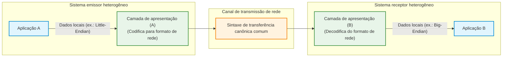
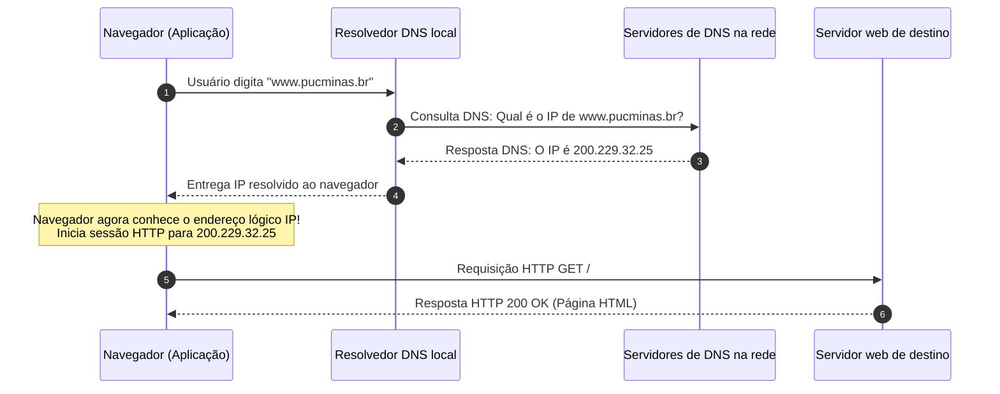

# Camadas de sessão, apresentação e aplicação do modelo OSI

As camadas inferiores do modelo OSI (*Open Systems Interconnection*, Interconexão de Sistemas Abertos) concentram-se no transporte físico, detecção de erros, comutação de enlace, roteamento global e entrega confiável de fluxos de dados de ponta a ponta. No entanto, viabilizar a entrega de bits entre dois computadores remotos é apenas metade do desafio da comunicação de dados. Quando os dados chegam à máquina destinatária, é indispensável coordenar a duração desse intercâmbio, converter sintaxes incompatíveis entre sistemas heterogêneos e fornecer serviços padronizados para que programas de computador consigam atender diretamente aos usuários humanos.

Essas responsabilidades são atribuídas aos três níveis superiores do modelo de referência: a camada de sessão (camada 5), a camada de apresentação (camada 6) e a camada de aplicação (camada 7). Diferente dos níveis inferiores de infraestrutura (implementados em hardware de rede e módulos do núcleo do sistema operacional), as três camadas superiores operam estritamente no espaço do software e das bibliotecas de tempo de execução, culminando na interface direta com aplicações como navegadores web, clientes de e-mail e utilitários de transferência de arquivos.

## Camada de sessão: gerenciamento do ciclo de diálogo e pontos de checagem

A camada de sessão é responsável por estabelecer, gerenciar, sincronizar e encerrar conexões lógicas estruturadas entre aplicações de nós distintos. Para compreender o conceito de sessão, a analogia direta mais intuitiva é a de uma chamada telefônica: antes de iniciar o diálogo propriamente dito, disca-se o número, aperta-se o botão de chamada, o interlocutor atende, pronuncia "alô", as duas partes se identificam mutuamente e estabelecem o contexto da conversa. Somente após essa fase preliminar a troca de mensagens acontece. Ao término do assunto, ambas as partes despedem-se e encerram a ligação desligando o aparelho. Toda essa sequência ordenada de abertura, conversação e encerramento constitui uma **sessão**.

No ambiente de redes, a camada de sessão desempenha quatro papéis cruciais de controle:

- **Controle de diálogo (*Dialogue Control*):** coordena a alternância de transmissão entre as partes quando o canal subjacente opera em half-duplex (revezamento de fala) ou gerencia o fluxo quando opera em full-duplex simultâneo, garantindo que as mensagens não se sobreponham de forma caótica;
- **Gerenciamento de tokens (*Token Management*):** evita que duas partes tentem executar concorrentemente uma mesma operação crítica e mutuamente exclusiva. A camada de sessão emite um passe virtual de autorização (*token*); apenas a extremidade que detém a posse transitória do token tem permissão técnica para solicitar ou disparar aquela transação crítica específica;
- **Sincronização e pontos de checagem (*Checkpoints*):** em transmissões volumosas e prolongadas (como a transferência de arquivos pesados ou migração de bases de dados), a camada de sessão insere marcadores de sincronização sequenciais ao longo do fluxo de dados. Caso ocorra uma desconexão ou queda física da rede quando 90% do arquivo já foi transferido, o sistema não é forçado a reiniciar a transmissão do zero: a camada de sessão restaura a conexão e retoma o envio exatamente a partir do último ponto de checagem validado com sucesso;
- **Relatório e notificação de exceções:** monitora anomalias no tráfego de dados e emite relatórios formais às camadas superiores quando ocorrem falhas não recuperáveis no canal.

## Camada de apresentação: sintaxe, semântica e interoperabilidade

Uma rede de computadores aberta é formada pela união de equipamentos radicalmente heterogêneos: servidores de grande porte (*mainframes*), computadores pessoais com diferentes sistemas operacionais e dispositivos móveis com processadores de arquiteturas distintas. Cada plataforma possui suas próprias convenções internas de armazenamento e representação de dados em memória. A camada de apresentação (camada 6) tem como missão assegurar que a informação transmitida pela camada de aplicação de um nó seja plenamente inteligível para a camada de aplicação do outro nó, cuidando da **sintaxe** e da **semântica** das mensagens trocadas.

A analogia clássica é a conversa entre um profissional brasileiro que fala exclusivamente português e um parceiro comercial japonês que fala unicamente japonês. Para que haja comunicação comercial sem ruídos, ambos concordam em adotar um idioma comum intermediário, como o inglês. No modelo OSI, a camada de apresentação atua exatamente como esse tradutor universal, convertendo os dados do formato proprietário da máquina de origem para uma representação de rede padrão e, no destino, convertendo a representação de rede para o formato aceito pela máquina destinatária.

A camada de apresentação atende a três frentes principais de transformação:

1. **Tradução de formatos de dados e ordenação de bytes:** resolve incompatibilidades entre plataformas que ordenam bytes de números inteiros na memória de forma inversa: **little-endian** (onde o byte menos significativo fica no menor endereço de memória, padrão das arquiteturas x86 e ARM modernas) e **big-endian** (onde o byte mais significativo fica no menor endereço, padrão histórico de mainframes IBM e protocolos IP de rede). Ela também converte padrões de codificação de texto incompatíveis, como conjuntos ASCII (*American Standard Code for Information Interchange*) e EBCDIC (*Extended Binary Coded Decimal Interchange Code*);
2. **Criptografia e decifragem de segurança:** protege a confidencialidade das informações transformando o texto em claro original em dados cifrados ininteligíveis antes da transmissão pela rede e restaurando o texto original no receptor mediante chaves criptográficas;
3. **Compressão e descompressão de dados:** reduz o volume de bits que precisa transitar pelos canais físicos utilizando algoritmos de compressão (como transformações de imagem JPEG, vídeo MPEG ou texto gzip), economizando largura de banda e tempo de transmissão.

## Camada de aplicação: serviços diretos aos processos do usuário

A camada de aplicação (camada 7) situa-se no topo da hierarquia OSI e constitui a fronteira direta entre os protocolos de rede e os programas de computador que interagem com o usuário. É um equívoco comum supor que o software de usuário final em si (como o navegador Google Chrome ou o aplicativo Mozilla Thunderbird) seja a camada de aplicação; na verdade, esses softwares são clientes que **fazem uso dos serviços e protocolos** definidos na camada de aplicação para trocar mensagens padronizadas.

Se duas aplicações precisam dialogar, elas necessitam de regras que estabeleçam a estrutura exata das requisições e respostas. Quando um navegador web precisa solicitar uma página ou enviar um formulário preenchido a um servidor web, ambas as partes precisam concordar previamente sobre o significado de cada comando transmitido (como `GET`, `POST` ou códigos de resposta `200 OK` e `404 Not Found`). Essa sintaxe de diálogo é fornecida por protocolos de aplicação.

A tabela abaixo sintetiza os principais protocolos concebidos na camada de aplicação:

| Protocolo | Nome por extenso | Função fundamental na rede | Contexto prático |
| :--- | :--- | :--- | :--- |
| **HTTP** | *Hypertext Transfer Protocol* | Protocolo cliente-servidor para requisição e transferência de páginas web, documentos e hipermídia | Navegação em sites web e APIs RESTful |
| **DNS** | *Domain Name System* | Serviço distribuído de resolução de nomes que traduz endereços amigáveis em endereços lógicos IP | Mapeamento de `www.pucminas.br` para `200.229.32.25` |
| **IMAP** | *Internet Message Access Protocol* | Protocolo de correio eletrônico que permite gerenciar e sincronizar caixas postais diretamente no servidor | Consulta de e-mails mantendo mensagens arquivadas na nuvem |
| **POP3** | *Post Office Protocol version 3* | Protocolo de correio eletrônico voltado a descarregar e transferir mensagens para a máquina local do usuário | Leitura local de e-mails em clientes dedicados |
| **SMTP** | *Simple Mail Transfer Protocol* | Protocolo padrão responsável pelo envio e roteamento de mensagens de e-mail entre servidores | Despacho de mensagens a partir de clientes ou entre servidores de correio |
| **FTP** | *File Transfer Protocol* | Protocolo cliente-servidor dedicado à transferência bidirecional confiável de arquivos entre máquinas | Upload e download de arquivos em repositórios remotos |
| **SSH** | *Secure Shell* | Protocolo de emulação de terminal criptografado e execução remota segura de comandos | Administração remota de servidores e infraestrutura Linux |

## O serviço do DNS e a resolução de nomes

Entre os protocolos da camada de aplicação, o DNS (*Domain Name System*, Sistema de Nomes de Domínio) ocupa um papel de utilidade pública essencial para o funcionamento cotidiano da rede. Enquanto os roteadores de camada 3 operam estritamente sobre endereços numéricos lógicos (como `192.168.0.106` ou `200.229.32.25`), seres humanos possuem grande dificuldade para memorizar sequências numéricas aleatórias para cada serviço que desejam utilizar.

O DNS resolve esse abismo cognitivo atuando como uma gigantesca "lista telefônica" distribuída e hierárquica mundial. Quando um usuário digita `www.pucminas.br` na barra de navegação, ocorre a seguinte sequência na camada de aplicação:

Graças a essa abstração, se a instituição de ensino mudar de provedor de hospedagem ou alterar toda a sua infraestrutura de servidores com novos endereços IP, basta atualizar a entrada correspondente nos registros de zona DNS: os usuários continuam acessando o mesmo endereço textual sem perceber qualquer alteração física subjacente.

## Pontos que costumam gerar confusão

* **O programa navegador Web é a própria camada de aplicação:** O navegador é um software de usuário final que consome os serviços da camada de aplicação; a camada de aplicação é composta pelos protocolos (como HTTP e DNS) e pelas rotinas de comunicação de rede.
* **Criptografia é uma responsabilidade exclusiva da camada de aplicação:** No modelo OSI tradicional, a criptografia e a formatação de dados são tarefas designadas formalmente à camada de apresentação (camada 6), embora na pilha prática TCP/IP protocolos modernos como o TLS/SSL operem incorporados no nível de aplicação e transporte.
* **A sincronização da camada de sessão retransmite pacotes perdidos:** Quem gerencia a retransmissão de pacotes individuais perdidos por ruído ou descarte é a camada de transporte (via TCP); a sincronização da camada de sessão marca checkpoints em nível de arquivo ou transação para retomar fluxos de trabalho interrompidos.
* **O endereço amigável do site é enviado diretamente ao roteador:** Roteadores de infraestrutura não interpretam nomes de domínio textuais como `www.pucminas.br`; o nome precisa ser previamente traduzido pelo serviço DNS em um endereço numérico IP antes de qualquer pacote ser montado e roteado.
* **Arquiteturas Little-Endian e Big-Endian impedem a comunicação em rede:** A camada de apresentação padroniza a sintaxe de transferência de rede (*Network Byte Order*, tradicionalmente big-endian), convertendo a ordem de bytes no envio e na recepção para garantir a integridade numérica independentemente do hardware utilizado.
