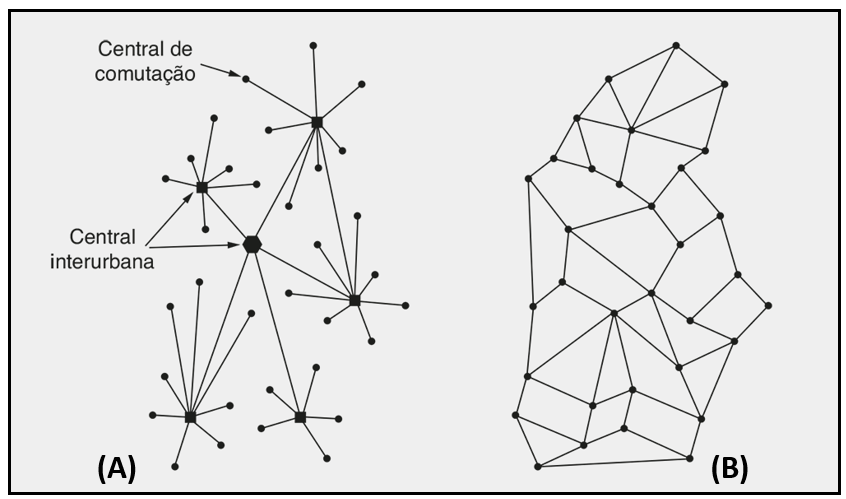
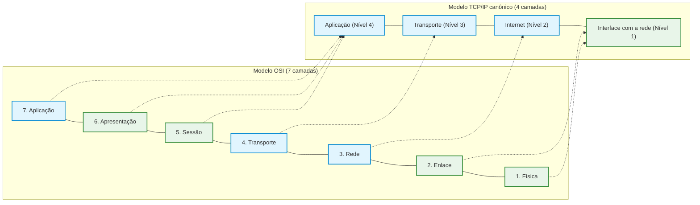
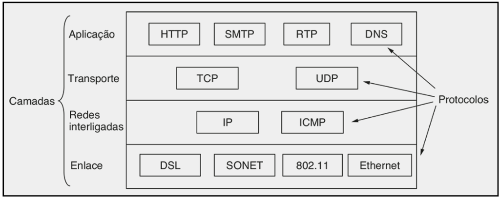

# Introdução ao modelo TCP/IP e arquitetura da Internet

Enquanto o modelo de referência OSI (*Open Systems Interconnection*, Interconexão de Sistemas Abertos) foi concebido formalmente por comitês internacionais como um guia teórico e normativo universal, o modelo TCP/IP (*Transmission Control Protocol/Internet Protocol*, Protocolo de Controle de Transmissão/Protocolo de Internet) trilhou o caminho inverso: nasceu de demandas práticas e operacionais de engenharia e tornou-se a pilha real e definitiva que viabiliza a Internet moderna.

Desenvolvido originalmente sob encomenda de agências governamentais para conectar redes computacionais geograficamente dispersas e heterogêneas, o conjunto TCP/IP consolidou os fundamentos da comutação de pacotes descentralizada. Para compreender a essência dessa arquitetura, é necessário revisitar o contexto histórico da Guerra Fria, a gênese da ARPANET (*Advanced Research Projects Agency Network*, Rede da Agência de Projetos de Pesquisa Avançados), a transição entre modelos conceituais de 4 e 5 camadas e a distribuição concreta de protocolos e interfaces de soquetes (*sockets*) entre hardware, sistema operacional e aplicações.

## Contexto histórico: da fragilidade telefônica à ARPANET

No auge da Guerra Fria, durante a década de 1960, o Departamento de Defesa dos Estados Unidos (*United States Department of Defense*, DoD) identificou uma vulnerabilidade crítica em sua infraestrutura militar de comando e controle. As comunicações governamentais dependiam integralmente do sistema telefônico público de comutação de circuitos mantido por concessionárias de telecomunicações.

Conforme ilustrado no gráfico abaixo, a arquitetura do sistema telefônico tradicional (A) era rigidamente hierárquica e centralizada. As linhas dos assinantes convergiam para centrais de comutação locais, que por sua vez conectavam-se a poucas centrais interurbanas de grande porte. Se um ataque nuclear ou sabotagem física destruísse essas centrais estratégicas, toda a malha de telecomunicações do país colapsaria instantaneamente, isolando regiões inteiras em ilhas de comunicação incomunicáveis.

A meta militar consistia em projetar uma rede descentralizada e distribuída (B), sem nenhum nó ou centro de comutação único vital. Nessa nova abordagem proposta teoricamente pelo pesquisador Paul Baran, os dados seriam divididos em fragmentos autônomos (pacotes) capazes de navegar por caminhos alternativos através de uma malha redundante. Se determinados enlaces ou nós fossem bombardeados e destruídos no meio da transmissão, os nós sobreviventes recalculariam rotas em tempo real, preservando a continuidade operacional das comunicações estratégicas.

O impulso político decisivo para materializar esse projeto ocorreu em 1957, quando a antiga União Soviética colocou em órbita o primeiro satélite artificial da história, o *Sputnik*. O impacto geopolítico dessa façanha científica levou o governo norte-americano a criar a ARPA (*Advanced Research Projects Agency*, Agência de Projetos de Pesquisa Avançados) para fomentar iniciativas tecnológicas de fronteira. A ARPA financiou o projeto da ARPANET, cuja primeira transmissão de dados foi realizada com sucesso em outubro de 1969 interligando a Universidade da Califórnia em Los Angeles (UCLA) e o Instituto de Pesquisa de Stanford (*Stanford Research Institute*, SRI). Poucos meses depois, a rede já interconectava quatro instituições pioneiras (UCLA, SRI, Universidade da Califórnia em Santa Bárbara e Universidade de Utah), crescendo rapidamente ao longo dos anos seguintes.

## A invenção do TCP/IP, Berkeley Unix e as interfaces de soquetes

À medida que novas redes de naturezas tecnológicas distintas começaram a ser implantadas (redes via satélite, enlaces de rádio móveis e redes locais cabeadas), surgiu o problema de interconectá-las. A ARPANET original utilizava o protocolo NCP (*Network Control Program*, Programa de Controle de Rede), que operava apenas dentro de sua rede homogênea e não permitia o diálogo direto entre redes autônomas distintas.

Em 1974, Vinton Cerf e Robert Kahn publicaram o artigo clássico *A Protocol for Packet Network Intercommunication*, apresentando os protocolos e o modelo fundamental do TCP/IP. Pela primeira vez estabeleceu-se o conceito de **redes interconectadas** (*inter-networking*, termo que deu origem à palavra **Internet**). A premissa revolucionária do TCP/IP foi transferir a responsabilidade de roteamento global para um protocolo comum de rede (o IP) e deixar a inteligência e o controle de confiabilidade exclusivamente nos computadores das extremidades (via TCP), tratando a infraestrutura intermediária de telecomunicações como uma "nuvem" de trânsito neutra.

Para fomentar a adoção global desse padrão, a ARPA financiou contratos com grandes fabricantes de tecnologia (como IBM e Hewlett-Packard) para que desenvolvessem implementações do TCP/IP para suas plataformas de hardware. No entanto, o catalisador definitivo de sua hegemonia ocorreu no início da década de 1980, quando a Universidade da Califórnia em Berkeley reescreveu e incorporou a pilha TCP/IP diretamente no sistema operacional Unix (na versão 4.2BSD, *Berkeley Software Distribution*).

Nessa versão do BSD Unix, os engenheiros introduziram a API de **soquetes** (*sockets API*), uma interface de programação padronizada que tratava a comunicação de rede como um fluxo simples de entrada e saída, de forma idêntica à leitura e escrita em arquivos de disco. Essa abstração facilitou enormemente a vida dos programadores em todo o mundo, impulsionando uma explosão de novos softwares de rede e consolidando o TCP/IP como o padrão dominante na indústria e no meio acadêmico.

## Comparação arquitetural: modelo OSI versus modelo TCP/IP

Embora o modelo de referência OSI estruture a comunicação em 7 níveis rigorosos, o modelo TCP/IP simplificou essa organização. As camadas de sessão (camada 5) e apresentação (camada 6) do modelo OSI deixaram de existir como níveis independentes na pilha TCP/IP. Suas funções (como controle de turnos de diálogo, serialização de formatos, compressão e criptografia) foram deliberadamente incorporadas pelas próprias aplicações e bibliotecas de software na camada de aplicação.

A literatura técnica de redes apresenta o modelo TCP/IP sob duas abordagens consagradas:

- **Modelo de 4 camadas (RFC 1122):** modelo clássico e original formulado pela IETF, que funde os aspectos físicos e de enlace em um único nível inferior denominado **Camada de interface com a rede** (ou simplesmente camada de interface/acesso à rede), seguido pela **Camada de Internet** (nível 2), **Camada de transporte** (nível 3) e **Camada de aplicação** (nível 4);
- **Modelo híbrido de 5 camadas:** abordagem didática amplamente adotada em livros modernos (como os de Andrew Tanenbaum e James Kurose), que preserva as camadas Física e de Enlace separadas na base da pilha para facilitar a análise de cabeamento, modulação e switches locais.

A denominação da camada 2 do modelo TCP/IP de 4 camadas recebe o nome oficial de **Camada de Internet** (*Internet layer*). Embora autores em contextos específicos utilizem os termos camada de internet e camada de rede como sinônimos funcionais, a designação formal de "camada de internet" reflete o seu propósito original de realizar a interconexão de redes autônomas através do protocolo IP.

## Distribuição de protocolos na pilha TCP/IP

A arquitetura TCP/IP organiza seus padrões em uma hierarquia funcional clara, onde cada camada concentra protocolos concebidos para atender a demandas específicas de comunicação:

A tabela abaixo sintetiza a distribuição dos principais protocolos da Internet pelas quatro camadas do modelo TCP/IP:

| Camada TCP/IP | Nível | Protocolos fundamentais | Função primordial |
| :--- | :---: | :--- | :--- |
| **Aplicação** | 4 | HTTP, DNS, SMTP, RTP, FTP, IMAP, SSH, SIP | Comunicação direta entre processos de software do usuário; incorpora funções de sessão e apresentação |
| **Transporte** | 3 | TCP (*Transmission Control Protocol*), UDP (*User Datagram Protocol*) | Comunicação lógica ponta a ponta entre processos, com entrega confiável (TCP) ou rápida não orientada à conexão (UDP) |
| **Internet** | 2 | IP (*Internet Protocol* - IPv4/IPv6), ICMP (*Internet Control Message Protocol*) | Endereçamento lógico global, roteamento de pacotes através de redes autônomas e diagnóstico de erros de entrega |
| **Interface com a rede** | 1 | Ethernet (IEEE 802.3), Wi-Fi (IEEE 802.11), DSL, SONET/SDH, fibra óptica | Modulação de sinais, controle de acesso ao meio físico e transmissão de quadros entre nós adjacentes |

## Implementação física da pilha nos computadores modernos

Nos computadores e sistemas operacionais atuais, as camadas do modelo TCP/IP não são apenas conceitos teóricos abstratos; elas são distribuídas de forma física e computacional em camadas tangíveis de software e hardware:

1. **Camada de aplicação:** é executada no **espaço do usuário** (*user space*). Os protocolos (como HTTP e DNS) são implementados diretamente pelos programas executáveis instalados, como o navegador Google Chrome, o cliente de correio eletrônico ou serviços de segundo plano do sistema operacional;
2. **Camadas de transporte e internet:** residem no **núcleo do sistema operacional** (*kernel space*). Quando o usuário instala distribuições Linux, Microsoft Windows ou macOS em uma máquina, a pilha de protocolos TCP, UDP, IP e ICMP já vem pré-instalada e compilada nativamente dentro do sistema operacional, sendo acessada pelas aplicações através da API de soquetes;
3. **Camada de interface com a rede:** opera na fronteira entre software e hardware. A parcela lógica superior (gerenciamento de filas de pacotes e controle de enlace) é executada pelo **driver de dispositivo** da placa de rede dentro do sistema operacional, enquanto a conversão física de bits em pulsos elétricos, modulação de rádio e conectores mecânicos (placas de rede, chips Wi-Fi e transceptores) é implementada integralmente em **hardware**.

Quando um usuário digita uma busca em seu navegador, a requisição nasce no software da aplicação (camada 4), desce para o sistema operacional Windows ou Linux para receber portas de transporte TCP e endereçamento IP (camadas 3 e 2) e, finalmente, é entregue ao driver da placa de rede e ao conector físico para ser disparada pelo cabo ou pelo ar (camada 1).

## Pontos que costumam gerar confusão

* **O modelo TCP/IP possui um número universal e rígido de camadas na literatura:** O modelo original padronizado pela IETF possui 4 camadas (Interface, Internet, Transporte e Aplicação), mas muitos livros didáticos adotam uma divisão híbrida em 5 camadas (Física, Enlace, Rede, Transporte e Aplicação) para manter o rigor no ensino de cabeamento e enlaces.
* **O modelo TCP/IP não possui segurança ou controle de sessão:** As funções de sessão e de apresentação do modelo OSI continuam presentes na Internet, mas foram incorporadas diretamente pelos próprios protocolos da camada de aplicação (como SIP para VoIP ou TLS/HTTPS para criptografia).
* **A ARPANET e a Internet são nomes sinônimos para a mesma rede:** A ARPANET foi uma rede militar e acadêmica precursora e homogênea operando sobre o protocolo NCP; a Internet nasceu a partir de 1974 com o protocolo TCP/IP, cuja arquitetura permitiu interligar múltiplas redes heterogêneas e autônomas em escala global.
* **Toda a pilha TCP/IP é implementada em software pelo programador da aplicação:** O desenvolvedor de software apenas consome a API de soquetes na camada de aplicação; toda a complexidade de TCP, IP e roteamento é resolvida nativamente pelo núcleo do sistema operacional e pela placa de rede.
* **O protocolo IP garante que os dados cheguem sem perda ao computador de destino:** O protocolo IP opera na camada de Internet sob o princípio de "melhor esforço" (*best-effort*), sem garantia de entrega ou ordenação; a garantia de confiabilidade e confirmação é responsabilidade exclusiva do protocolo TCP na camada de transporte.
