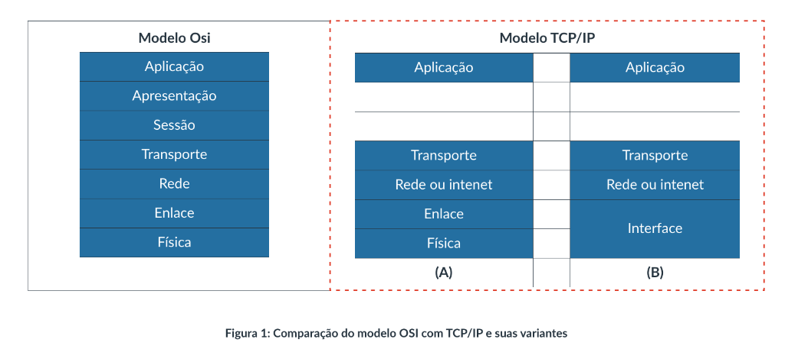
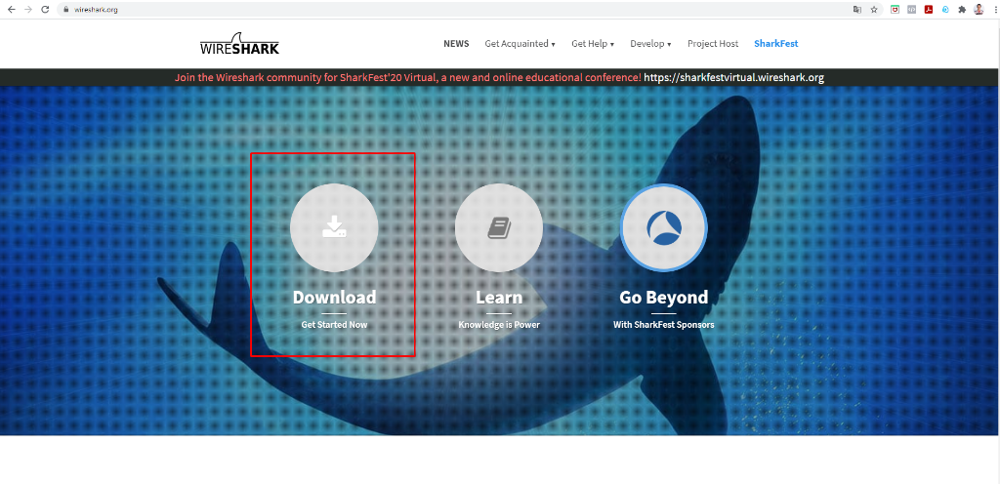
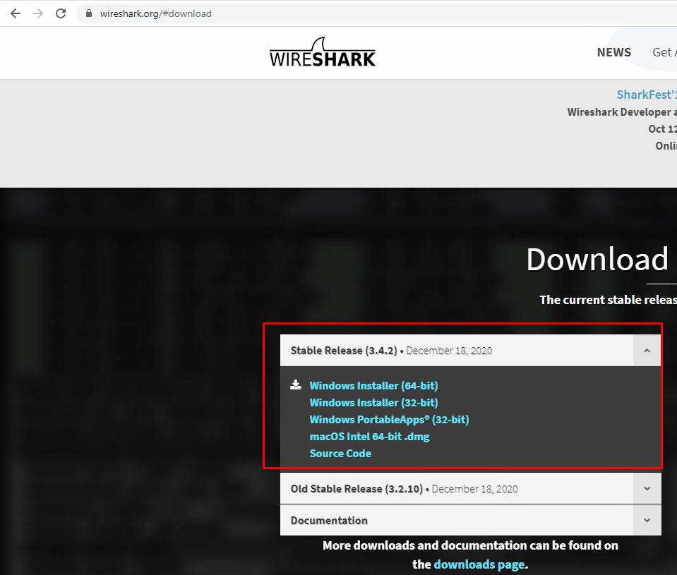
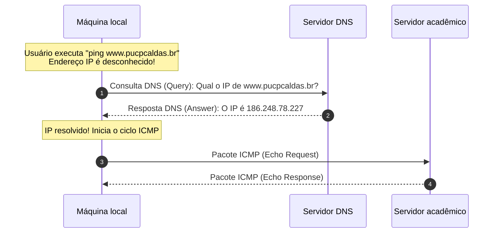

# Camada de interface do modelo TCP/IP e análise com Wireshark

Na arquitetura da pilha TCP/IP (*Transmission Control Protocol/Internet Protocol*, Protocolo de Controle de Transmissão/Protocolo de Internet), a base de sustentação é a **camada de interface com a rede** (frequentemente denominada de camada de acesso à rede ou camada de interface). Essa camada unifica e sintetiza todas as responsabilidades que o modelo conceitual OSI distribui entre a camada física (nível 1) e a camada de enlace de dados (nível 2). Seu propósito primordial é conectar a máquina aos enlaces de comunicação físicos locais, modulando sinais e estruturando os dados em quadros (*frames*) para transmissão entre nós adjacentes.

Para os profissionais e estudantes de redes de computadores, a melhor maneira de consolidar a compreensão do trânsito de dados na camada de interface é a inspeção direta de tráfego em tempo real. Por meio de analisadores de protocolos (*sniffers*) como o Wireshark, torna-se possível dissecar as estruturas binárias das unidades de dados de protocolo, acompanhar a hierarquia de encapsulamento e verificar como campos de controle (como o EtherType) informam ao sistema operacional para qual processo do núcleo os pacotes devem ser despachados.

## A camada de interface: abstração física e serviço não orientado à conexão

A camada de interface tem o papel fundamental de **isolar e abstrair** as camadas superiores dos detalhes de infraestrutura mecânica, óptica e eletromagnética. Graças a essa abstração, a camada de Internet (com o protocolo IP) não precisa saber se o computador está conectado por um cabo de rede azul de par trançado, por uma fibra óptica submarina ou por uma antena de radiofrequência: o IP simplesmente gera o seu pacote e delega a transmissão ao nó seguinte requisitando o serviço da camada de interface local.



Na arquitetura TCP/IP, a camada de interface opera sob duas premissas de projeto essenciais:

1. **Apoio à comutação por pacotes:** o modelo foi projetado para que cada pacote de uma mesma transmissão possa seguir caminhos físicos independentes, saltando por diferentes enlaces e nós intermediários;
2. **Serviço não orientado à conexão:** no nível de interface de rede local, os quadros são emitidos sem negociação preliminar de circuitos (*connectionless*). O nó simplesmente despacha o quadro no meio compartilhado. Caso uma aplicação necessite de confirmação de entrega ou controle rígido de conexão, essa garantia é delegada à camada de transporte através do protocolo TCP (*Transmission Control Protocol*).

Além disso, a camada de interface acomoda com facilidade topologias e tecnologias heterogêneas ao longo do trajeto de uma mensagem. Em uma aplicação de rede elétrica inteligente (*Smart Grid*), por exemplo, os dados de telemetria emitidos por um medidor residencial podem trafegar inicialmente por uma rede sem fio em malha (*Mesh*), conectar-se a um anel óptico metropolitano baseado em SONET (*Synchronous Optical Network*) e, finalmente, alcançar o servidor central através de uma rede local comutada em estrela com tecnologia Ethernet (IEEE 802.3). Todas essas tecnologias operam no nível de interface.

## Monitoramento prático de tráfego com o Wireshark

O **Wireshark** é o analisador de protocolos de código aberto mais utilizado mundialmente em ambientes corporativos e acadêmicos. Ele opera capturando os dados que trafegam pela interface de rede física (placa de rede cabeada ou controladora Wi-Fi) em **modo promíscuo**, permitindo dissecar cabeçalhos de todos os níveis da pilha com precisão cirúrgica.

A obtenção do software é realizada diretamente no portal oficial da ferramenta ([wireshark.org](https://www.wireshark.org/)), clicando no botão de download da página principal:



O instalador está disponível para múltiplos sistemas operacionais, incluindo pacotes compilados para ambientes Microsoft Windows (instaladores de 64 bits), macOS e código-fonte para distribuições Linux:



Após a instalação, o fluxo de captura inicia-se acessando o menu de opções de captura (*Capture $\to$ Options*), selecionando a interface de rede ativa que possui tráfego de saída (por exemplo, a interface de rede sem fio Wi-Fi) e disparando a gravação contínua.

## O experimento do ping e a resolução prévia de nomes por DNS

Para inspecionar o encapsulamento real na camada de interface, considere o experimento prático de emitir um teste de conectividade utilizando o utilitário `ping` no terminal do sistema operacional, direcionado a um endereço de servidor acadêmico:

```shell
ping www.pucpcaldas.br
```

O comando `ping` utiliza o protocolo ICMP (*Internet Control Message Protocol*, Protocolo de Mensagens de Controle da Internet) para enviar mensagens de solicitação de eco (*Echo Request*) e aguardar a devolução de mensagens de resposta de eco (*Echo Response*). No entanto, o protocolo IP exige que o pacote contenha o endereço lógico numérico do destino, e não o nome de domínio textual amigável `www.pucpcaldas.br`.

Por essa razão, antes de disparar o primeiro pacote ICMP, o computador é obrigado a consultar previamente o serviço DNS (*Domain Name System*, Sistema de Nomes de Domínio) na camada de aplicação. A ordem real dos acontecimentos na rede é representada no fluxo a seguir:



No Wireshark, ao filtrar os pacotes capturados digitando `dns` na barra de busca de filtros, a ferramenta exibe exatamente as duas mensagens preliminares:

1. A mensagem de consulta (*Standard query*), contendo a pergunta formal do cliente: *"Qual o endereço IP associado a www.pucpcaldas.br?"*;
2. A mensagem de resposta (*Standard query response*), na qual o servidor DNS indica que o endereço correspondente é `186.248.78.227`.

## Anatomia do quadro Ethernet e o papel do campo EtherType

A interface do Wireshark divide a inspeção dos dados em três painéis principais: a lista superior com o resumo dos pacotes capturados, a janela central contendo a árvore hierárquica dos protocolos decodificados e o painel inferior exibindo os dados em estado bruto (representação hexadecimal à esquerda e caracteres ASCII à direita).

Na janela central, a hierarquia de encapsulamento reflete a descida completa pela pilha de protocolos:

```
+-- Frame (Camada de interface: atributos físicos de tempo e tamanho)
    +-- Ethernet II (Cabeçalho de enlace: MAC de origem, MAC de destino e Type)
        +-- Internet Protocol Version 4 (Camada de Internet: endereçamento IP)
            +-- User Datagram Protocol (Camada de transporte: portas UDP)
                +-- Domain Name System (Camada de aplicação: query/answer DNS)
```

Ao expandir o cabeçalho **Ethernet II** (nível de interface), encontram-se três campos cardeais que estruturam o quadro:

- **Endereço MAC de destino (6 bytes):** o endereço físico da placa de rede do próximo salto (roteador padrão ou máquina destinatária local);
- **Endereço MAC de origem (6 bytes):** o endereço físico da interface de rede transmissora;
- **Tipo (*Type* ou EtherType - 2 bytes):** código numérico padronizado que indica qual protocolo de camada superior está encapsulado na carga útil do quadro.

```
+-------------------+-------------------+-------------------+-------------------------+
|  MAC Destino      |  MAC Origem       |  EtherType        |  Payload (Carga Útil)   |
|   (6 bytes)       |   (6 bytes)       |   (2 bytes)       |    (46 a 1500 bytes)    |
+-------------------+-------------------+-------------------+-------------------------+
| XX:XX:XX:XX:XX:XX | YY:YY:YY:YY:YY:YY |      0x0800       | Pacote IPv4             |
+-------------------+-------------------+-------------------+-------------------------+
```

No experimento realizado, o painel hexadecimal exibe o valor `08 00` (hexadecimal `0x0800`). Esse código padronizado pelo IEEE especifica formalmente que a carga útil contida dentro daquele quadro é um **pacote IPv4**. Caso o quadro transportasse uma mensagem de resolução de endereços físicos, o campo conteria `0x0806` (protocolo ARP, *Address Resolution Protocol*); se transportasse um pacote IPv6, o valor seria `0x86DD`.

Esse campo desempenha uma função crucial no momento da recepção: quando o sinal elétrico ou de radiofrequência atinge a placa de rede do computador, o controlador de hardware valida o endereço MAC de destino, remove o cabeçalho Ethernet e precisa saber para quem entregar a carga útil. A placa de rede emite uma **interrupção de hardware** (*hardware interrupt*) para a CPU do computador, notificando o sistema operacional. Ao ler o código `0x0800` no EtherType, o núcleo do sistema operacional sabe imediatamente que deve despachar os dados para a rotina ou processo encarregado de processar o protocolo IPv4 no núcleo (*kernel*).

Sem o campo EtherType no nível de interface, a pilha de protocolos seria incapaz de desmultiplexar o tráfego recebido e encaminhá-lo para a camada de rede adequada.

## Pontos que costumam gerar confusão

* **A camada de interface do TCP/IP equivale unicamente à camada de enlace do OSI:** O modelo TCP/IP de 4 camadas reúne tanto as atribuições mecânicas/elétricas da camada física (nível 1) quanto a estruturação lógica em quadros da camada de enlace (nível 2) em um único nível funcional.
* **O Wireshark modifica ou desacelera os dados que transitam pela rede:** O software opera em modo passivo de escuta (*packet sniffer*), clonando os pacotes que chegam à placa de rede para exibição sem interferir no tráfego ou reescrever os dados originais.
* **O ping dispara pacotes diretamente para o domínio textual do destino:** O comando `ping` depende compulsoriamente de uma resolução DNS prévia caso receba um nome de domínio, pois o protocolo IP e os quadros Ethernet exigem endereços numéricos para envio físico.
* **O campo EtherType indica a porta da aplicação de destino:** O EtherType situa-se na camada de interface e indica o protocolo da camada de rede (como IPv4 ou ARP); as portas lógicas que identificam a aplicação (como porta 80 para HTTP ou 53 para DNS) são tratadas exclusivamente na camada de transporte (TCP ou UDP).
* **O tamanho do quadro Ethernet é ilimitado:** Padrões Ethernet convencionais possuem uma unidade máxima de transmissão (*Maximum Transmission Unit*, MTU) que limita a carga útil (*payload*) a 1.500 bytes por quadro.
