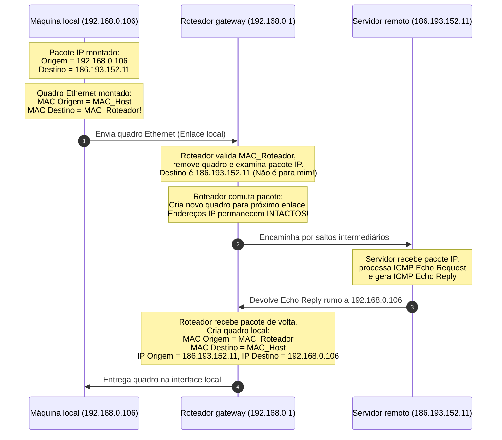

# Camada de internet do modelo TCP/IP, roteamento e protocolo ICMP

A camada de Internet (formalmente designada como camada de rede em determinadas bibliografias) é considerada o verdadeiro coração operacional da arquitetura TCP/IP (*Transmission Control Protocol/Internet Protocol*, Protocolo de Controle de Transmissão/Protocolo de Internet). É este nível que viabiliza a própria definição de Internet: a capacidade de transportar pacotes de dados de forma autônoma e descentralizada entre sistemas computacionais situados em redes lógicas e físicas completamente distintas, transpondo múltiplos nós intermediários de comutação (roteadores).

Ao adotar a comutação por pacotes sem conexão (*connectionless packet switching*), a camada de Internet não garante que os dados cheguem na mesma sequência em que foram emitidos, tampouco assume a responsabilidade de reenviar dados perdidos por congestionamento de tráfego. Essa simplicidade arquitetural deliberada preserva a velocidade da infraestrutura de roteamento global e apoia-se em dois protocolos cardeais: o **IP** (*Internet Protocol*), responsável pelo tráfego de dados e endereçamento lógico, e o **ICMP** (*Internet Control Message Protocol*), responsável por diagnósticos, relatórios de erros e ferramentas operacionais consagradas como o `ping` e o `tracert`.

## Roteamento por múltiplos saltos e a comutação de pacotes

Em uma rede local homogênea, dois computadores conseguem dialogar diretamente no nível de enlace (camada de interface com a rede) através de seus endereços físicos MAC. No entanto, quando um usuário solicita um recurso hospedado em um servidor corporativo remoto, não existe um enlace direto de cabo ou fibra interligando ambas as máquinas. A entrega da mensagem depende de múltiplos enlaces sucessivos conectados por roteadores, formando uma cadeia de saltos (*hops*).

A camada de Internet do modelo TCP/IP adota o princípio da **comutação por pacotes** (também denominada rede de datagramas). Isso significa que uma mensagem longa gerada pela aplicação é segmentada na camada de transporte e despachada na camada de Internet em pacotes autônomos. Cada pacote carrega o endereço de destino final completo e é tratado de forma independente pelos roteadores ao longo do caminho.

```mermaid
flowchart LR
    classDef core fill:#e1f5fe,stroke:#0288d1,stroke-width:2px;
    classDef component fill:#e8f5e9,stroke:#388e3c,stroke-width:2px;
    classDef data fill:#fff3e0,stroke:#f57c00,stroke-width:2px;

    HostLocal["Máquina local<br>(192.168.0.106)"]:::core
    RotCasa["Roteador residencial<br>(192.168.0.1)"]:::component
    RotISP1["Roteador de borda (ISP)<br>(172.16.126.4)"]:::component
    PontoTroca["Ponto de troca (IX.br)<br>(187.16.218.58)"]:::component
    Backbone["Roteador de trânsito<br>(74.125.243.65)"]:::component
    Servidor["Servidor remoto<br>(172.217.30.163)"]:::data

    HostLocal -->|"Salto 1"| RotCasa
    RotCasa -->|"Salto 2"| RotISP1
    RotISP1 -->|"Salto 3...4"| PontoTroca
    PontoTroca -->|"Salto 5...7"| Backbone
    Backbone -->|"Salto final"| Servidor
```



Essa independência de itinerário produz duas consequências imediatas:

- **Resiliência dinâmica a falhas:** se um enlace intermediário sofrer rompimento de fibra óptica ou sobrecarga extrema, os roteadores recalcularão dinamicamente as tabelas de rotas e encaminharão os pacotes seguintes por rotas alternativas sem interromper a transmissão global;
- **Chegada desordenada de pacotes:** como enlaces distintos apresentam latências físicas, larguras de banda e comprimentos de propagação diferentes, um pacote $A$ transmitido instantes antes de um pacote $B$ pode pegar um caminho ligeiramente mais demorado e alcançar o destino após o pacote $B$. A camada de Internet não realiza reordenação; ela apenas entrega os pacotes à camada de transporte (especificamente ao protocolo TCP), que utiliza os números de sequência contidos no cabeçalho TH para reordenar o fluxo antes da entrega à aplicação.

## Rastreamento de rotas com a ferramenta tracert

Para evidenciar a sucessão de saltos intermediários que separam uma máquina de um destino remoto, os sistemas operacionais disponibilizam o comando de diagnóstico **tracert** (no Windows) ou **traceroute** (em distribuições Linux e macOS).

A sintaxe de execução requer apenas o comando acompanhado do nome de domínio amigável ou endereço IP de destino. Por exemplo, ao rastrear o itinerário de rede até os servidores do Google:

```shell
C:\Users\antigravity>tracert www.google.com.br

Rastreando a rota para www.google.com.br [172.217.30.163]
com no máximo 30 saltos:

  1      1ms     1ms       1ms  ARCHER_C5 [192.168.0.1]
  2      4ms     2ms       1ms  172.16.126.4
  3      3ms     1ms       3ms  172.16.126.21
  4     10ms     2ms       2ms  172.16.126.53
  5      7ms     7ms       7ms  as15169.saopaulo.sp.ix.br [187.16.218.58]
  6     43ms    12ms       8ms  74.125.243.65
  7      8ms    19ms       8ms  142.250.46.227
  8      7ms     7ms       8ms  eze03s36-in-f3.1e100.net [172.217.30.163]

Rastreamento concluído.
```

O relatório gerado pelo utilitário revela a cadeia completa de nós intermediários:

- **Salto 1 (`192.168.0.1`):** corresponde ao gateway padrão residencial (o roteador local com interface Wi-Fi e portas de switch);
- **Saltos 2 a 4 (`172.16.126.x`):** equipamentos de agregação e distribuição interna do provedor de acesso à Internet (*Internet Service Provider*, ISP);
- **Salto 5 (`as15169.saopaulo.sp.ix.br` - `187.16.218.58`):** ponto de troca de tráfego (*Internet Exchange Point*, IX.br) em São Paulo, onde o sistema autônomo do provedor entrega os pacotes diretamente à rede da empresa destinatária;
- **Saltos 6 a 8 (`172.217.30.163`):** roteadores de trânsito internos do data center até a entrega física no servidor web final.

Cada linha exibe três medições consecutivas de tempo de ida e volta (*Round-Trip Time*, RTT) expressas em milissegundos (ms), permitindo diagnosticar gargalos locais ou intercontinentais de latência.

## O protocolo ICMP e o mecanismo de teste com ping

Embora o protocolo IP seja encarregado de encapsular e encaminhar os dados, ele opera sem conexão e não possui mecanismos internos para alertar o emissor sobre anomalias de rota, expiração de tempo de trânsito ou descarte de pacotes por buffers cheios. Essa função de suporte e supervisão operacional é delegada ao protocolo **ICMP** (*Internet Control Message Protocol*, Protocolo de Mensagens de Controle da Internet).

O ICMP atua intimamente atrelado ao IP, sendo encapsulado diretamente dentro da carga útil de pacotes IP (campo *Protocol* do cabeçalho IP preenchido com o valor numérico 1). Os roteadores e sistemas finais utilizam mensagens ICMP para duas finalidades essenciais:

1. **Relatório de erros e exceções operacionais:** quando um pacote IP não consegue prosseguir viagem (por exemplo, se a rota para a rede de destino não existe na tabela do roteador ou se o campo de tempo de vida TTL, *Time-to-Live*, atinge o valor zero antes da entrega), o roteador intermediário descarta o pacote e despacha uma mensagem ICMP de erro (como *Destination Unreachable* ou *Time Exceeded*) de volta ao endereço IP de origem do transmissor;
2. **Diagnóstico e teste de conectividade (Ping):** quando o administrador ou usuário executa o utilitário `ping <endereço>`, a pilha de rede gera uma mensagem ICMP denominada **Echo Request** (solicitação de eco - Tipo 8). Ao receber essa mensagem, a interface destinatária processa a solicitação e devolve compulsoriamente uma mensagem ICMP denominada **Echo Reply** (resposta de eco - Tipo 0).

Caso o comando seja parametrizado para emitir apenas um pacote (por exemplo, `ping -n 1 www.pocos-net.com.br`), o emissor dispara um único pacote com o Echo Request e calcula a latência com base no instante exato de recepção do Echo Reply correspondente.

## Desacoplamento entre endereços MAC e IP no fluxo de roteamento

A inspeção detalhada de quadros e pacotes em analisadores de rede (como o Wireshark) revela um princípio arquitetural decisivo: o desacoplamento rigoroso entre os endereços físicos (camada de interface/enlace) e os endereços lógicos (camada de Internet/rede).

Considere o envio de uma mensagem de teste `ping` partindo da máquina local (`192.168.0.106`) em direção ao servidor remoto (`186.193.152.11`) através do roteador residencial (`192.168.0.1`):



A análise dessa troca evidencia a divisão de papéis:

- **No trajeto de ida (Echo Request):** o pacote IP carrega permanentemente como endereço de origem a máquina local (`192.168.0.106`) e como endereço de destino o servidor remoto (`186.193.152.11`). Porém, o quadro Ethernet inicial carrega como **MAC de destino o endereço físico do roteador local** (descoberto previamente na tabela local através do comando `arp -a`). O computador sabe que não pode alcançar o MAC do servidor remoto diretamente, despachando o quadro para o gateway;
- **No nó intermediário:** o roteador recebe o quadro, confere seu MAC, remove o cabeçalho Ethernet e constata que o endereço IP final não pertence a ele. O roteador consulta sua tabela de rotas, aloca uma nova interface de saída, forja um novo cabeçalho de enlace compatível com a próxima rede e encaminha o pacote;
- **No trajeto de volta (Echo Reply):** o servidor remoto devolve o pacote contendo origem `186.193.152.11` e destino `192.168.0.106`. Ao ingressar novamente na rede residencial pelo roteador, este forja um quadro Ethernet local contendo seu próprio MAC como origem e o MAC da máquina local (`5C-CD-5B-3C-B2-61`) como destino.

Esse experimento confirma a regra de ouro das redes de computadores: **os endereços lógicos IP de origem e destino final permanecem inalterados por toda a travessia**, enquanto **os endereços físicos MAC mudam a cada novo salto de enlace**.

## Pontos que costumam gerar confusão

* **A camada de Internet do TCP/IP realiza a reordenação de pacotes que chegam fora de ordem:** A camada de Internet opera por comutação pura de pacotes sob o princípio de melhor esforço (*best-effort*), sem ordenar dados; a reordenação de segmentos recebidos é responsabilidade da camada de transporte (TCP).
* **O utilitário tracert envia pacotes com um comando especial de rastreamento:** O `tracert` não possui um protocolo exclusivo; ele utiliza mensagens rotineiras de ICMP ou UDP manipulando deliberadamente o campo TTL (*Time-to-Live*) do cabeçalho IP a partir de 1, provocando mensagens de erro *ICMP Time Exceeded* em cada roteador para revelar seus endereços.
* **O comando ping utiliza a camada de transporte com portas TCP:** O `ping` opera exclusivamente sobre o protocolo ICMP na camada de Internet; ele não utiliza portas lógicas de transporte TCP ou UDP e não realiza negociação prévia de conexão (*handshake*).
* **O endereço MAC do computador de destino pode ser descoberto através da Internet:** O endereço MAC possui significância restrita ao enlace local; computadores remotos na Internet nunca tomam conhecimento do endereço físico da máquina de origem, pois os cabeçalhos de enlace são descartados e reescritos pelo primeiro roteador de saída.
* **O protocolo ICMP é dispensável caso o protocolo IP esteja em pleno funcionamento:** O ICMP é um componente mandatório e inseparável da camada de Internet; sem ele, roteadores não conseguem notificar emissões sobre rotas inalcançáveis, fragmentações necessárias ou laços infinitos de roteamento causados por falhas de configuração.
