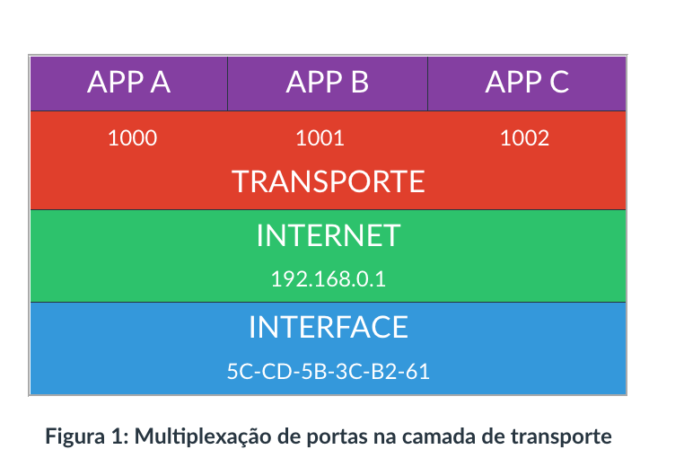
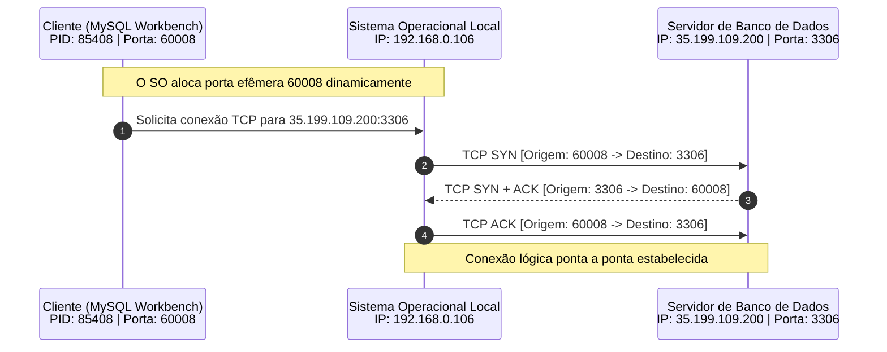

# Camada de transporte do modelo TCP/IP, portas e protocolos TCP e UDP

A camada de transporte do modelo TCP/IP (*Transmission Control Protocol/Internet Protocol*, Protocolo de Controle de Transmissão/Protocolo de Internet) é responsável por estabelecer a comunicação lógica direta entre processos de software em execução em máquinas distintas. Enquanto as camadas inferiores cuidam da infraestrutura física, do enlace local e do roteamento de datagramas entre hospedeiros através de nós intermediários, a camada de transporte atua exclusivamente no modelo **ponta a ponta** (*end-to-end*). Isso significa que ela só é executada nos nós terminais (a máquina emissora de origem e a máquina receptora de destino), sendo totalmente ignorada e transparente para switches e roteadores no núcleo da rede.

Para viabilizar a execução concorrente de múltiplos serviços em um mesmo sistema computacional, a camada de transporte implementa a **multiplexação e demultiplexação de portas**. Essa abstração lógica permite que pacotes com o mesmo endereço IP e direcionados à mesma placa de rede física sejam entregues com precisão cirúrgica a cada processo de aplicação correspondente, apoiando-se nos dois protocolos fundamentais da arquitetura da Internet: o **TCP** (*Transmission Control Protocol*), confiável e orientado à conexão, e o **UDP** (*User Datagram Protocol*), ágil, sem conexão e baseado em datagramas independentes.

## Multiplexação de portas e identificação de processos

Em uma rotina de uso convencional, um mesmo computador pode realizar simultaneamente o download de um arquivo pelo navegador web, trocar mensagens em tempo real pelo Microsoft Teams e sincronizar transações com um banco de dados relacional remoto. Fisicamente, todos os quadros chegam à mesma placa de rede compartilhando o mesmo endereço de enlace MAC e o mesmo endereço de rede IP. Ao receber o pacote desempacotado da camada de Internet, o sistema operacional necessita de um critério inequívoco para determinar qual aplicativo deve receber a carga útil de dados.

A técnica de Feynman esclarece essa distribuição através da analogia de um edifício residencial:
- O **endereço IP** equivale ao endereço geográfico do prédio (como `Avenida Marechal Deodoro, número 1000`). Todas as cartas enviadas aos moradores chegam à portaria sob esse mesmo destino global.
- O **número da porta** (*port number*) equivale ao número do apartamento individual (como `Apartamento 11` ou `Apartamento 42`). É ele que permite ao porteiro encaminhar cada correspondência diretamente ao morador correto, sem confusão entre as unidades.

Na camada de transporte, cada aplicação que deseja enviar ou receber dados pela rede associa-se a um identificador numérico de 16 bits (variando de 0 a 65535), denominado **porta lógica**. A composição entre o endereço IP e a porta constitui um **soquete de rede** (*network socket*), que define de forma única e inequívoca o canal de comunicação entre dois processos no planeta.



Na recepção, o processo inverso chama-se **demultiplexação**: a placa de rede valida o endereço MAC, o núcleo do sistema operacional desempacota o datagrama IP, valida o IP de destino e encaminha o segmento à camada de transporte. A camada de transporte lê o campo de porta de destino no cabeçalho do segmento e despacha a mensagem imediatamente ao processo correspondente.

## Protocolo TCP: conexão, confiabilidade e controle de fluxo

O protocolo **TCP** (*Transmission Control Protocol*, Protocolo de Controle de Transmissão) é o protocolo orientado à conexão e de entrega confiável da pilha TCP/IP. Antes de despachar qualquer byte útil da aplicação, os dois hospedeiros realizam um procedimento de sincronização inicial (*three-way handshake*), negociando parâmetros de controle como números de sequência iniciais e tamanho máximo de segmento.

O TCP trata os dados gerados pela aplicação como um **fluxo contínuo de bytes** (*byte stream*), dividindo esse fluxo em blocos denominados **segmentos** no transmissor e remontando-os de maneira transparente no receptor. Suas principais responsabilidades operacionais englobam:

1. **Garantia de entrega por confirmação e retransmissão:** Para assegurar que nenhuma informação seja perdida, o emissor guarda uma cópia em memória de cada segmento despachado e inicia um temporizador. O receptor, ao receber os dados com sucesso, responde com uma mensagem de confirmação **ACK** (*Acknowledgment*). Se o temporizador expirar antes da chegada do ACK, o TCP conclui que o segmento foi descartado e realiza a retransmissão automática de forma imperceptível para a aplicação.
2. **Ordenação de dados por números de sequência:** Como a camada de Internet subjacente comuta pacotes de forma autônoma por rotas variáveis, segmentos podem chegar ao destino fora da ordem original. O cabeçalho TCP insere um número de sequência de 32 bits em cada segmento, permitindo que a camada de transporte no destino reordene perfeitamente o fluxo de bytes antes de entregá-lo à aplicação.
3. **Controle de fluxo:** Ajusta a cadência de transmissão à capacidade de processamento do hospedeiro receptor. Se o emissor transmitir dados com rapidez superior à velocidade de leitura da aplicação de destino, o buffer de entrada do receptor transbordará. Por meio do mecanismo de **janela deslizante** (*sliding window*), o receptor informa no campo de janela do cabeçalho TCP quanto espaço livre resta em seu buffer, instruindo o emissor a diminuir ou acelerar o ritmo.
4. **Controle de congestionamento:** Observa o comportamento dos nós intermediários da malha. Roteadores sobrecarregados descartam pacotes por saturação de suas filas internas. Quando o TCP detecta múltiplos timeouts de confirmação sem recebimento de ACKs, ele infere que a rede pública está congestionada e reduz drasticamente a taxa de injeção de dados, recuperando a velocidade progressivamente. Por essa razão, o tráfego gerado pelo protocolo TCP ocorre tipicamente em **rajadas**, variando sua velocidade conforme as oscilações de carga dos roteadores intermediários.

> **Atenção para desenvolvimento de software:** Quando uma aplicação solicita o envio de dados através de uma API de soquetes de rede (como `socket.send()`), os bytes enviados podem ser agrupados em um único segmento ou fragmentados em vários segmentos TCP distintos. Da mesma forma, chamadas sucessivas podem ser fundidas em um só pacote pelo sistema operacional. Portanto, protocolos da camada de aplicação nunca devem presumir que cada chamada de escrita corresponderá a uma mensagem discreta idêntica no destino; a aplicação deve delimitar seus próprios blocos semânticos.

## Protocolo UDP: datagramas autônomos e baixa latência

Em contraposição ao rigor do TCP, o protocolo **UDP** (*User Datagram Protocol*, Protocolo de Datagrama do Usuário) opera de forma **não orientada à conexão** e com entrega de melhor esforço (*best-effort*). O UDP não realiza sincronização prévia (*handshake*), não emite confirmações de entrega (ACKs), não reordena pacotes, não detecta congestionamento na rede e não regula a velocidade de processamento do hospedeiro receptor através de controle de fluxo.

O UDP adota o modelo de **datagramas independentes**: cada mensagem despachada pela aplicação é preservada como uma entidade atômica discreta. Se um programa emitir dez chamadas de envio contendo um byte cada, o receptor lerá exatamente dez datagramas independentes.

O cabeçalho do UDP possui apenas 8 bytes (porta de origem, porta de destino, comprimento total e checksum de integridade), em contraste com o cabeçalho TCP, que consome no mínimo 20 bytes. Essa arquitetura minimalista traz vantagens expressivas:
- **Taxa de transmissão constante:** Como não aguarda confirmações nem diminui o ritmo diante de congestionamento, o UDP transmite em fluxo constante e previsível.
- **Latência mínima:** A ausência de sincronização prévia permite o envio imediato da carga útil no primeiro pacote.
- **Economia de largura de banda:** O cabeçalho enxuto reduz substancialmente o *overhead* de transmissão sobre enlaces físicos limitados.

Por esses motivos, o UDP é a escolha preferencial para sistemas de transmissão contínua em tempo real (como *streaming* de áudio e vídeo, chamadas de voz sobre IP e jogos eletrônicos multiplayer), nos quais pequenas perdas transitórias de pacotes são preferíveis a atrasos cumulativos de retransmissão. É também empregado em protocolos de consulta rápida da camada de aplicação, como o DNS (*Domain Name System*), no qual uma única mensagem de pergunta e resposta resolve o endereço desejado.

| Característica funcional | Protocolo TCP | Protocolo UDP |
| --- | --- | --- |
| **Orientação à conexão** | Sim (sincronização prévia *three-way handshake*) | Não (envio direto sem estado prévio) |
| **Confiabilidade de entrega** | Alta (garantia por confirmação ACK e retransmissão) | Nenhuma (entrega de melhor esforço, sujeita a perdas) |
| **Ordenação de dados** | Garantida por números de sequência de 32 bits | Nenhuma (entregue na ordem em que chega) |
| **Mecanismos de controle** | Controle de fluxo e controle de congestionamento | Inexistentes |
| **Modelo de dados** | Fluxo contínuo de bytes (*byte stream*) | Datagramas atômicos e independentes |
| **Tamanho do cabeçalho** | No mínimo 20 bytes (com campos de opções) | Fixo em 8 bytes |
| **Padrão de tráfego** | Em rajadas ajustadas dinamicamente | Taxa contínua e constante |
| **Aplicações típicas** | Navegação Web (HTTP/HTTPS), SSH, FTP, Banco de dados (MySQL) | Streaming multimídia ao vivo, DNS, VoIP, Jogos em rede |

## Inspeção prática de soquetes com Wireshark e netstat

A dinâmica da camada de transporte pode ser observada na prática através da conexão de uma ferramenta cliente (como o MySQL Workbench) a uma instância remota de banco de dados rodando em um servidor Linux.



### Análise de portas no Wireshark

Ao capturar o tráfego gerado pela inicialização da conexão com o banco de dados no analisador Wireshark, aplica-se o filtro de exibição para a porta de serviço configurada:

```text
tcp.port == 3306
```

Na inspeção do pacote capturado, a hierarquia de encapsulamento da pilha TCP/IP revela os seguintes parâmetros de controle:
- **Camada de interface (Ethernet II):** Exibe os endereços físicos MAC da placa de rede local e do gateway padrão da rede.
- **Camada de internet (Internet Protocol):** Exibe o endereço IP de origem (`192.168.0.106`) e o endereço IP do servidor remoto (`35.199.109.200`).
- **Camada de transporte (Transmission Control Protocol):** Apresenta dois campos cruciais:
  - **Source Port (`60008`):** Porta de origem gerada e alocada dinamicamente pelo sistema operacional local para a sessão do cliente (conhecida como **porta efêmera**).
  - **Destination Port (`3306`):** Porta de destino bem conhecida (*well-known/registered port*) na qual o serviço de banco de dados MySQL aguarda conexões entrantes.

### Mapeamento de processos locais via terminal

No terminal de comandos do sistema operacional, é possível inspecionar a tabela ativa de soquetes e identificar qual processo de software é o proprietário da porta.

O comando `netstat` exibe as conexões de rede ativas. Executando sua variação detalhada:

```bash
netstat -nao
```

Os parâmetros utilizados exercem funções específicas:
- `-n`: Exibe endereços IP e números de portas em formato puramente numérico, evitando consultas reversas de DNS que retardariam a resposta.
- `-a`: Lista todas as conexões ativas e portas de escuta (*listening ports*) do sistema.
- `-o`: Inclui a coluna com o **PID** (*Process Identifier*, Identificador de Processo) associado a cada conexão.

Na saída gerada, a linha referente à sessão estabelecida apresenta:

```text
Proto  Endereço Local          Endereço Externo        Estado          PID
TCP    192.168.0.106:60008     35.199.109.200:3306     ESTABLISHED     85408
```

Ao cruzar o identificador numérico `85408` com a lista de processos em execução no gerenciador de tarefas do sistema operacional, confirma-se diretamente que o executável associado é o software de gerenciamento do banco de dados (MySQL Workbench). Essa correlação comprova como as três camadas de endereçamento trabalham em conjunto: o endereço MAC move o quadro pelo meio local, o endereço IP conduz o pacote pela Internet e a porta lógica entrega o segmento ao processo de destino correto.

## Pontos que costumam gerar confusão

- **A camada de transporte atua em roteadores intermediários:** Roteadores de infraestrutura de rede analisam e comutam pacotes exclusivamente até a camada de Internet (camada 3). A camada de transporte opera estritamente de ponta a ponta entre os dois nós terminais.
- **Portas identificam computadores físicos:** O endereço IP identifica o computador na rede lógica global; o número da porta identifica o processo de software específico em execução dentro desse computador.
- **Portas de origem e destino possuem sempre o mesmo valor:** Em uma conexão cliente-servidor, a porta de destino normalmente corresponde a uma porta de serviço registrada (como 80 para HTTP ou 3306 para MySQL), enquanto a porta de origem é um número aleatório efêmero (acima de 1024, como 60008) alocado pelo sistema operacional cliente para aquela sessão individual.
- **O UDP é um protocolo com defeito por perder dados:** O descarte de garantias no UDP é uma escolha de engenharia consciente para viabilizar latência ultrabaixa e taxas contínuas sem retransmissões que congelariam fluxos em tempo real.
- **Uma chamada de envio na API equivale exatamente a um segmento TCP na rede:** O TCP opera como um fluxo contínuo de bytes (*byte stream*), permitindo agrupar ou fracionar gravações de dados conforme o tamanho do segmento negociado, exigindo que a camada de aplicação estruture seus próprios limites de mensagem.
- **O controle de fluxo protege a rede contra congestionamento:** O controle de fluxo protege unicamente a memória e o buffer do hospedeiro receptor contra sobrecarga; quem protege a malha de roteadores intermediários contra saturação é o controle de congestionamento.
