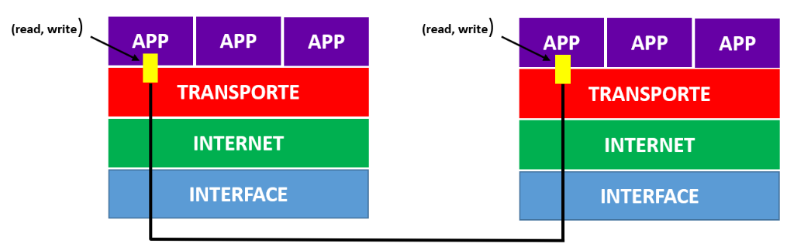
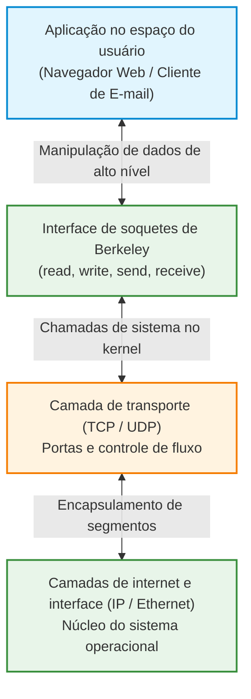
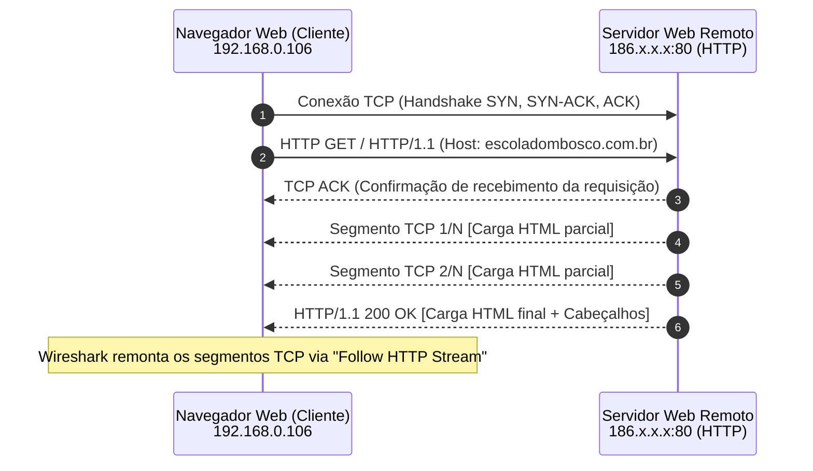

# Camada de aplicação do modelo TCP/IP, soquetes de Berkeley e inspeção HTTP

A camada de aplicação situa-se no topo da pilha de protocolos do modelo TCP/IP (*Transmission Control Protocol/Internet Protocol*, Protocolo de Controle de Transmissão/Protocolo de Internet). Diferente das camadas inferiores, que cuidam do transporte físico de sinais, do enlace local, do roteamento inter-redes e do controle de fluxo entre processos, a camada de aplicação é onde residem a semântica dos dados, as regras negociais e os protocolos com os quais os usuários e programas interagem diretamente.

Trata-se de uma camada **ponta a ponta** (*end-to-end*), executada exclusivamente nos hospedeiros emissores e receptores. Por projeto arquitetural pragmático, o TCP/IP não possui camadas separadas de sessão e apresentação, absorvendo as funções de gerenciamento de sessão, criptografia, formatação e sintaxe diretamente dentro da própria camada de aplicação quando demandadas por protocolos específicos.

## Absorção das camadas de sessão e apresentação e a interface de soquetes

Durante a padronização do modelo de referência OSI (*Open Systems Interconnection*, Interconexão de Sistemas Abertos), os níveis 5 (sessão) e 6 (apresentação) foram concebidos para coordenar diálogos e traduzir formatos de dados. Contudo, a experiência prática da indústria demonstrou que a grande maioria das aplicações de rede não necessita dessas etapas ou prefere controlá-las internamente. Por essa razão, a pilha TCP/IP fundiu essas atribuições no nível de aplicação:
- **Controle de sessão sob demanda:** Aplicações de telefonia sobre IP utilizam o protocolo SIP (*Session Initiation Protocol*, Protocolo de Iniciação de Sessão) diretamente na camada de aplicação para abrir, gerenciar e encerrar chamadas multimídia.
- **Apresentação e segurança flexíveis:** A criptografia e integridade de dados (como TLS/SSL) e a codificação de formatos (JSON, XML, HTML, MIME) operam diretamente no espaço do usuário, sem impor custos de processamento a protocolos mais simples.

Para que desenvolvedores de software pudessem criar soluções distribuídas sem precisar dominar as rotinas internas do sistema operacional, a Universidade de Berkeley introduziu, na versão Unix 4.2BSD, a API de **soquetes de Berkeley** (*Berkeley sockets*). O soquete atua como uma porta de comunicação lógica bidirecional fim a fim. Uma vez aberto e conectado o soquete entre cliente e servidor, o desenvolvedor apenas lê e escreve bytes como se estivesse manipulando um arquivo local no disco, utilizando chamadas de sistema padronizadas como `read()`, `write()`, `send()` e `receive()`.

## Protocolos fundamentais da camada de aplicação

Qualquer engenheiro ou desenvolvedor de software pode conceber e implementar um protocolo próprio de camada de aplicação, definindo as regras sintáticas (formato das mensagens) e semânticas (significado dos comandos e respostas). Todavia, a Internet apoia-se em um conjunto de protocolos universais padronizados por RFCs (*Requests for Comments*) da IETF (*Internet Engineering Task Force*):

- **HTTP (*Hypertext Transfer Protocol*, Protocolo de Transferência de Hipertexto):** Protocolo baseado em texto plano e arquitetura cliente-servidor utilizado para solicitar e transferir recursos, páginas HTML e APIs REST na World Wide Web (porta registrada 80).
- **DNS (*Domain Name System*, Sistema de Nomes de Domínio):** Banco de dados hierárquico e distribuído que converte nomes textuais amigáveis (como `google.com`) em endereços IP numéricos (porta 53, prioritariamente sobre UDP).
- **SMTP (*Simple Mail Transfer Protocol*, Protocolo Simples de Transferência de Correio):** Protocolo padronizado para o despacho e roteamento de mensagens de correio eletrônico entre servidores de e-mail (porta 25 ou 587).
- **FTP (*File Transfer Protocol*, Protocolo de Transferência de Arquivos):** Protocolo dedicado à cópia e manipulação de arquivos entre computadores, operando com canais separados para controle (porta 21) e transferência de dados (porta 20).
- **TELNET (*Teletype Network*, Rede de Teletipo):** Protocolo de terminal virtual e emulação de comandos remotos em texto puro sem criptografia (porta 23).
- **RTP (*Real-time Transport Protocol*, Protocolo de Transporte em Tempo Real):** Protocolo para entrega e sincronização de fluxos contínuos de áudio e vídeo sob restrições rígidas de tempo, normalmente encapsulado em UDP.

| Protocolo | Significado por extenso | Função principal na rede | Porta padrão | Transporte comum |
| --- | --- | --- | --- | --- |
| **HTTP** | *Hypertext Transfer Protocol* | Transferência de páginas web e consumo de APIs | 80 | TCP |
| **DNS** | *Domain Name System* | Resolução hierárquica de nomes em endereços IP | 53 | UDP (e TCP para zonas) |
| **SMTP** | *Simple Mail Transfer Protocol* | Envio e retransmissão de mensagens de e-mail | 25 / 587 | TCP |
| **FTP** | *File Transfer Protocol* | Transferência e gestão remota de arquivos | 20 (dados) / 21 (controle) | TCP |
| **TELNET** | *Teletype Network* | Sessão de terminal remoto em texto claro | 23 | TCP |
| **RTP** | *Real-time Transport Protocol* | Entrega de áudio e vídeo contínuos em tempo real | Variável (1024 a 65535) | UDP |
| **SIP** | *Session Initiation Protocol* | Estabelecimento e controle de sessões VoIP | 5060 / 5061 | UDP / TCP |

## Inspeção prática de tráfego HTTP com Wireshark

A inspeção empírica de requisições web no analisador Wireshark revela com clareza o desacoplamento de camadas e o processo de remontagem do fluxo de bytes transmitido pela rede.

### O impacto da criptografia na visibilidade do tráfego

Para fins didáticos e de depuração com analisadores de protocolos de rede, conexões realizadas via HTTP puro (porta 80) trafegam em texto claro (*cleartext*), permitindo inspecionar cada método, cabeçalho e corpo de resposta. Quando um site implementa HTTPS (*Hypertext Transfer Protocol Secure*, porta 443), os dados da camada de aplicação são envelopados pelo protocolo criptográfico TLS/SSL (*Transport Layer Security*, Segurança da Camada de Transporte). Nesses cenários, a captura no Wireshark exibe apenas registros binários criptografados (*Application Data*), inviabilizando a visualização de cabeçalhos sem a chave de descriptografia da sessão.

### Análise de cabeçalhos e reconstrução de streams

Ao capturar o acesso a uma página web HTTP e aplicar o filtro `http` no Wireshark, a hierarquia da pilha revela as quatro camadas empilhadas:
1. **Camada de interface:** Quadro Ethernet II com MACs locais.
2. **Camada de internet:** Pacote IPv4 indicando a máquina local (`192.168.0.106`) e o servidor remoto (`186.x.x.x`).
3. **Camada de transporte:** Segmento TCP apontando para a porta de destino 80 do servidor web.
4. **Camada de aplicação:** Mensagem HTTP contendo o método de requisição (`GET / HTTP/1.1`) e o cabeçalho `Host: escoladombosco.com.br`.

Como uma página HTML comumente excede o tamanho máximo de segmento negociado no TCP (*Maximum Segment Size*, MSS), o servidor web divide a resposta em múltiplos segmentos TCP sucessivos. Utilizando o recurso **Follow HTTP Stream** (ou **Follow TCP Stream**) no Wireshark, a ferramenta coleta automaticamente todos os segmentos dispersos que compõem aquela transação e reconstrói o fluxo completo da camada de aplicação em uma janela unificada. Nessa visão consolidada, é possível ler os cabeçalhos de resposta do servidor (`HTTP/1.1 200 OK`, `Content-Type: text/html`) seguidos diretamente pela árvore de código-fonte HTML idêntica à renderizada no navegador do usuário.

## Pontos que costumam gerar confusão

- **A camada de aplicação engloba os programas do usuário com suas interfaces gráficas:** A camada de aplicação não engloba a interface gráfica com botões e janelas, mas sim o protocolo e a lógica de comunicação em rede (como HTTP, SMTP ou DNS) consumidos pelo software.
- **O modelo TCP/IP não possui segurança porque não tem a camada de apresentação do OSI:** O modelo TCP/IP implementa segurança de forma modular; protocolos modernos integram serviços criptográficos na camada de aplicação (como TLS no HTTPS e SSH) ou na camada de internet (como o IPsec).
- **Cada requisição HTTP enviada pela aplicação vira um único pacote físico na rede:** Uma resposta HTTP volumosa é fragmentada pelo TCP em diversos segmentos menores na camada de transporte, demandando o recurso de *stream reassembly* do receptor ou do Wireshark para recompor o documento HTML original.
- **O desenvolvedor precisa controlar o endereço IP e a porta manualmente em cada envio:** A API de soquetes de Berkeley abstrai esses detalhes após a conexão inicial; o desenvolvedor realiza operações simples de leitura e escrita (`read` e `write`) sobre o identificador do soquete.
- **O protocolo DNS pertence à camada de transporte por rodar em UDP:** O DNS é estritamente um protocolo da camada de aplicação; ele utiliza a porta 53 provida pelo protocolo UDP na camada de transporte como mecanismo de despacho de suas consultas e respostas.
